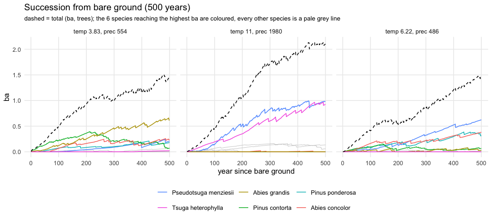
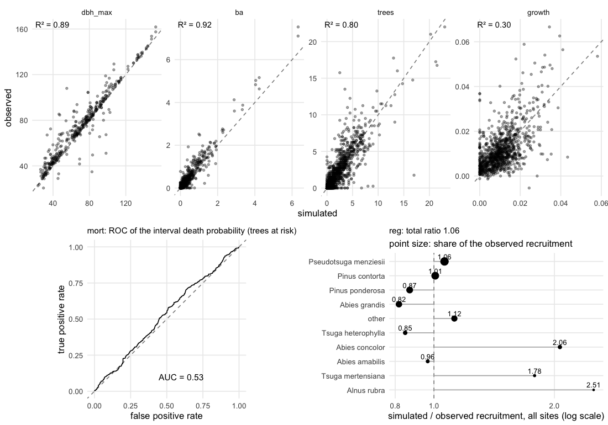
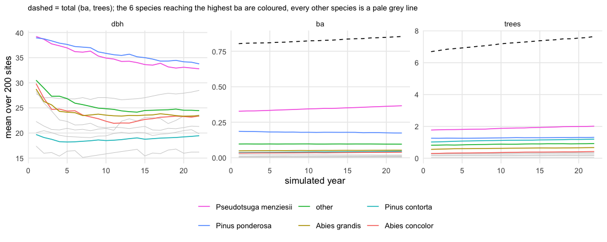

<!-- badges: start -->

[](https://www.repostatus.org/#active)
[](https://www.gnu.org/licenses/gpl-3.0)
<!-- badges: end -->

<!-- [](https://github.com/FINNverse/FINN/actions/workflows/R-CMD-check.yaml) -->

<!-- README.md is generated from README.Rmd. Please edit that file -->

# Forest Informed Neural Networks (FINN)

FINN is an R package designed for modular, dynamic vegetation (forest)
models. Modularity is achieved by implementing all components and the
platform in R and by allowing users to pass their own processes to FINN
as R functions. Nevertheless, FINN is highly performant (has a low
runtime) because it is implemented in torch for R, which allows access
to highly optimised routines and enables FINN to run on the GPU.
Consequently, FINN scales extremely well with the number of sites.
Furthermore, FINN can seamlessly integrate neural networks into
processes, or even replace them entirely (hybrid modelling).
Additionally, FINN’s parameters can be optimised directly using
stochastic gradient descent.

## Internal workings of FINN

You can learn more about FINN in the accompanying paper [Pichler & Käber
(2026) - Inferring processes within dynamic forest models using hybrid
modelling](https://doi.org/10.1111/2041-210x.70347), published in
*Methods in Ecology and Evolution*.

## Installation

Install the released version of FINN from CRAN:

``` r
install.packages("FINN")
```

FINN runs on `torch`, and the `torch` backend (libtorch) is downloaded
on first use rather than with the package, so install it once before the
first fit:

``` r
torch::install_torch()
```

Or the development version from
[GitHub](https://github.com/FINNverse/FINN):

``` r
# install.packages("devtools")
devtools::install_github("FINNverse/FINN")
```

## A first example

FINN comes with forest inventory data from Oregon (US FIA): observations
of 200 plots over two remeasurement intervals, their climate, and the
trees at the first census. The example fits a model to them, checks it
on 200 plots it has not seen, and simulates from bare ground.

``` r
library(FINN)
library(data.table)
Nsp  <- max(fia_obs_dt$species)
init <- makeInitCohorts(fia_init_trees, Nspecies = Nsp)

# one process per component; growth, mortality and regeneration respond
# linearly to temperature and precipitation
FINN.seed(1)
m <- finn(N_species = Nsp, recruits_dbh = 12.9,
          competition_process  = createProcess(~ 0, competition, optimizeSpecies = TRUE),
          growth_process       = createProcess(~ temp + prec, growth, optimizeSpecies = TRUE),
          mortality_process    = createProcess(~ temp + prec, mortality, optimizeSpecies = TRUE),
          regeneration_process = createProcess(~ temp + prec, regeneration_capped, optimizeSpecies = TRUE))

# all processes are fitted jointly; `holdout` evaluates the model right after the fit
fit(m, data = fia_obs_dt, env = fia_env_dt, init_cohort = init,
    epochs = 300L, batchsize = 40L, patches = 4, patch_size = 0.06,
    tree_data = fia_tree_dt, plot_progress = FALSE,
    holdout = list(data = fia_obs_test, env = fia_env_test,
                   init_cohort = makeInitCohorts(fia_init_test, Nspecies = Nsp),
                   tree_data = fia_tree_test))
```

**Bare ground.** A fitted model can be run from an empty stand. This is
the hardest test of a forest model: the species composition and the size
structure have to emerge from growth, mortality, competition and
regeneration alone.

``` r
cold_to_warm <- fia_env_dt[, .(temp = mean(temp)), by = siteID][order(temp)]$siteID[c(10, 100, 190)]
bg <- simulateForest(m, bare_ground = TRUE, years = 500, sites = cold_to_warm)
plot(bg)
```



**Observed against simulated** on the 200 test plots: the largest tree,
basal area, stem number and growth with R², mortality as a ROC curve
with its AUC, recruitment as the ratio of simulated to observed per
species.

``` r
plot(m$evaluation)
```



**Over time.** The simulated stands of the 200 test plots over the 22
years, per species, as the mean over the plots:

``` r
sim <- simulateForest(m, env = fia_env_test,
                      init_cohort = makeInitCohorts(fia_init_test, Nspecies = Nsp))
plot(sim)
```



`summary(m)` prints the skill on the training and the test plots, how
far the fit has converged and the effects of the environment; `plot(m)`
draws the fitted parameters of every species.

## Introduction

Start with [Introduction to
FINN](https://finnverse.github.io/FINN/articles/A-Introduction_to_FINN.html),
then browse the rest:

| Vignette | What it covers |
|----|----|
| [Introduction to FINN](https://finnverse.github.io/FINN/articles/A-Introduction_to_FINN.html) | the model, its processes, and a first simulation |
| [Parameterising FINN from Ellenberg indicator values](https://finnverse.github.io/FINN/articles/B-Succession_demo.html) | deriving species niches from Ellenberg values; succession along a climate gradient |
| [Preparing your data for FINN](https://finnverse.github.io/FINN/articles/C-Data_preparation.html) | going from a raw tree list to FINN’s input tables |
| [Fitting FINN to forest inventory data](https://finnverse.github.io/FINN/articles/D-Fit_to_FIA.html) | calibrating on US FIA data, with a held-out test |
| [Mortality: a binomial response and a NN process](https://finnverse.github.io/FINN/articles/E-Mortality.html) | choosing the right likelihood, and scoring it honestly |

The same pages ship with the package — `vignette(package = "FINN")`
lists them.

<!-- Link to the RENDERED articles, not to files in vignettes/. Source paths break
     whenever a vignette is renamed (they did once already, when these moved from
     .qmd to precompiled .Rmd), and GitHub shows the un-executed source anyway -
     no figures, no results. The site URLs survive renames. -->

## How to cite FINN

Please cite the paper describing the approach, not the software:

> Pichler, M. & Käber, Y. (2026) Inferring processes within dynamic
> forest models using hybrid modelling. *Methods in Ecology and
> Evolution*, **17**, 2477–2493.
> <https://doi.org/10.1111/2041-210X.70347>

`citation("FINN")` prints this entry and its BibTeX form:

``` bibtex
@Article{,
  title   = {Inferring processes within dynamic forest models using hybrid modelling},
  author  = {Maximilian Pichler and Yannek Käber},
  journal = {Methods in Ecology and Evolution},
  year    = {2026},
  volume  = {17},
  number  = {8},
  pages   = {2477--2493},
  doi     = {10.1111/2041-210X.70347},
}
```
