# Fitting FINN to forest inventory data (Oregon, US FIA)

Dynamic forest models are usually developed through a combination of
encoding ecological knowledge into model structures and parameters.
Usually the resulting parameters are then further refined by manual
calibration procedures. Here we calibrate FINN directly from data: a
subset of the US Forest Inventory & Analysis (FIA) program for Oregon,
prepared exactly as in the **Preparing your data for FINN** vignette.

We fit FINN to 200 sites and evaluate on 200 **held-out** sites.

The calibration needs a torch backend and takes several minutes, so this
vignette is **precompiled**: the code was run once and its output
committed with it. The code you see is exactly the code that produced
the output next to it.

``` r

library(FINN)
library(torch)
library(data.table)
library(ggplot2)

# Training length. Every epoch simulates the 20 years between the inventories
# for all 200 sites; the convergence section below shows the loss curves and how
# far the parameters still move.
EPOCHS <- 500L
```

## The data

The input tables are a seeded sample of 400 Oregon FIA plots with their
WorldClim climate, split into 200 sites to fit on and 200 holdout sites
for evaluation
([`?fia_obs_dt`](https://finnverse.github.io/FINN/reference/fia_obs_dt.md)).
A fitted FINN model should generalize to other sites, so the holdout is
a genuine out-of-sample test.

``` r

# The tables ship with FINN as datasets (?fia_obs_dt), already in FINN's input
# format, so there is nothing to read or prepare.

# --- training sites --------------------------------------------------------
obs_dt     <- fia_obs_dt        # observations, wide (one column per variable)
env_dt     <- fia_env_dt        # RAW, untransformed climate
init_trees <- fia_init_trees
species_dt <- fia_species_dt

# --- holdout sites: never seen during fitting ------------------------------
obs_test   <- fia_obs_test
env_test   <- fia_env_test
init_test  <- fia_init_test

cat(sprintf("train: %d sites | holdout: %d sites | %d species | inventory years %s | env years %d-%d\n",
            uniqueN(obs_dt$siteID), uniqueN(obs_test$siteID), uniqueN(obs_dt$species),
            paste(sort(unique(obs_dt$year)), collapse = " & "), min(env_dt$year), max(env_dt$year)))
#> train: 200 sites | holdout: 200 sites | 11 species | inventory years 10 & 20 & 21 | env years 1-22
species_dt
#>     species            species_name
#>       <int>                  <char>
#>  1:       1   Pseudotsuga menziesii
#>  2:       2         Pinus ponderosa
#>  3:       3          Pinus contorta
#>  4:       4          Abies concolor
#>  5:       5           Abies grandis
#>  6:       6      Tsuga heterophylla
#>  7:       7       Tsuga mertensiana
#>  8:       8 Lithocarpus densiflorus
#>  9:       9             Alnus rubra
#> 10:      10          Abies amabilis
#> 11:      11                   other
```

FINN simulates the forest in **yearly steps**. The first inventory
(2001-02) is the starting state at year 0, and the two remeasurements
are compared with the simulated stand 10 and 20 years later; one site of
each sample had its third inventory a year or two late, at year 21 or
22. Each observation carries `period_length`, the years since the
previous inventory, and its growth and mortality are **yearly** rates:
[`fit()`](https://finnverse.github.io/FINN/reference/fit.md) averages
the simulated yearly rates over those years, and sums the simulated
recruits over them for `reg`. Because the intervals differ between a few
sites, [`fit()`](https://finnverse.github.io/FINN/reference/fit.md)
scores every site over its own window, which it announces when it
starts.

``` r

unique(obs_dt[, .(siteID, year, period_length)])[, .(sites = .N), by = .(year, period_length)]
#>     year period_length sites
#>    <int>         <int> <int>
#> 1:    10            10   200
#> 2:    20            10   199
#> 3:    21            11     1
```

The environment is supplied in **natural units**: with
`env_autoscale = TRUE` (the default) FINN z-standardizes the predictors
internally and reuses the same constants at prediction time, so raw
values are all we ever pass. It has one row per site and simulated year;
the climate here is each plot’s long-term normal, the same in every
year.

``` r

ggplot(melt(unique(env_dt[, c("siteID", "temp", "prec")]), id.vars = "siteID",
            measure.vars = c("temp", "prec")),
       aes(value)) +
  geom_histogram(bins = 20, fill = "grey40") +
  facet_wrap(~variable, scales = "free", labeller = as_labeller(
    c(temp = "Mean~annual~temp~(degree*C)", prec = "Annual~precip~(mm)"), label_parsed)) +
  labs(x = NULL, y = "sites") + theme_minimal()
```

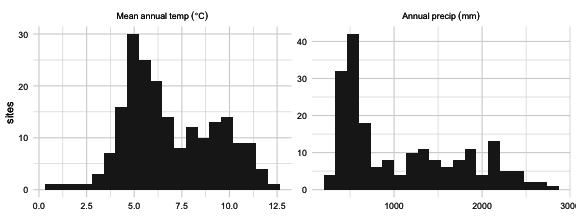

Stand abundance, measured as total basal area per plot (summed over
species), against the temperature and precipitation gradients:

``` r

# total stand basal area per plot: sum over species, averaged over inventories
site_ba  <- obs_dt[, .(ba = sum(ba, na.rm = TRUE)), by = .(siteID, year)][
                   , .(ba = mean(ba)), by = siteID]
site_env <- env_dt[, .(temp = mean(temp), prec = mean(prec)), by = siteID]
grad <- melt(merge(site_ba, site_env, by = "siteID"),
             id.vars = c("siteID", "ba"), measure.vars = c("temp", "prec"),
             variable.name = "gradient")

ggplot(grad, aes(value, ba)) +
  geom_point(alpha = 0.4, size = 0.9, colour = "grey30") +
  geom_smooth(method = "loess", se = FALSE, colour = "firebrick", linewidth = 0.9) +
  facet_wrap(~gradient, scales = "free_x", labeller = as_labeller(
    c(temp = "Mean~annual~temp~(degree*C)", prec = "Annual~precip~(mm)"), label_parsed)) +
  labs(x = NULL, y = "Total basal area per plot") + theme_minimal()
```

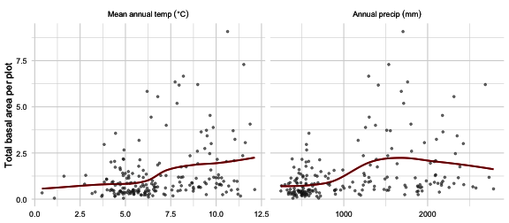

## Initial cohorts

Each simulation starts from the observed first inventory. We build the
starting state for both samples, the holdout gets its own cohorts, from
its own sites.

``` r

Nsp <- max(obs_dt$species)
init_cohorts      <- makeInitCohorts(init_trees, Nspecies = Nsp)
init_cohorts_test <- makeInitCohorts(init_test,  Nspecies = Nsp)
```

``` r

# shared colours for the two model variants, reused by the scatter and ALE panels
model_cols <- c("Process (mechanistic)" = "#1b9e77", "Hybrid (growth = NN)" = "#d95f02")
```

## Fit a Process-FINN

In the fully mechanistic configuration every process keeps its
predefined form, while its species and environmental parameters are
learned (`optimize* = TRUE`) and the formula chooses which environmental
predictors enter the growth, regeneration and mortality responses. The
model is calibrated end-to-end by gradient descent through the entire
simulation.

The four processes are FINN’s defaults, written out here only to give
each a formula:
[`regeneration_capped()`](https://finnverse.github.io/FINN/reference/regeneration_capped.md)
is the default regeneration, a recruitment mean with a fitted carrying
capacity `K` (see *The recruitment cap* below). All six responses are
fitted jointly in one
[`fit()`](https://finnverse.github.io/FINN/reference/fit.md) call with
the default loss, and this joint fit with the defaults is the
calibration we recommend.

We pass **two** climate drivers rather than all six available. `~.`
would use every column, but the six are strongly collinear; `temp` and
`tempmin` correlate at r = 0.93, `prec` and `precwarmq` at 0.86, and two
principal components carry 90% of the variance. Collinear predictors are
not a problem for the *fit* (that is what ALE is designed for), but they
are a problem for the *interpretation* below: two drivers that correlate
at 0.93 have no separately identifiable response curves, so calling each
one a “niche” would be reading structure into an arbitrary split. Two
weakly-correlated drivers (r = 0.64) give curves that mean what the text
says they mean. Measured across three seeds on the earlier ten-year
steps, the cost was nothing on growth (0.56 vs 0.55 held out) and ~0.02
on basal area, tree numbers and regeneration.

``` r

FINN.seed(42)
m <- finn(
  N_species            = uniqueN(obs_dt$species),
  recruits_dbh         = 12.9,   # DBH (cm) assigned to a new recruit; ~ FIA's 12.7 cm (5 in) minimum
  competition_process  = createProcess(~0, FINN::competition,  optimizeSpecies = TRUE),
  growth_process       = createProcess(~ temp + prec, FINN::growth,       optimizeSpecies = TRUE, optimizeEnv = TRUE),
  regeneration_process = createProcess(~ temp + prec, FINN::regeneration_capped, optimizeSpecies = TRUE, optimizeEnv = TRUE),
  mortality_process    = createProcess(~ temp + prec, FINN::mortality,    optimizeSpecies = TRUE, optimizeEnv = TRUE)
)
```

### Balancing the six losses

The objective is the sum of six terms, one per response, and their raw
magnitudes have nothing to do with each other: `dbh` is a squared error
in cm², `growth` a squared error on a ratio, `trees` a Poisson deviance.
Before anything is trained it is worth seeing what each term would
contribute. `fit(epochs = 0)` runs the set-up only, the data tensors,
the intercept-only baselines and the weights derived from them, and
reports each response’s share of the objective; nothing is trained and
the parameters stay as they were.

``` r

fit(m, env = env_dt, data = obs_dt, init_cohort = init_cohorts, epochs = 0L,
    patches = 4, patch_size = 0.06, plot_progress = FALSE)
#> ℹ Using per-site aggregation windows (one backward per batch): period_length varies between sites
#> ℹ weights: intercept-only baseline x your vector (dbh=0.00202, ba=3.9, trees=0.684, growth=1.91e+04, mortality=19, regeneration=0.588)
#> ℹ share of the objective at the intercept-only baseline (scaled): dbh=17%, ba=17%, trees=17%, growth=17%, mortality=17%, regeneration=17%
```

With the default `loss_weights = "auto"` every loss is divided by its
own intercept-only baseline, the loss of predicting the single best
constant, so each term starts at 1 and the six shares are equal. The
baselines are kept in `m$loss_baseline`, the weights in
`m$loss_weights`.

A numeric `loss_weights` vector multiplies these scaled losses (since
0.2.0), so a number reads directly as a share: `c(1, 1, 1, 2, 1, 1)`
gives growth twice the weight of every other response, and the report
says so.

``` r

fit(m, env = env_dt, data = obs_dt, init_cohort = init_cohorts, epochs = 0L,
    patches = 4, patch_size = 0.06, plot_progress = FALSE,
    loss_weights = c(1, 1, 1, 2, 1, 1))
#> ℹ Using per-site aggregation windows (one backward per batch): period_length varies between sites
#> ℹ weights: intercept-only baseline x your vector (dbh=0.00202, ba=3.9, trees=0.684, growth=1.91e+04, mortality=19, regeneration=0.588)
#> ℹ share of the objective at the intercept-only baseline (scaled): dbh=14%, ba=14%, trees=14%, growth=29%, mortality=14%, regeneration=14%
```

`weight_scale = FALSE` applies the same vector to the unscaled losses,
which is what `weights` meant before 0.2.0 and what reproduces an
analysis fitted with an earlier version. The report is printed in that
mode too, and it shows why the scaling is the default:

``` r

fit(m, env = env_dt, data = obs_dt, init_cohort = init_cohorts, epochs = 0L,
    patches = 4, patch_size = 0.06, plot_progress = FALSE,
    loss_weights = c(1, 1, 1, 2, 1, 1), weight_scale = FALSE)
#> ℹ Using per-site aggregation windows (one backward per batch): period_length varies between sites
#> ℹ share of the objective at the intercept-only baseline (raw scale): dbh=99%, ba=0.052%, trees=0.29%, growth=4.2e-05%, mortality=0.011%, regeneration=0.34%
```

On the raw scale the diameter term is the objective and the nominal
factor of two on growth is a factor of two on a share that was already
negligible. Read the printed shares at the start of every fit; a
response that holds a fraction of a percent of the objective is a
response the fit will not learn.

### The fit

``` r

fit(m,
  env         = env_dt,      # raw climate
  data        = obs_dt,
  init_cohort = init_cohorts,
  device      = "cpu",
  epochs      = EPOCHS,
  batchsize   = 40L,
  patches     = 4,
  patch_size  = 0.06,
  lr          = 0.01,
  env_autoscale   = TRUE,        # default
  checkpoints     = 50L,         # record every parameter every 50 epochs (m$param_history)
  plot_progress   = FALSE        # the convergence plot below is the readable one
)
```

## Replace growth with a neural network (Hybrid-FINN)

FINN’s defining feature is that **any single demographic process can be
swapped from a mechanistic function to a neural network**, while the
others stay mechanistic, a *hybrid* model. The mechanistic processes
keep the system ecologically constrained; the network absorbs structure
the fixed functional form cannot express. Here we replace **growth**
with a small neural network via
[`createHybrid()`](https://finnverse.github.io/FINN/reference/createHybrid.md),
leaving competition, regeneration and mortality mechanistic, and refit
on the same data with the **identical
[`fit()`](https://finnverse.github.io/FINN/reference/fit.md) call**.

``` r

FINN.seed(42)
m_hybrid <- finn(
  N_species            = uniqueN(obs_dt$species),
  recruits_dbh         = 12.9,
  competition_process  = createProcess(~0, FINN::competition,  optimizeSpecies = TRUE),
  growth_process       = createHybrid(~ temp + prec, hidden = c(20L, 20L), transformer = FALSE),  # NN replaces growth
  regeneration_process = createProcess(~ temp + prec, FINN::regeneration_capped, optimizeSpecies = TRUE, optimizeEnv = TRUE),
  mortality_process    = createProcess(~ temp + prec, FINN::mortality,    optimizeSpecies = TRUE, optimizeEnv = TRUE)
)
```

``` r

fit(m_hybrid,
  env = env_dt, data = obs_dt, init_cohort = init_cohorts, device = "cpu",
  epochs = EPOCHS, batchsize = 40L, patches = 4, patch_size = 0.06,
  lr = 0.01, env_autoscale = TRUE, plot_progress = FALSE
)
```

With both variants fitted, the rest of the vignette inspects and
compares them: training convergence, the skill on the training and the
held-out sites
([`evaluate()`](https://finnverse.github.io/FINN/reference/evaluate.md)),
a [`summary()`](https://rspatial.github.io/terra/reference/summary.html)
of the fit, the fitted parameters
([`plot()`](https://rspatial.github.io/terra/reference/plot.html)), a
run from bare ground, and the accumulated local effects that reveal what
the network learned.

## Training convergence

Both variants are trained the same way. Because the losses are scaled by
their intercept-only baselines, `m$history` can be read **per response**
on one axis, and the dashed line at 1 is a real reference: it is the
intercept-only model, so a curve below it means that response is
predicted better than by its own mean.

``` r

hist_dt <- as.data.table(do.call(rbind, m$history))[, 1:6]
setnames(hist_dt, c("dbh", "ba", "trees", "growth", "mort", "reg"))
hist_dt[, epoch := .I]
ggplot(melt(hist_dt, id.vars = "epoch", variable.name = "response"),
       aes(epoch, value, colour = response)) +
  geom_hline(yintercept = 1, linetype = "dashed", colour = "grey40") +
  geom_line(alpha = 0.8) +
  scale_y_log10() +
  scale_colour_viridis_d() +
  labs(x = "epoch", y = "loss / intercept-only baseline\n(1 = no better than the mean)",
       colour = NULL) +
  theme_minimal()
```

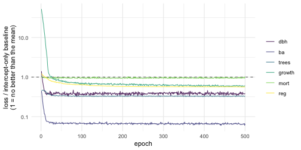

The structural responses drop well below 1 within a few epochs. The
per-tree rates sit much closer to it; they are only weakly constrained
by two inventories, which is the honest picture and the reason for the
caveat further down.

A flat loss is necessary for convergence, not sufficient: the objective
can be flat along a direction in which the parameters are still moving,
which is what a poorly identified parameter looks like.
[`fit()`](https://finnverse.github.io/FINN/reference/fit.md) keeps the
parameters of the last 51 epochs, and
[`summary()`](https://rspatial.github.io/terra/reference/summary.html)
(below) reports how far each one moved over the last 50.
`checkpoints = 50` in addition recorded every parameter block every 50
epochs in `m$param_history`, to compare points of the fit further apart
(with `folder = "<dir>"` the whole model is also written there at each
checkpoint, as `epoch_<k>model.pt`, to resume from with
[`torch::torch_load()`](https://torch.mlverse.org/docs/reference/torch_load.html)
and a further
[`fit()`](https://finnverse.github.io/FINN/reference/fit.md), or to
compare).

## Assess the fit: `evaluate()`

The fit was calibrated on the 200 training sites, so scoring it there
only tells us how well it *reproduces* them. The honest question is
whether it transfers.
[`evaluate()`](https://finnverse.github.io/FINN/reference/evaluate.md)
answers both: it simulates the model on the training sites it keeps from
[`fit()`](https://finnverse.github.io/FINN/reference/fit.md) and, with
`holdout`, on the 200 held-out sites, each started from its own first
inventory and driven by its own environment, and pairs every simulated
value with its observation on site × year × species.

The simulation runs in yearly steps, so a prediction is put together the
way [`fit()`](https://finnverse.github.io/FINN/reference/fit.md)
compares it with an inventory: the stand (`dbh`, `ba`, `trees`) at the
year of the census, the yearly growth and mortality rates of the
`period_length` years before it compounded into one rate per year – the
geometric mean of `1 + g` minus one, and one minus the geometric mean
survival, the functional
[`makeObsData()`](https://finnverse.github.io/FINN/reference/makeObsData.md)
derives the observed rates with – and the expected recruits per hectare
(`r_mean_ha`) summed over those years.

Two optional parts are added here. `tree_data`, the trees of the holdout
inventories (`fia_tree_test`), adds the largest diameter per site,
census and species (`dbh_max`), a size measure that a few large or many
small trees do not shift as much as the mean diameter.
`bare_ground = TRUE` runs the model from an empty stand for `years`
years, under the climate of each of `sites` held constant: we take the
coldest, a middle and the warmest training site. `fit(..., holdout = )`
would run the same evaluation right after the fit.

``` r

site_temp  <- env_dt[, .(temp = mean(temp)), by = siteID][order(temp)]
bare_sites <- site_temp[c(1, .N %/% 2, .N), siteID]   # coldest, middle, warmest

FINN.seed(1)
ev <- evaluate(m,
  holdout     = list(data = obs_test, env = env_test, init_cohort = init_cohorts_test,
                     tree_data = fia_tree_test),
  bare_ground = TRUE, years = 500, sites = bare_sites, patches = 50)
ev
#> FINN evaluation
#> ===============
#> 
#> Training data (observed vs simulated, aggregated as fit() scores):
#>  response      R2 correlation     RMSE     bias pred/obs    n   AUC
#>       dbh  0.6308       0.833 13.50357 -5.46851    0.863 1048    NA
#>        ba  0.9353       0.971  0.12872 -0.01282    0.892 4400    NA
#>     trees  0.8000       0.895  0.75783  0.04324    1.068 4400    NA
#>    growth  0.2118       0.559  0.00775 -0.00138    0.875 1003    NA
#>      mort  0.0741       0.383  0.10492 -0.00778    1.004 1003 0.639
#>       reg -0.0273       0.240  6.15605  0.21111    1.138 4400    NA
#>  deaths pred/obs
#>               NA
#>               NA
#>               NA
#>               NA
#>              1.3
#>               NA
#> 
#> Holdout (observed vs simulated, aggregated as fit() scores):
#>  response      R2 correlation     RMSE     bias pred/obs    n   AUC
#>       dbh  0.4645      0.7412 13.90761 -4.79831    0.868 1048    NA
#>   dbh_max  0.8697      0.9448 10.31176 -4.01634    0.946  393    NA
#>        ba  0.9233      0.9680  0.09635 -0.01028    0.882 4400    NA
#>     trees  0.8066      0.8986  0.78260  0.02472    1.039 4400    NA
#>    growth  0.2984      0.6035  0.00773 -0.00046    0.960 1000    NA
#>      mort -0.0256     -0.0208  0.09162 -0.00525    1.006  994 0.524
#>       reg  0.0906      0.3144  6.03722  0.09746    1.063 4400    NA
#>  deaths pred/obs
#>               NA
#>               NA
#>               NA
#>               NA
#>               NA
#>             1.25
#>               NA
#> 
#> Bare ground: 500 years, 3 run(s); plot(x, type = "bare_ground") draws them.
```

The skill measures are R² (`1 - SSE/SST`, the share of the observed
variation the simulation reproduces; it is negative when the observed
mean predicts better), the Pearson correlation, the RMSE in each
response’s own units, the bias (mean of simulated minus observed) and
`pred/obs`, the ratio of the mean simulation to the mean observation.
For mortality the AUC replaces R² as the measure of skill (see *Scoring
mortality per tree* below and the mortality vignette).

[`plot()`](https://rspatial.github.io/terra/reference/plot.html) draws
the comparison on the holdout (`set = "train"` for the training sites):
observed against simulated for the states and growth, with R² in each
panel; the ROC curve of mortality, every tree at risk one case; and the
ratio of simulated to observed recruitment per species, summed over all
sites, because recruitment per site is too noisy for a correlation.

``` r

plot(ev)
```

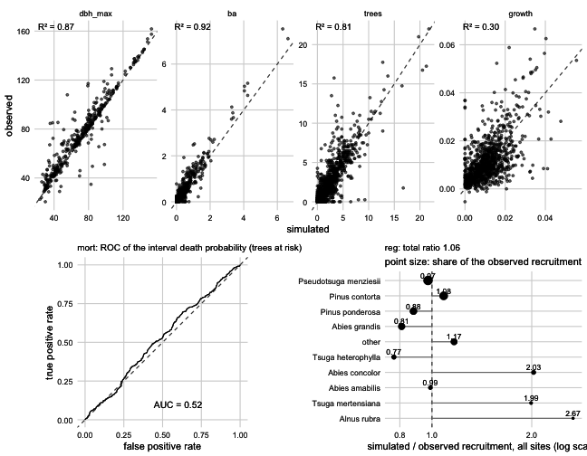

The same skill per species, `type = "heatmap"`: R² (AUC for mortality)
on the left, and the ratio of simulated to observed on the right, white
where the two agree, red where the model under- and blue where it
overestimates:

``` r

plot(ev, type = "heatmap")
```

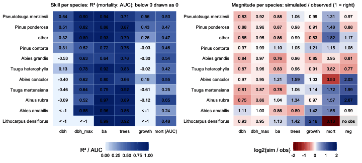

### Process against hybrid

The hybrid is evaluated the same way. Side by side, R² and RMSE of both
models on the training and the held-out sites:

``` r

m_hybrid$eval()                                  # deterministic: dropout off
FINN.seed(1)
ev_hybrid <- evaluate(m_hybrid,
  holdout = list(data = obs_test, env = env_test, init_cohort = init_cohorts_test))

skill_of <- function(ev, label)
  rbind(ev$train$skill[,   .(variable, model = label, split = "train",   r2, rmse)],
        ev$holdout$skill[, .(variable, model = label, split = "holdout", r2, rmse)])
comparison <- dcast(rbind(skill_of(ev, "Process (mechanistic)"),
                          skill_of(ev_hybrid, "Hybrid (growth = NN)"))[variable != "dbh_max"],
                    variable + model ~ split, value.var = c("r2", "rmse"))
setcolorder(comparison, c("variable", "model", "r2_train", "r2_holdout",
                          "rmse_train", "rmse_holdout"))
cols <- c("r2_train", "r2_holdout", "rmse_train", "rmse_holdout")
comparison[, (cols) := lapply(.SD, signif, 2), .SDcols = cols][]
#> Key: <variable, model>
#>     variable                 model r2_train r2_holdout rmse_train rmse_holdout
#>       <fctr>                <char>    <num>      <num>      <num>        <num>
#>  1:      dbh  Hybrid (growth = NN)    0.600      0.440    14.0000      14.0000
#>  2:      dbh Process (mechanistic)    0.630      0.460    14.0000      14.0000
#>  3:       ba  Hybrid (growth = NN)    0.940      0.940     0.1200       0.0870
#>  4:       ba Process (mechanistic)    0.940      0.920     0.1300       0.0960
#>  5:    trees  Hybrid (growth = NN)    0.800      0.810     0.7600       0.7700
#>  6:    trees Process (mechanistic)    0.800      0.810     0.7600       0.7800
#>  7:   growth  Hybrid (growth = NN)    0.330      0.200     0.0071       0.0083
#>  8:   growth Process (mechanistic)    0.210      0.300     0.0078       0.0077
#>  9:     mort  Hybrid (growth = NN)    0.032     -0.017     0.1100       0.0910
#> 10:     mort Process (mechanistic)    0.074     -0.026     0.1000       0.0920
#> 11:      reg  Hybrid (growth = NN)   -0.030      0.073     6.2000       6.1000
#> 12:      reg Process (mechanistic)   -0.027      0.091     6.2000       6.0000

# the paired tables of both models, for the sections below
pairs_of <- function(ev, label) rbindlist(list(
  copy(ev$train$matched)[,   `:=`(model = label, split = "train")],
  copy(ev$holdout$matched)[, `:=`(model = label, split = "holdout")]), fill = TRUE)
obs_pred <- rbind(pairs_of(ev, "Process (mechanistic)"),
                  pairs_of(ev_hybrid, "Hybrid (growth = NN)"), fill = TRUE)
```

Basal area and tree numbers are reconstructed well **and hold up on
sites the model never saw**; the mean diameter is reproduced less well
on the held-out sites than on the training sites. The gap between the
train and holdout columns is the part that matters, because it is the
only evidence that the fitted processes generalise rather than memorise.
The noisier per-tree rates (growth, mortality, regeneration) are harder
to constrain from two inventories and should be read with that in mind
(see the caveat below). The hybrid tracks the mechanistic model on the
structural variables, with **no growth equation specified**, which is
what makes hybrids useful when a process’s form is uncertain; the
surrounding mechanistic processes still anchor the model ecologically.

> **A caveat on the rate variables.** `growth`, `mort` and `reg` are
> per-tree rates and are only weakly constrained by two inventories, so
> their R² is a **noisy estimate**; refitting with a different random
> seed moves it by a few hundredths. Differences of that size between
> the models should not be over-read; the structural variables,
> estimated from far more information, are what carry the comparison.
> `mort` is the extreme case and gets a vignette of its own
> (**Mortality: a binomial response and a neural-network process**)
> because R² and rank correlation are the wrong tools for a response
> that is mostly zeros; its AUC is the measure to read.

### Score what the loss scores

[`evaluate()`](https://finnverse.github.io/FINN/reference/evaluate.md)
pairs on site × year × species, which is the cell the loss is computed
on: [`fit()`](https://finnverse.github.io/FINN/reference/fit.md)
compares the patch-mean of each site, year and species with the
observation, and so does the table. Aggregating the predictions
differently before scoring (summing species to a stand total, averaging
the two censuses, pooling sites into regions) asks a different and
usually easier question, and the number it returns is not the skill of
the fitted objective. If a stand total is what matters, score it as
well, but say so; and for a count-weighted response weight the metric
the way the loss does. The mortality vignette carries this through for
the binomial term, whose AUC is weighted by `n_at_risk` exactly as the
likelihood is.

### A model-free reference: persistence

An R² of 0.92 on basal area sounds good until it is compared with the
simplest forecast available: the previous census of the same site and
species, unchanged. On a ten-year interval that *persistence* forecast
is strong for the state variables, and a model has to beat it before it
can claim to have learned dynamics rather than inertia. The persistence
forecast is no simulation, so it is scored by hand, with the measures
[`evaluate()`](https://finnverse.github.io/FINN/reference/evaluate.md)
uses: the second census of the holdout sites predicted by the first,
next to the two models scored on the same cells.

``` r

r2   <- function(obs, pred) 1 - sum((pred - obs)^2) / sum((obs - mean(obs))^2)
rmse <- function(obs, pred) sqrt(mean((pred - obs)^2))

hold <- obs_pred[split == "holdout" & variable %in% c("dbh", "ba", "trees")]
# the first remeasurement (year 10) stands in as the prediction for the second
# (year 20, or 21/22 where it came late); the observations are the same in the
# tables of both models
obs_hold <- hold[model == "Process (mechanistic)"]
persist  <- merge(obs_hold[year > 10, .(siteID, species, variable, obs)],
                  obs_hold[year == 10, .(siteID, species, variable, pred = obs)],
                  by = c("siteID", "species", "variable"))
ref <- rbind(persist[, .(variable, obs, pred, model = "Persistence (year 10 as is)")],
             hold[year > 10, .(variable, obs, pred, model)])
ref[, .(r2 = round(r2(obs, pred), 2), rmse = signif(rmse(obs, pred), 2)),
    by = .(variable, model)][order(variable, model)]
#>    variable                       model    r2   rmse
#>      <fctr>                      <char> <num>  <num>
#> 1:      dbh        Hybrid (growth = NN)  0.34 16.000
#> 2:      dbh Persistence (year 10 as is)  0.87  6.800
#> 3:      dbh       Process (mechanistic)  0.36 15.000
#> 4:       ba        Hybrid (growth = NN)  0.91  0.110
#> 5:       ba Persistence (year 10 as is)  0.96  0.076
#> 6:       ba       Process (mechanistic)  0.89  0.120
#> 7:    trees        Hybrid (growth = NN)  0.73  0.920
#> 8:    trees Persistence (year 10 as is)  0.89  0.600
#> 9:    trees       Process (mechanistic)  0.72  0.930
```

Persistence wins on all three state variables, and not narrowly. That is
the expected result for a ten-year interval in mature stands: most of
the basal area present at the second census was already there at the
first, and the models are at a disadvantage here, they start from the
year-0 tree list and never see the year-10 census, so their year-20
prediction carries twenty simulated years of compounded error. The
lesson is not that the models are poor but that a holdout R² on `dbh`,
`ba` or `trees` is mostly a statement about the initial cohorts. The
processes are tested by the rates, and by what the model does over
horizons where persistence has nothing to say, such as the runs from
bare ground below. Persistence has no prediction for the first
remeasurement, which is why the table scores the second only.

### Calibration: predicted against observed by decile

A scatter shows the spread; it hides a systematic bias of the kind a
fitted model develops when it compresses towards the mean. Binning the
predictions into deciles and comparing the mean prediction of each bin
with the mean observation in it is the calibration view, and it is
cheap. Cells in which the species is absent from both the observation
and the prediction are left out: they are most of the table and would
pile the lower deciles onto zero.

``` r

calib <- obs_pred[split == "holdout" & variable %in% c("ba", "trees") & (obs > 0 | pred > 0)]
calib[, bin := cut(pred, unique(quantile(pred, 0:10 / 10)), include.lowest = TRUE),
      by = .(model, variable)]
calib_dt <- calib[, .(pred = mean(pred), obs = mean(obs), n = .N), by = .(model, variable, bin)]
ggplot(calib_dt, aes(pred, obs, colour = model)) +
  geom_abline(slope = 1, intercept = 0, colour = "grey40", linewidth = 0.3) +
  geom_line(alpha = 0.6) + geom_point(size = 1.6) +
  facet_wrap(~variable, scales = "free") +
  scale_colour_manual(values = model_cols) +
  labs(x = "mean prediction in decile", y = "mean observation in decile", colour = NULL) +
  theme_minimal() + theme(legend.position = "top")
```

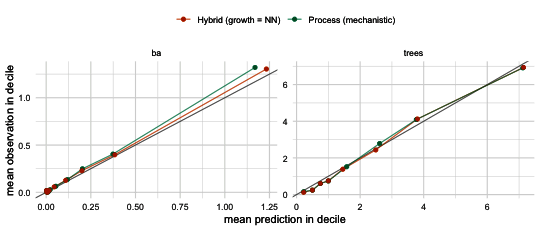

Points on the diagonal are calibrated; a slope below one means the model
under-predicts the dense stands and over-predicts the sparse ones, a
slope above one the reverse. A correlation is blind to either; R² is
not, but it does not say which way the error goes.

### A blocked holdout

The 200 holdout sites are a random draw from the same region as the
training sites, so every holdout site has training neighbours in climate
space, and nearly so in geographic space. That split measures
interpolation. The question usually asked of a calibrated model, how it
does in conditions or places it was not trained on, needs a holdout that
is *blocked*: with coordinates, hold out whole spatial blocks (grid
cells, or clusters of plots); without them, hold out a block of the
environmental gradient. The bundled sample carries no coordinates, so
the block here is environmental, but the recipe is the same. We hold out
the warmest fifth of the training sites, fit the same model on the other
160, and score it on the 40 blocked sites and, for comparison, on the
200 random holdout sites.

``` r

site_temp <- env_dt[, .(temp = mean(temp)), by = siteID]
warm      <- site_temp[temp > quantile(temp, 0.8), siteID]      # the blocked holdout
cool      <- setdiff(site_temp$siteID, warm)                    # the training block

FINN.seed(42)
m_block <- finn(
  N_species            = Nsp, recruits_dbh = 12.9,
  competition_process  = createProcess(~0, FINN::competition,  optimizeSpecies = TRUE),
  growth_process       = createProcess(~ temp + prec, FINN::growth,       optimizeSpecies = TRUE, optimizeEnv = TRUE),
  regeneration_process = createProcess(~ temp + prec, FINN::regeneration_capped, optimizeSpecies = TRUE, optimizeEnv = TRUE),
  mortality_process    = createProcess(~ temp + prec, FINN::mortality,    optimizeSpecies = TRUE, optimizeEnv = TRUE)
)
fit(m_block,
  env = env_dt[siteID %in% cool], data = obs_dt[siteID %in% cool],
  init_cohort = makeInitCohorts(init_trees[siteID %in% cool], Nspecies = Nsp),
  device = "cpu", epochs = EPOCHS, batchsize = 40L, patches = 4, patch_size = 0.06,
  lr = 0.01, plot_progress = FALSE
)
```

Each holdout is one call of
[`evaluate()`](https://finnverse.github.io/FINN/reference/evaluate.md):

``` r

FINN.seed(1)
ev_random  <- evaluate(m_block, holdout = list(
  data = obs_test, env = env_test, init_cohort = init_cohorts_test))
ev_blocked <- evaluate(m_block, holdout = list(
  data = obs_dt[siteID %in% warm], env = env_dt[siteID %in% warm],
  init_cohort = makeInitCohorts(init_trees[siteID %in% warm], Nspecies = Nsp)))
blocked <- rbind(
  ev_random$holdout$skill[,  .(variable, holdout = "random", r2, r, rmse, bias, n)],
  ev_blocked$holdout$skill[, .(variable, holdout = "blocked (40 warmest sites)", r2, r, rmse, bias, n)])[
  variable %in% c("dbh", "ba", "trees", "growth")][
  , `:=`(r2 = round(r2, 2), r = round(r, 2), rmse = signif(rmse, 2), bias = signif(bias, 2))][
  order(variable, holdout)]
blocked
#>    variable                    holdout    r2     r    rmse     bias     n
#>      <fctr>                     <char> <num> <num>   <num>    <num> <int>
#> 1:      dbh blocked (40 warmest sites)  0.44  0.77 20.0000 -1.1e+01   195
#> 2:      dbh                     random  0.42  0.72 15.0000 -5.2e+00  1048
#> 3:       ba blocked (40 warmest sites)  0.92  0.96  0.2100 -2.3e-02   880
#> 4:       ba                     random  0.92  0.97  0.0950 -9.8e-03  4400
#> 5:    trees blocked (40 warmest sites)  0.60  0.83  1.2000  1.6e-01   880
#> 6:    trees                     random  0.77  0.88  0.8600  5.8e-02  4400
#> 7:   growth blocked (40 warmest sites) -0.50  0.39  0.0100  1.7e-03   187
#> 8:   growth                     random  0.27  0.58  0.0079 -2.7e-04  1000
```

The blocked rows are the transfer skill, and they are the ones to report
when the model is meant to be applied beyond the sampled conditions. On
the warm block the R² of basal area is 0.92 against 0.92 on the random
holdout, with an RMSE of 0.21 against 0.095; for tree numbers the R² is
0.6 against 0.77, and for growth -0.5 against 0.27. Where the R² falls
while the correlation of the same cells holds, the model orders the warm
sites but misplaces their level, and the bias column says in which
direction. That is what an environmental response that is extrapolating
looks like, and a random holdout cannot show it. It is also the reason
to keep the climate formula small: a response curve fitted to two
collinear drivers can fit the training block and still extrapolate in
opposite directions.

## What the model learned: `summary()` and `plot()`

[`summary()`](https://rspatial.github.io/terra/reference/summary.html)
brings the checks of a fit together: the skill that
[`evaluate()`](https://finnverse.github.io/FINN/reference/evaluate.md)
stored on the model (without a stored evaluation it evaluates the
training sites itself), the convergence of the loss and of the
parameters over the last 50 epochs, the bare-ground runs, and for each
process and species how important each environmental predictor is
(ALE-variance importance, rate-normalised) and its average conditional
effect. The conditional effects need a simulation and the local
derivatives of every process, which takes long on all 200 training
sites, so we compute them on a subset of 30 sites; `env` and
`init_cohort` choose the sites (without them, all training sites).

``` r

xai_sites <- sort(unique(env_dt$siteID))[1:30]
env_xai   <- env_dt[siteID %in% xai_sites]
init_xai  <- makeInitCohorts(init_trees[siteID %in% xai_sites], Nspecies = Nsp)
```

``` r
s <- summary(m, env = env_xai, init_cohort = init_xai)
s
FINN model summary
==================

## Skill (observed vs simulated, aggregated as fit() scores)

Training data:
 response      R2 correlation     RMSE     bias pred/obs    n   AUC
      dbh  0.6308       0.833 13.50357 -5.46851    0.863 1048    NA
       ba  0.9353       0.971  0.12872 -0.01282    0.892 4400    NA
    trees  0.8000       0.895  0.75783  0.04324    1.068 4400    NA
   growth  0.2118       0.559  0.00775 -0.00138    0.875 1003    NA
     mort  0.0741       0.383  0.10492 -0.00778    1.004 1003 0.639
      reg -0.0273       0.240  6.15605  0.21111    1.138 4400    NA
 deaths pred/obs
              NA
              NA
              NA
              NA
             1.3
              NA

Holdout:
 response      R2 correlation     RMSE     bias pred/obs    n   AUC
      dbh  0.4645      0.7412 13.90761 -4.79831    0.868 1048    NA
  dbh_max  0.8697      0.9448 10.31176 -4.01634    0.946  393    NA
       ba  0.9233      0.9680  0.09635 -0.01028    0.882 4400    NA
    trees  0.8066      0.8986  0.78260  0.02472    1.039 4400    NA
   growth  0.2984      0.6035  0.00773 -0.00046    0.960 1000    NA
     mort -0.0256     -0.0208  0.09162 -0.00525    1.006  994 0.524
      reg  0.0906      0.3144  6.03722  0.09746    1.063 4400    NA
 deaths pred/obs
              NA
              NA
              NA
              NA
              NA
            1.25
              NA

## Convergence

Loss: the largest change is dbh, -1.90 % over the last 50 epochs (mean of the last 50 epochs against the 50 before).
         term loss_now  change
          dbh   0.3787 -1.90 %
           ba   0.0658 -0.07 %
        trees   0.3293 -0.09 %
       growth   0.5962 -1.01 %
    mortality   0.9526  0.15 %
 regeneration   0.5670 -0.33 %

Parameters: how much they moved over the last 50 epochs (from the parameters of every epoch).
  The change is the size of the step the values took, as a percentage of the size of the values:
  100 x |values now - values then| / |values then|, over all species of a parameter (or all weights
  of a network layer). 1 % means the values moved by about a hundredth of their size.
  The species parameter that moved most: mortality: growth, 8.84 %; the largest change overall: mortality: growth, 8.84 %.
      process                   part                      moved most change
       growth     species parameters              growth: size decay 4.25 %
       growth environmental response              nn_growth.0.weight 5.45 %
    mortality     species parameters               mortality: growth 8.84 %
    mortality environmental response           nn_mortality.0.weight 2.69 %
 regeneration     species parameters regeneration: light requirement 7.56 %
 regeneration environmental response        nn_regeneration.0.weight 2.44 %
 regeneration     recruit dispersion          par_theta_recruits_raw 0.00 %
 regeneration        recruitment cap                        reg_logK 0.01 %
  competition     species parameters           competition: strength 4.08 %

## Bare ground (mean of the last tenth of the run)
 siteID total_ba leading_species leading_share years
    100    0.622  Abies concolor         0.520   500
    113    1.537  Abies concolor         0.494   500
    186    8.859   Abies grandis         0.954   500

## Environment

### GROWTH

Analytical ALE importance (rate-normalised) (species in columns):
 variable Pseudotsuga menziesii Pinus ponderosa Pinus contorta Abies concolor
     prec                0.3162          0.2559          0.020         0.0162
     temp                0.0671          0.0132          0.101         0.3665
 Abies grandis Tsuga heterophylla Tsuga mertensiana Lithocarpus densiflorus
       0.00264            0.00588            0.0247                   0.193
       0.01798            0.89255            0.2413                   0.431
 Alnus rubra Abies amabilis  other
     0.00747          6.049 0.2916
     0.59406          0.564 0.0793

Average conditional effects (mean; species in columns):
 variable Pseudotsuga menziesii Pinus ponderosa Pinus contorta Abies concolor
     temp             -0.000777       -0.000807        0.00309       -0.00647
     prec              0.001979        0.011100       -0.00271        0.00240
 Abies grandis Tsuga heterophylla Tsuga mertensiana Lithocarpus densiflorus
      0.001585             0.0301           0.00446                -0.00580
     -0.000653             0.0047           0.00156                -0.00471
 Alnus rubra Abies amabilis    other
    -0.00835        0.00374 -0.00131
     0.00103       -0.02102  0.00282

### MORTALITY

Analytical ALE importance (rate-normalised) (species in columns):
 variable Pseudotsuga menziesii Pinus ponderosa Pinus contorta Abies concolor
     temp                 8.533         1.98970          0.211           1.26
     prec                 0.407         0.00817          0.990           3.31
 Abies grandis Tsuga heterophylla Tsuga mertensiana Lithocarpus densiflorus
         0.867             0.6833            0.0683                   5.086
         0.101             0.0117            1.0807                   0.544
 Alnus rubra Abies amabilis    other
      0.1066         0.5951 0.154370
      0.0326         0.0342 0.000396

Average conditional effects (mean; species in columns):
 variable Pseudotsuga menziesii Pinus ponderosa Pinus contorta Abies concolor
     prec              -0.00763       -0.000712        0.00876        0.00461
     temp               0.00873        0.003568        0.00371       -0.00324
 Abies grandis Tsuga heterophylla Tsuga mertensiana Lithocarpus densiflorus
      -0.00765           0.000747           -0.0245                 0.00411
       0.01338          -0.001029           -0.0055                -0.00659
 Alnus rubra Abies amabilis     other
     0.00322       -0.00691 -8.76e-05
     0.00461       -0.01584 -1.53e-03

### REGENERATION

Analytical ALE importance (rate-normalised) (species in columns):
 variable Pseudotsuga menziesii Pinus ponderosa Pinus contorta Abies concolor
     prec                0.0283           0.553          0.443         0.9998
     temp                0.7742           0.691          1.212         0.0235
 Abies grandis Tsuga heterophylla Tsuga mertensiana Lithocarpus densiflorus
         0.275             1.0666              1.50                    0.55
         1.261             0.0073              1.75                    1.54
 Alnus rubra Abies amabilis other
       0.340           9.76 2.621
       0.912           1.49 0.567

Average conditional effects (mean; species in columns):
 variable Pseudotsuga menziesii Pinus ponderosa Pinus contorta Abies concolor
     prec                0.0774          -0.738         -0.481       -0.12727
     temp                0.3236           0.113         -0.580       -0.00943
 Abies grandis Tsuga heterophylla Tsuga mertensiana Lithocarpus densiflorus
        -0.174            0.15469             0.329                  0.0379
        -0.317           -0.00442            -0.432                  0.0827
 Alnus rubra Abies amabilis  other
      0.1095         0.0718  0.128
      0.0836        -0.0503 -0.050
```

The convergence section answers what the loss curves cannot. The loss
has settled when its terms change by a fraction of a percent over the
last 50 epochs, the parameters when theirs do too. At a constant
learning rate the parameters can keep moving by several percent while
the loss is flat: part of that is the jitter of mini-batch Adam, which a
learning-rate schedule (`control = finnControl(lr_scheduler = "step")`
or `"cosine"`) damps at the end of a fit, the rest drift along
directions the objective does not care about. Two seeds, or two
checkpoints, compared on the holdout tell whether such drift reaches the
predictions.

[`plot()`](https://rspatial.github.io/terra/reference/plot.html) of a
fitted model draws the fitted parameters themselves, one point per
species, on the scale on which they enter the process functions; the
dashed lines mark the bounds of a parameter where a species comes near
one, and an open triangle a species that ended the fit at a bound:

``` r

plot(m)
```

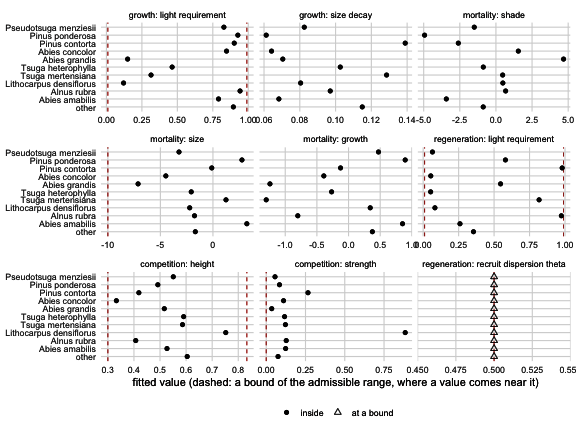

`pars = "env"` draws the environmental niches of the processes whose
response is linear: the fitted environmental term of every species
across the range of each predictor, the other held at its mean. For
growth and regeneration a higher curve means faster growth or more
recruits, for mortality more deaths:

``` r

plot(m, pars = "env")
```

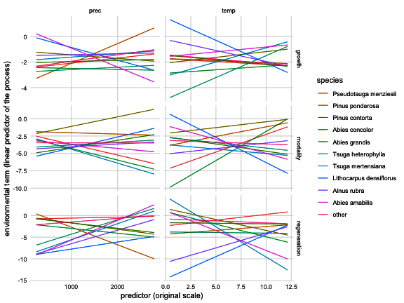

### From bare ground

The bare-ground runs that
[`evaluate()`](https://finnverse.github.io/FINN/reference/evaluate.md)
stored start from an empty stand under the climate of the coldest, a
middle and the warmest training site, held constant for 500 years.
`plot(ev, type = "bare_ground")` draws them as successions, one panel
per site labelled with its climate; outside an evaluation,
`simulateForest(m, bare_ground = TRUE, years = 500, sites = ...)` gives
the same run.

``` r

plot(ev, type = "bare_ground")
```

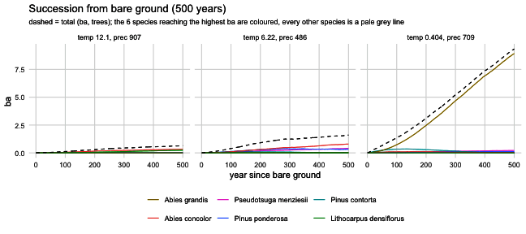

Basal area here is per patch of 0.06 ha, as in the inventory plots. Over
the last tenth of the run the three stands hold 0.6 to 8.9 m² per patch
(10 to 148 m² per hectare), led by Abies concolor and Abies grandis (the
bare-ground table of
[`summary()`](https://rspatial.github.io/terra/reference/summary.html)
above). These are long extrapolations from two inventories, and the
place to see whether the fitted processes produce a plausible forest at
all: a stand that collapses, or one species that takes every site, would
show here long before it shows in the skill tables. Here it does: at the
warmest site the stand grows to about 148 m² per hectare, with Abies
grandis holding 95 % of it, which is not a plausible forest; the skill
tables on the held-out sites do not reveal this.

### Trajectories against the inventories

[`simulateForest()`](https://finnverse.github.io/FINN/reference/predict.finn_class.md)
returns the whole trajectory, not only the census years.
`comparePlot(type = "timeseries")`, or the same
`plot(sim, obs, type = "timeseries")`, draws it as a line, averaged over
the sites, with the observations at their census years as points;
`species` gives one row of panels per species. The holdout sites, for
the four most common species:

``` r

FINN.seed(1)
sim_test <- simulateForest(m, env = env_test, init_cohort = init_cohorts_test)
comparePlot(sim_test, obs_test, type = "timeseries", species = c(1, 2, 4, 5))
```

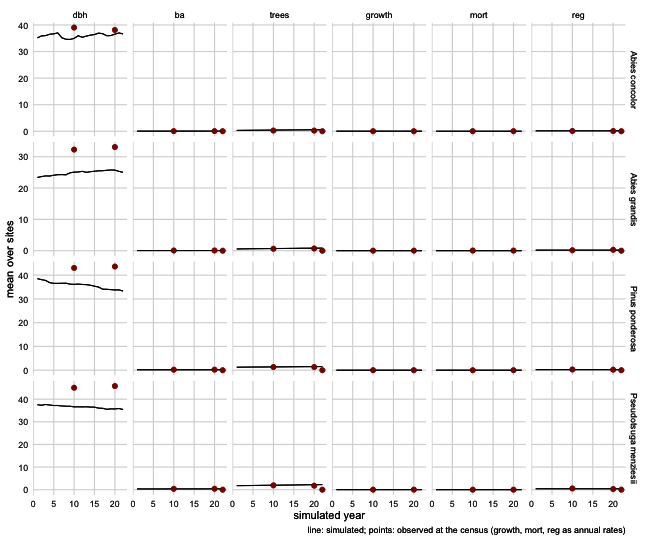

Each panel is the mean over the holdout sites where the species was
observed. The line shows what the model does between the censuses, which
the scatter plots cannot: whether a species’ basal area and stem numbers
rise or fall steadily, and whether the rates the inventories report at
year 10 and 20 sit on the simulated course. `plot(sim_test)` alone draws
the simulation without the observations.

## Scoring mortality per tree

The mortality term above compares the mean death probability over the
simulated cohorts of a site, census and species with the pooled rate of
the inventory. That mean carries a compositional confound: mortality
changes several-fold from the smallest to the largest trees, so the cell
mean moves whenever the simulated size distribution moves, whether or
not the hazard function is right. The bundled sample carries every tree
behind those counts, `fia_tree_dt` and `fia_tree_test`: one row per tree
alive at the start of an interval, with its diameter then and its fate.
With `loss_aggregation = c(mortality = "tree")` the mortality term is
scored on these trees instead, each at its measured diameter with the
light of the observed stand, against its 0/1 fate (see
[`?finn_loss`](https://finnverse.github.io/FINN/reference/finn_loss.md),
*Scoring individual trees*). Everything else stays as in the mechanistic
fit.

``` r

FINN.seed(42)
m_tree <- finn(
  N_species            = uniqueN(obs_dt$species),
  recruits_dbh         = 12.9,
  competition_process  = createProcess(~0, FINN::competition,  optimizeSpecies = TRUE),
  growth_process       = createProcess(~ temp + prec, FINN::growth,       optimizeSpecies = TRUE, optimizeEnv = TRUE),
  regeneration_process = createProcess(~ temp + prec, FINN::regeneration_capped, optimizeSpecies = TRUE, optimizeEnv = TRUE),
  mortality_process    = createProcess(~ temp + prec, FINN::mortality,    optimizeSpecies = TRUE, optimizeEnv = TRUE)
)
fit(m_tree,
  env = env_dt, data = obs_dt, init_cohort = init_cohorts, device = "cpu",
  epochs = EPOCHS, batchsize = 40L, patches = 4, patch_size = 0.06, lr = 0.01,
  loss_aggregation = c(mortality = "tree"),   # the mortality term on the observed trees
  tree_data        = fia_tree_dt,
  plot_progress    = FALSE
)
```

[`predictTrees()`](https://finnverse.github.io/FINN/reference/predictTrees.md)
runs the same per-tree code path on any tree list, so both fits are
scored on the holdout trees the same way: the probability that each of
the 10,109 holdout trees dies over its interval, against what happened
to it. The AUC needs no weighting here, every tree is one trial.
[`predictTrees()`](https://finnverse.github.io/FINN/reference/predictTrees.md)
needs `env` for exactly the sites in `tree_data`; two holdout sites have
no tallied tree at risk, so their climate rows are left out.

``` r

auc_binom <- function(p, pos, neg) {
  g <- data.table(p = p, pos = pos, neg = neg)[, .(pos = sum(pos), neg = sum(neg)), by = p][order(p)]
  neg_below <- cumsum(g$neg) - g$neg
  den <- sum(g$pos) * sum(g$neg)
  if (den == 0) return(NA_real_)
  sum(g$pos * (neg_below + 0.5 * g$neg)) / den
}
m$eval(); m_tree$eval()
env_tree <- env_test[siteID %in% fia_tree_test$siteID]   # the sites that have trees at risk
tree_pred <- function(model, label)
  cbind(fia_tree_test, model = label,
        mort_pred = predictTrees(model, tree_data = fia_tree_test, env = env_tree, patch_size = 0.06)$mort_pred)
tp <- rbind(tree_pred(m, "site-level mortality"), tree_pred(m_tree, "per-tree mortality"))
tree_auc <- tp[, .(trees = .N, deaths = sum(died), AUC = round(auc_binom(mort_pred, died, 1 - died), 3)), by = model]
tree_auc
#>                   model trees deaths   AUC
#>                  <char> <int>  <num> <num>
#> 1: site-level mortality 10109    734 0.573
#> 2:   per-tree mortality 10109    734 0.601
```

Both fits rank the holdout trees alike, AUC 0.573 for the site-level and
0.601 for the per-tree fit: on this sample the per-tree term buys little
ranking skill, which is the picture of the mortality vignette, where two
censuses carry little transferable mortality signal.

Where the two differ is in the size classes. Predicted and observed
yearly mortality of the holdout trees by diameter at the start of the
interval, in percent per year (a tree’s interval probability `p` over
`period_length` years is the yearly rate
`1 - (1 - p)^(1 / period_length)`):

``` r

annual <- function(p, years) 1 - (1 - p)^(1 / years)
tp[, dbh_class := cut(dbh, c(0, 20, 30, 45, 61, 80, 100, Inf),
                      labels = c("13-20", "20-30", "30-45", "45-61", "61-80", "80-100", ">100"))]
observed <- tp[model == "per-tree mortality",
               .(trees = .N, deaths = sum(died),
                 observed = round(100 * annual(mean(died), mean(period_length)), 2)), by = dbh_class]
predicted <- dcast(tp[, .(pred = round(100 * mean(annual(mort_pred, period_length)), 2)), by = .(dbh_class, model)],
                   dbh_class ~ model, value.var = "pred")
size_tab <- merge(observed, predicted, by = "dbh_class")[order(dbh_class)]
size_tab
#> Key: <dbh_class>
#>    dbh_class trees deaths observed per-tree mortality site-level mortality
#>       <fctr> <int>  <num>    <num>              <num>                <num>
#> 1:     13-20  3593    338     0.98               0.84                 1.70
#> 2:     20-30  2866    201     0.72               0.84                 1.08
#> 3:     30-45  1618     93     0.59               0.81                 0.97
#> 4:     45-61   553     34     0.63               0.69                 0.72
#> 5:     61-80   812     45     0.57               0.56                 0.54
#> 6:    80-100   450     16     0.36               0.50                 0.45
#> 7:      >100   217      7     0.33               0.31                 0.22
```

The site-level fit reproduces the pooled rate of a cell and leaves the
shape over size to the simulated size distribution: for the trees below
20 cm it predicts 1.7 % a year against the observed 0.98 %, for the
trees above 100 cm 0.22 against 0.33 %, the large-tree arm of the size
response that site-level rates leave unidentified. Scored per tree, the
same hazard function predicts 0.84 and 0.31 % in these two classes and
stays within a factor of 1.4 of the observation in every class. Neither
route is calibrated in every class; compare the columns class by class.

## The recruitment cap, and why stem counts hinge on a few bursts

Regeneration is the response with the least information in it: 87% of
the site × census × species cells record no recruit at all, and a
recruit enters at 12.9 cm, so over a ten-year interval it adds little to
basal area. The unbounded mechanistic mean rises as `exp(env)`, so a
steep climate coefficient could turn a warm, wet site into a burst of
hundreds of stems in one year. The default
[`regeneration_capped()`](https://finnverse.github.io/FINN/reference/regeneration_capped.md)
bounds it with a Beverton-Holt cap, `K m / (K + m)`: one carrying
capacity `K` (stems per hectare and year) shared by all species, started
at the largest observed recruitment per hectare and year and held near
it by a weak prior, then fitted with everything else
([`?regeneration_capped`](https://finnverse.github.io/FINN/reference/regeneration_capped.md);
[`?recruitment`](https://finnverse.github.io/FINN/reference/recruitment.md)
lists the options). The fitted cap of the joint model:

``` r

# the fitted carrying capacity, recruits per hectare and year
K <- exp(as.numeric(m$reg_logK))
K
#> [1] 14.57163
# the largest expected recruitment of a holdout site and species over an interval
max_reg <- ev$holdout$matched[variable == "reg", max(pred)]
max_reg
#> [1] 35.67944
```

The fitted `K` is 14.6 recruits per hectare and year. The largest
expected recruitment of any holdout site and species over a whole census
interval is 36 per hectare, about 3.6 a year, far below the cap: on this
sample the cap is a guard rail that the climate response never reaches.

The stem count deserves a closer look, because its skill is the least
stable of the three state variables. Recruits are *sampled* at
prediction time (`createProcess(sample_regeneration = TRUE)`, the
default), so a cell whose expected recruitment is large can receive a
burst in one simulation and nothing in the next. The same model
evaluated five times on the holdout with different seeds:

``` r

reps <- lapply(1:5, function(s) {
  FINN.seed(s)
  evaluate(m, holdout = list(data = obs_test, env = env_test,
                             init_cohort = init_cohorts_test))$holdout
})
trees_by_seed <- rbindlist(lapply(1:5, function(s)
  reps[[s]]$skill[variable == "trees", .(seed = s, r2 = round(r2, 3), r = round(r, 3),
                                         rmse = round(rmse, 3))]))
trees_by_seed
#>     seed    r2     r  rmse
#>    <int> <num> <num> <num>
#> 1:     1 0.807 0.899 0.783
#> 2:     2 0.801 0.895 0.794
#> 3:     3 0.809 0.900 0.778
#> 4:     4 0.813 0.902 0.771
#> 5:     5 0.812 0.902 0.771

# which cells carry the stem error? those whose predicted recruitment is in the
# top 1 % of the same simulation
burst <- rbindlist(lapply(1:5, function(s) {
  d <- reps[[s]]$matched
  merge(d[variable == "trees", .(siteID, year, species, obs, trees = pred)],
        d[variable == "reg",   .(siteID, year, species, reg = pred)],
        by = c("siteID", "year", "species"))[, seed := s]
}))
burst[, top := reg >= quantile(reg, 0.99), by = seed]
total_sq_error <- burst[, sum((obs - trees)^2)]
burst_tab <- burst[, .(cells = .N, share_of_sq_error = round(sum((obs - trees)^2) / total_sq_error, 2),
                       max_reg = round(max(reg), 1)), by = .(top_1pct_recruitment = top)]
burst_tab
#>    top_1pct_recruitment cells share_of_sq_error max_reg
#>                  <lgcl> <int>             <num>   <num>
#> 1:                FALSE 21780              0.84    11.2
#> 2:                 TRUE   220              0.16    35.8
```

The 1 % of cells with the largest predicted recruitment carry 16 % of
the squared stem error, and the seed-to-seed spread in the stem metrics
is the same mechanism at work: a site that receives a burst in one draw
and not in the next. That is why a single stems R² on a holdout should
not decide between two models whose regeneration differs; compare
several seeds, or score the *expected* stand
(`sample_regeneration = FALSE` at prediction time), and look at the
largest predicted recruitment, the tail the cap acts on.

## Interpreting the growth process with ALE

[`ALE()`](https://finnverse.github.io/FINN/reference/ALE.md) returns the
**accumulated local effect** of every driver on each process, the effect
measure of choice when predictors are correlated, because it accumulates
*local* changes within the observed data instead of extrapolating to
unrealistic combinations. Running it on **both** fitted models lets us
read what growth responds to *and* compare the mechanistic process with
the neural-network hybrid, across growth’s **structural** inputs (tree
size, light) and its **environmental niche** (climate). It returns one
table per process (`growth`, `mortality`, `regeneration`). Without `env`
and `init_cohort` it reads the effects over all training sites the model
keeps from [`fit()`](https://finnverse.github.io/FINN/reference/fit.md);
as for
[`summary()`](https://rspatial.github.io/terra/reference/summary.html),
we use the 30-site subset, which is much faster.

[`plot()`](https://rspatial.github.io/terra/reference/plot.html) draws
the environmental drivers of the three processes, one line per species,
here of the mechanistic model:

``` r

ale_proc <- ALE(m,        env = env_xai, init_cohort = init_xai, plot = FALSE)   # mechanistic growth
ale_hyb  <- ALE(m_hybrid, env = env_xai, init_cohort = init_xai, plot = FALSE)   # growth = NN
plot(ale_proc)
```

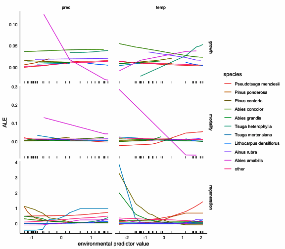

The drivers are on the standardised scale the model works on. To compare
the two models, we use the growth table of each:

``` r


# one tidy table with both variants. Environmental drivers come back on the
# model's scaled axis, so back-transform temp/prec to natural units (deg C, mm);
# the structural drivers (dbh, light) are already on their natural axes.
to_natural <- function(a, model) {
  sc <- as.data.table(model$env_scaling)[, .(var = variable, center, scale)]
  merge(data.table(a), sc, by = "var", all.x = TRUE)[!is.na(center), x := x * scale + center]
}
growth <- rbind(
  to_natural(ale_proc$growth, m)[,        model := "Process (mechanistic)"],
  to_natural(ale_hyb$growth,  m_hybrid)[, model := "Hybrid (growth = NN)"])
growth <- merge(growth, species_dt, by = "species")
```

One helper plots the growth ALE of both variants for any set of drivers,
one panel per species × driver, with **independent axes** so responses
of very different magnitude stay legible side by side:

``` r

plot_growth_ale <- function(vars, labs) {
  d <- growth[var %in% vars & species %in% c(1, 2, 4, 5)]   # the four focal species
  d[, var := factor(var, levels = names(labs))]
  ggplot(d, aes(x, ale, colour = model)) +
    geom_line(linewidth = 0.7) +
    facet_grid(species_name ~ var, scales = "free",
               labeller = labeller(var = as_labeller(labs, label_parsed),
                                    species_name = label_value)) +
    scale_colour_manual(values = model_cols) +
    labs(x = NULL, y = "accumulated local effect on growth", colour = NULL) +
    theme_minimal() + theme(legend.position = "top", strip.text.y = element_text(angle = 0))
}
```

### Environmental niches

Because the environmental responses are learned rather than prescribed,
each curve is an inferred **niche**, how a species’ growth scales along
a climate gradient. The mechanistic process can bend a curve only as far
as its exponential response to a linear climate term allows; the network
can shape it freely, so a curve with an optimum inside the sampled range
is something only the hybrid can draw.

Read these as *illustrations of what ALE recovers*, not as settled
ecology. The per-species shapes are noisier than the structural
responses below; growth is weakly constrained by two inventories (see
the caveat above), and the mechanistic and hybrid curves do not always
agree, even on the sign of a response. That disagreement is itself
informative: where two models trained on the same data diverge, the data
are not pinning that response down.

``` r

plot_growth_ale(c("temp", "prec"),
                c(temp = "temperature~(degree*C)", prec = "precipitation~(mm)"))
```

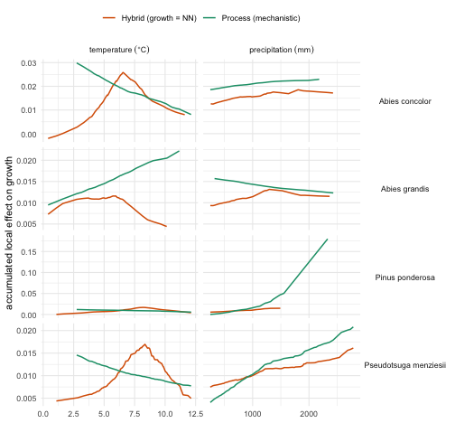

### Which drivers matter: `feature_importance()`

The niches show the *shape* of each response;
[`feature_importance()`](https://finnverse.github.io/FINN/reference/feature_importance.md)
gives its *magnitude*. It permutes each environmental predictor and
re-simulates, measuring the resulting increase in prediction error, a
re-simulation counterpart to the analytical importance in
[`summary()`](https://rspatial.github.io/terra/reference/summary.html).
Below we read off the importances for the growth process of the four
focal species:

``` r

FINN.seed(1)
fi <- feature_importance(m, env_dt, init_cohorts, nperm = 20L, seed = 1L,
                         patches = 4, patch_size = 0.06, device = "cpu")
fimp_growth <- merge(data.table(fi$growth)[species %in% c(1, 2, 4, 5)],
                     species_dt, by = "species")
```

``` r

ggplot(fimp_growth, aes(reorder(variable, importance), importance, fill = importance)) +
  geom_col() +
  coord_flip() +
  facet_wrap(~species_name, nrow = 1) +
  scale_fill_viridis_c(guide = "none") +
  labs(x = NULL, y = "permutation importance (delta error)") + theme_minimal()
```

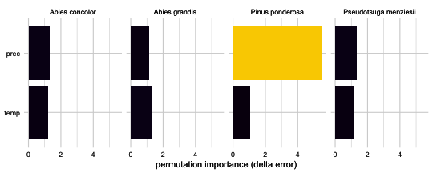

The importances are learned per species, not shared: the same driver can
carry most of the response of one species and little of another.

### Response to size and light: did the network recover the mechanistic form?

The point of a hybrid is to ask which functional form the neural network
learned and how it *compares* to the mechanistic function it replaced.
In the mechanistic process growth **declines with tree size** and
**increases with light availability**, by construction. Where the
network recovers the same shape without being given the functional form,
the mechanistic form was a reasonable choice; where its curves part from
the mechanistic ones, the data do not pin the response down.

``` r

plot_growth_ale(c("dbh", "light"),
                c(dbh = "diameter~(cm)", light = "light~availability"))
```

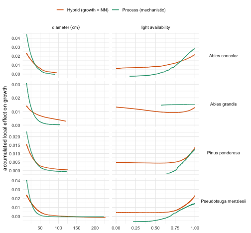

Each curve spans only the range its *own* model actually simulates (ALE
never extrapolates), so where the process and hybrid cover different
ranges, the two models simply place that species in different
conditions; the mismatch is information, not an artefact.

``` r

sessionInfo()
#> R version 4.5.0 (2025-04-11)
#> Platform: aarch64-apple-darwin20
#> Running under: macOS 26.5.1
#> 
#> Matrix products: default
#> BLAS:   /Library/Frameworks/R.framework/Versions/4.5-arm64/Resources/lib/libRblas.0.dylib 
#> LAPACK: /Library/Frameworks/R.framework/Versions/4.5-arm64/Resources/lib/libRlapack.dylib;  LAPACK version 3.12.1
#> 
#> locale:
#> [1] en_US.UTF-8/en_US.UTF-8/en_US.UTF-8/C/en_US.UTF-8/en_US.UTF-8
#> 
#> time zone: Europe/Berlin
#> tzcode source: internal
#> 
#> attached base packages:
#> [1] stats     graphics  grDevices utils     datasets  methods   base     
#> 
#> other attached packages:
#> [1] ggplot2_3.5.2       data.table_1.18.6.1 torch_0.15.1       
#> [4] FINN_0.2.0         
#> 
#> loaded via a namespace (and not attached):
#>  [1] Matrix_1.7-3       bit_4.6.0          gtable_0.3.6       dplyr_1.1.4       
#>  [5] compiler_4.5.0     tidyselect_1.2.1   Rcpp_1.1.2         callr_3.7.6       
#>  [9] splines_4.5.0      scales_1.4.0       lattice_0.22-6     R6_2.6.1          
#> [13] labeling_0.4.3     generics_0.1.4     knitr_1.50         tibble_3.3.0      
#> [17] pillar_1.11.0      RColorBrewer_1.1-3 rlang_1.2.0        xfun_0.57         
#> [21] bit64_4.6.0-1      viridisLite_0.4.2  cli_3.6.6          withr_3.0.2       
#> [25] magrittr_2.0.3     mgcv_1.9-1         ps_1.9.1           grid_4.5.0        
#> [29] processx_3.8.6     lifecycle_1.0.5    nlme_3.1-168       coro_1.1.0        
#> [33] vctrs_0.6.5        evaluate_1.0.5     glue_1.8.0         farver_2.1.2      
#> [37] abind_1.4-8        tools_4.5.0        pkgconfig_2.0.3
```
