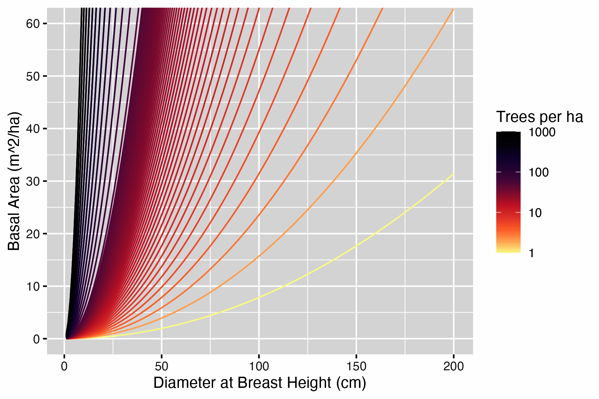
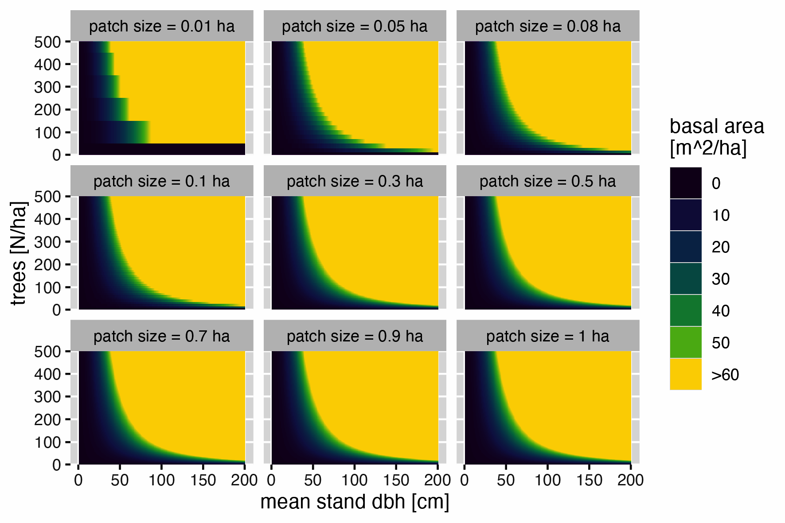

# Calculate the Basal Area of a Stand

This function calculates the basal area of a stand based on the diameter
at breast height (dbh), the number of trees, and the patch size in
hectares.

## Usage

``` r
BA_stand(dbh, trees, patch_size_ha)
```

## Arguments

- dbh:

  A torch tensor or numeric vector representing the diameter at breast
  height of the trees in centimeters.

- trees:

  A torch tensor or numeric vector representing the number of trees.

- patch_size_ha:

  A numeric value representing the size of the patch in hectares.

## Value

An object of the type and shape of `dbh` (a torch.Tensor for tensors):
the basal area of each cohort in square meters per hectare.

## Details

The basal area of a stand is the cross-sectional area of all trees in a
stand per unit area. This function calculates the basal area per ha
using the formula: \$\$BA = \left( \frac{\pi \left(
\frac{\text{dbh}}{100} \right)^2}{4} \right) \times \text{trees} \div
\text{patch\\size\\ha}\$\$

The formula takes into account the diameter at breast height (dbh) in
centimeters, the number of trees, and the size of the patch in hectares
to calculate the basal area in square meters per hectare.

This plot illustrates the basal area for different combinations of dbh
and number of trees.



Sensitivity of basal area for different combinations of dbh, number of
trees to patch size.



## See also

[`BA_stem()`](https://finnverse.github.io/FINN/reference/BA_stem.md) for
one stem,
[`competition()`](https://finnverse.github.io/FINN/reference/competition.md),
which turns the basal area of the taller cohorts into the light a cohort
receives

## Examples

``` r
# three cohorts on a patch of 0.1 ha: two 50-cm trees, ten 20-cm trees and
# forty 5-cm trees
cohorts <- data.frame(siteID = 1, patchID = 1, cohortID = 1:3, species = 1,
                      dbh = c(50, 20, 5), trees = c(2, 10, 40))
cohort <- CohortMat(obs_df = cohorts)
ba <- BA_stand(cohort$dbh, cohort$trees, patch_size_ha = 0.1)
ba          # m^2/ha per cohort, [sites, patches, cohorts]
#> torch_tensor
#> (1,.,.) = 
#>   3.9270  3.1416  0.7854
#> [ CPUFloatType{1,1,3} ]
ba$sum()    # the stand: 7.9 m^2/ha
#> torch_tensor
#> 7.85398
#> [ CPUFloatType{} ]

# the same trees on a patch half the size are twice the basal area per hectare
BA_stand(cohort$dbh, cohort$trees, patch_size_ha = 0.05)$sum()
#> torch_tensor
#> 15.708
#> [ CPUFloatType{} ]

# numeric vectors work as well
BA_stand(dbh = c(50, 20, 5), trees = c(2, 10, 40), patch_size_ha = 0.1)
#> [1] 3.9269908 3.1415927 0.7853982
```
