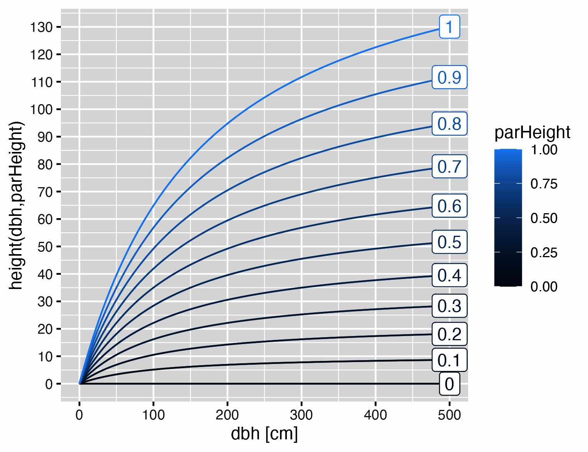

# Calculate the height of a tree based on its diameter at breast height and an allometry parameter

Calculate the height of a tree based on its diameter at breast height
and an allometry parameter

## Usage

``` r
height(dbh, parHeight)
```

## Arguments

- dbh:

  A numeric value representing the diameter at breast height of the tree
  in cm.

- parHeight:

  A numeric value representing the species height allometry.

## Value

A numeric vector (or torch.Tensor, for tensor input) with the height of
the tree in m.

## Details

This function calculates the height of a tree based on the diameter at
breast height (dbh) and a parameter parHeight.

The height is calculated using the formula: \$\$height = \left( \exp
\left( \frac{(\text{dbh} \times \text{parHeight})}{(\text{dbh} + 100)}
\right) - 1 \right) \times 100 + 0.001\$\$ where dbh is the diameter at
breast height of the tree in cm and parHeight is an allometric species
specific parameter.

As the diameter grows, the height approaches
\\(\exp(\text{parHeight}) - 1) \times 100\\ m: 35 m for parHeight = 0.3,
65 m for 0.5, 101 m for 0.7. When the height parameter is fitted (the
first column of the competition parameters), FINN keeps it between 0.3
and \\\log(2.3) \approx 0.83\\, so no species can grow taller than 130
m, the physical limit of tree height (Koch et al. 2004). Values below
0.3 suit small trees and shrubs; set
[`createProcess(lower = )`](https://finnverse.github.io/FINN/reference/createProcess.md)
for them.

## References

Koch, G. W., Sillett, S. C., Jennings, G. M. & Davis, S. D. (2004). The
limits to tree height. Nature 428, 851-854.



## See also

[`competition()`](https://finnverse.github.io/FINN/reference/competition.md),
which ranks the cohorts of a patch by this height

## Examples

``` r
# a 30-cm tree of a species with parHeight = 0.5 is about 12 m tall
height(30, 0.5)
#> [1] 12.2315
# the same diameter for a tall-growing and a short-growing species
height(c(30), c(0.5,0.3))
#> [1] 12.231501  7.169349
# two diameters of one species
height(c(30,20), c(0.5))
#> [1] 12.231501  8.691405

# the height curve of three species; the asymptote is (exp(parHeight) - 1) * 100 m
dbh <- seq(0, 150, by = 10)
round(sapply(c(low = 0.3, mid = 0.5, tall = 0.7), function(p) height(dbh, p)), 1)
#>        low  mid tall
#>  [1,]  0.0  0.0  0.0
#>  [2,]  2.8  4.7  6.6
#>  [3,]  5.1  8.7 12.4
#>  [4,]  7.2 12.2 17.5
#>  [5,]  9.0 15.4 22.1
#>  [6,] 10.5 18.1 26.3
#>  [7,] 11.9 20.6 30.0
#>  [8,] 13.1 22.9 33.4
#>  [9,] 14.3 24.9 36.5
#> [10,] 15.3 26.7 39.3
#> [11,] 16.2 28.4 41.9
#> [12,] 17.0 29.9 44.3
#> [13,] 17.8 31.4 46.5
#> [14,] 18.5 32.7 48.5
#> [15,] 19.1 33.9 50.4
#> [16,] 19.7 35.0 52.2
```
