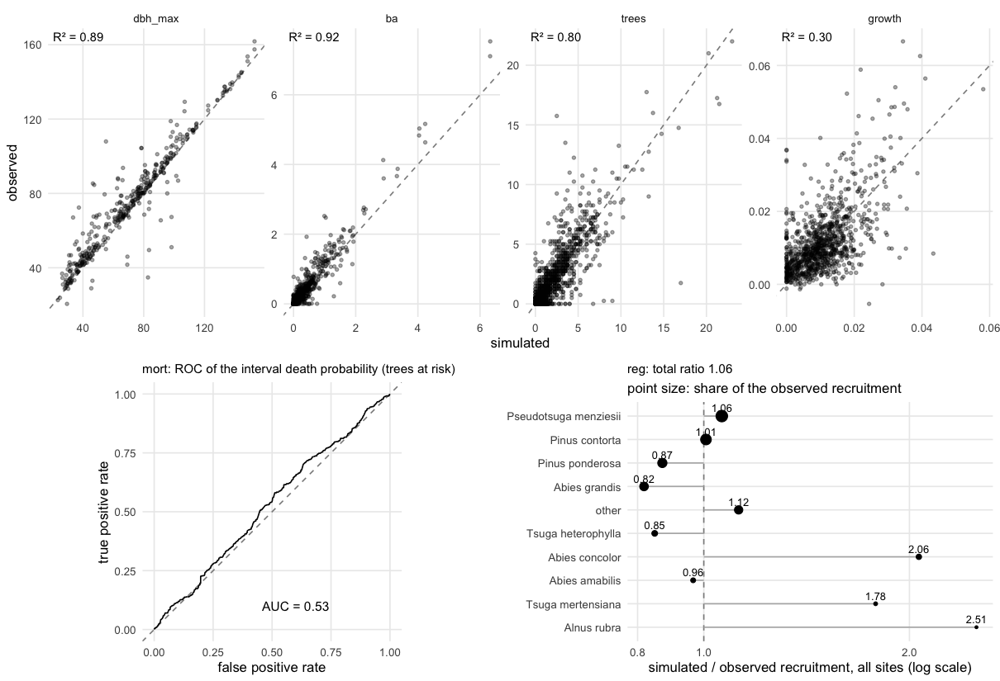
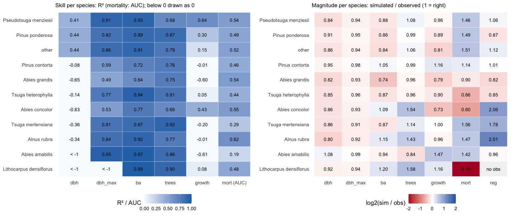
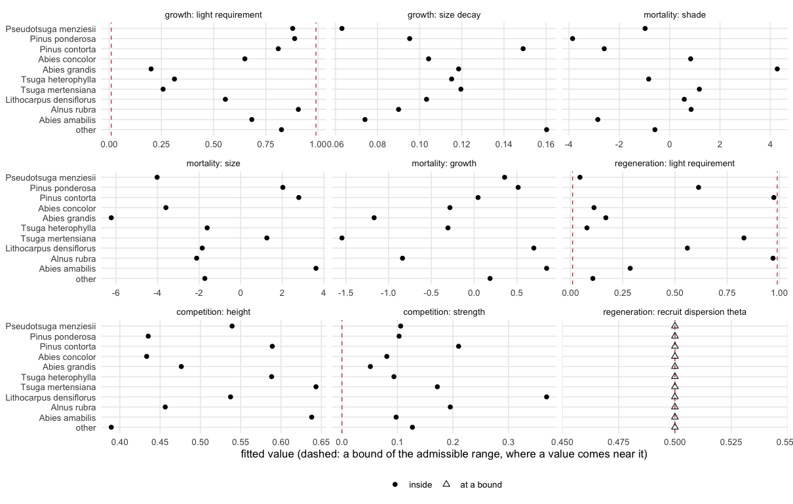
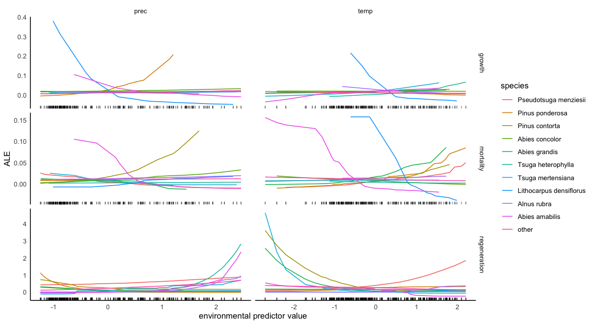
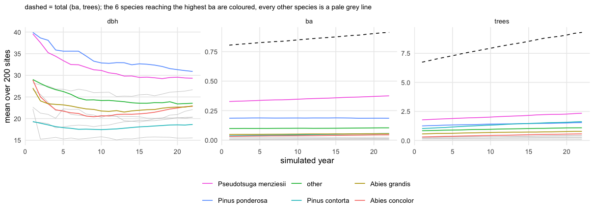
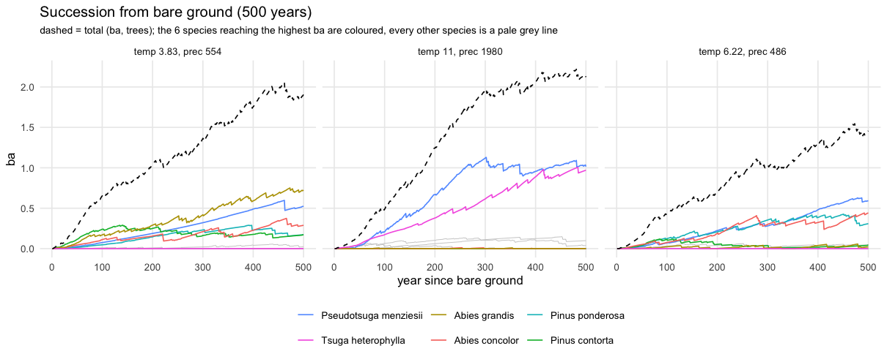

# FINN 0.2.0 release notes

FINN 0.2.0 follows 0.1.0 (CRAN, August 2026). Since then we have calibrated FINN
on large forest inventories: the German national forest inventory, the US
Forest Inventory and Analysis (FIA), and further national inventories. These
fits showed where 0.1.0 gave unstable or silently wrong results. Version 0.2.0
fixes them and sets a clear default: one joint fit of all processes. It also
adds functions to evaluate a fitted model against observations, check its
convergence and plot its parameters.

All code and figures here use the Oregon FIA data that come with the package:
a model fitted to 200 plots over two remeasurement intervals and checked on
200 other plots. The script `demo_fia.R` in this folder reproduces every figure
and number (about 15 minutes, most of it the fit).

## 1. What changes and why

Several defaults change results compared with 0.1.0. `NEWS.md` lists all of
them under "Changes that alter results", each with the setting that restores
the old behaviour where there is one. The most important ones:

| problem in 0.1.0 | 0.2.0 | old behaviour |
|---|---|---|
| The stem-count likelihood exploded where a species was simulated with zero stems but observed | offset 0.01 per patch; gradients through the expected deaths and recruits | `fit(trees_offset = NULL, rb_gradient = FALSE)` |
| Recruitment could grow without bound, to more than a hundred times the observed | recruitment capped by a Beverton–Holt term, with a prior at the largest observed rate | `createProcess(func = FINN::regeneration)` |
| The recruit dispersion `theta` collapsed towards 0 | `theta` estimated with a lower bound of 0.5 | `createProcess(theta_floor = 0)` |
| Approximate draws for deaths and small recruit numbers | exact binomial and Poisson–Gamma draws | `mortality_draw = "gamma"`, `regeneration_sampler = "gaussian"` |
| Mortality limited to 1–99 % per year | 0.1–99.9 % per year | `mortality_floor = 0.01, mortality_ceiling = 0.99` |
| Dead and empty cohort slots changed the light of the living trees | competition among live cohorts only | `light_mask = FALSE` |
| A fixed recruitment floor of 0.2 per patch and year | `reg_floor = 1e-3`, an argument of the regeneration process | `reg_floor = 0.2` |

Data preparation now works on annual steps. `makeObsData()` returns annual
growth and mortality rates, `resolveSiteIDs()` an annual time axis, and `fit()`
compounds the simulated annual rates over each remeasurement interval in the
same way as the observed ones.

Some arguments have new names. The old names still work and give a warning:
`fit(loss_weights = )` (was `weights`), `fit(loss_recruit = )` (was
`recruits`), and the optimizer settings in `fit(control = finnControl())`.

## 2. Fitting and evaluating a model

The default is a joint fit: all processes (growth, mortality, regeneration,
competition) are estimated together against all six observed responses
(mean dbh, basal area, stems, growth, mortality, recruitment).

**A plain fit:**

```r
library(FINN); library(data.table)
Nsp  <- max(fia_obs_dt$species)
init <- makeInitCohorts(fia_init_trees, Nspecies = Nsp)

FINN.seed(1)
m <- finn(N_species = Nsp, recruits_dbh = 12.9,
          competition_process  = createProcess(~ 0, competition, optimizeSpecies = TRUE),
          growth_process       = createProcess(~ temp + prec, growth, optimizeSpecies = TRUE),
          mortality_process    = createProcess(~ temp + prec, mortality, optimizeSpecies = TRUE),
          regeneration_process = createProcess(~ temp + prec, regeneration_capped, optimizeSpecies = TRUE))

fit(m, data = fia_obs_dt, env = fia_env_dt, init_cohort = init,
    epochs = 300L, batchsize = 40L, patches = 4, patch_size = 0.06,
    tree_data = fia_tree_dt)
```

**Evaluating it afterwards.** `evaluate()` simulates the model on the training
data and, if given, on a holdout, and compares the simulation with the
observations. It can also run a simulation from bare ground. It returns the
result as its own object and also keeps it in the model (`m$evaluation`), where
`summary()` finds it.

```r
test <- list(data        = fia_obs_test,
             env         = fia_env_test,
             init_cohort = makeInitCohorts(fia_init_test, Nspecies = Nsp),
             tree_data   = fia_tree_test)   # optional: the observed trees

ev <- evaluate(m, holdout = test, bare_ground = TRUE, years = 500)
ev                               # skill on the training data and the holdout
plot(ev)                         # observed against simulated
plot(ev, type = "heatmap")       # skill per species
plot(ev, type = "bare_ground")   # the bare-ground runs
```

**Both in one call.** `fit(holdout = )` runs the same evaluation right after the
fit:

```r
fit(m, data = fia_obs_dt, env = fia_env_dt, init_cohort = init,
    epochs = 300L, batchsize = 40L, patches = 4, patch_size = 0.06,
    tree_data = fia_tree_dt, holdout = test)
```

`fit()` now also keeps the training observations, the observed trees, the
patch count and the species names, so the evaluation needs no further input.
For a model fitted with an earlier version, pass the training data with
`evaluate(m, train = list(data =, env =, init_cohort =))`.

## 3. `summary()`: skill and convergence

```r
s <- summary(m)
s                            # skill, convergence, bare ground, environment
print(s, epochs_back = 10)   # convergence over the last 10 epochs instead of 50
```

The summary starts with the skill per response: R² and the correlation of
observed and simulated values first, then RMSE, the bias and the ratio of
simulated to observed means. For mortality it adds the tree-level AUC and the
ratio of predicted to observed deaths. On the 200 test plots:

```
 response     R2  correlation    RMSE    bias  pred/obs     n    AUC  deaths pred/obs
      dbh   0.40         0.71   14.67   -4.75      0.87  1048
  dbh_max   0.89         0.95    9.69   -4.00      0.95   393
       ba   0.92         0.97    0.10   -0.01      0.88  4400
    trees   0.80         0.89    0.80    0.03      1.05  4400
   growth   0.30         0.61   0.008  -0.001      0.92  1000
     mort  -0.02         0.00    0.09   -0.01      0.99   994   0.53             1.23
      reg   0.11         0.34    5.97    0.10      1.06  4400
```

`dbh_max` is the largest diameter per site and species (section 4). It is far
better predicted than the mean diameter (R² 0.89 against 0.40), because the
mean depends on how many small trees a plot has. For mortality the R² of
single plot rates says little; the AUC and the death ratio are the measures to
read. Here the AUC of 0.53 shows that this model barely separates the trees
that died from those that survived.

The convergence check follows. It shows how much the loss and the parameters
still changed over the last 50 epochs:

```
Loss: the largest change is ba, -1.93 % over the last 50 epochs
(mean of the last 50 epochs against the 50 before).
         term loss_now  change
          dbh   0.3839  0.08 %
           ba   0.0655 -1.93 %
        trees   0.3287 -0.13 %
       growth   0.6372 -1.07 %
    mortality   0.9521 -0.01 %
 regeneration   0.5712 -0.81 %

Parameters: how much they moved over the last 50 epochs.
  The species parameter that moved most: competition: strength, 13.43 %.
      process                   part                      moved most  change
       growth     species parameters       growth: light requirement  5.27 %
       growth environmental response              nn_growth.0.weight  7.46 %
    mortality     species parameters               mortality: growth 12.79 %
    mortality environmental response           nn_mortality.0.weight  3.22 %
 regeneration     species parameters regeneration: light requirement 12.53 %
 regeneration environmental response        nn_regeneration.0.weight  4.79 %
 regeneration     recruit dispersion          par_theta_recruits_raw  0.00 %
 regeneration        recruitment cap                        reg_logK  0.18 %
  competition     species parameters           competition: strength 13.43 %
```

For each process the table names the parameter that changed most, separately
for the species parameters and for the environmental response (here the
linear coefficients of temperature and precipitation; for a neural-network
response the weights of its layers). The change is the size of the step the
values took over the last 50 epochs, as a percentage of the size of the values,
taken over all species of a parameter or all weights of a layer: 1 % means the
values moved by about a hundredth of their size. Species parameters are
compared on the scale on which they act.

Here the loss still falls by up to 1.9 % over 50 epochs, and several species
parameters still move by more than 10 %: competition strength, the effect of
growth on mortality and the light requirement of regeneration. This fit of 300
epochs has not converged; a longer fit is needed before its parameters are
interpreted. Vignette D fits the same data for 500 epochs.

`fit()` keeps the parameters of the last 51 epochs for this check; for a model
fitted with an earlier version, the parameter snapshots taken every
`checkpoints` epochs are used.

After that the summary shows the end state of the bare-ground runs and, as
before, the importance of each environmental predictor and its average
effect, per process and species.

## 4. `comparePlot()`: simulation against observations

```r
sim <- simulateForest(m, env = fia_env_test, init_cohort = test$init_cohort,
                      return_cohorts = c(10L, 20L))   # cohorts at the census years, for dbh_max
comparePlot(sim, fia_obs_test, tree_data = fia_tree_test)
plot(sim, fia_obs_test)                              # the same
```

The simulation is summarised as `fit()` scores it: stand states at the census,
growth and mortality compounded over the interval, recruits summed. Tables in
long or wide format both work. Observations without a simulated counterpart
are dropped with a message. The page shows:

- largest dbh (with `tree_data`), basal area, stems and growth: observed against
  simulated, with R²;
- mortality: the ROC curve of the interval death probability and its AUC,
  each tree at risk counting as one case;
- recruitment: the ratio of simulated to observed recruitment summed over all
  plots, per species, since recruitment per plot is too noisy for a
  correlation.

`plot(ev)` draws the same page from a stored evaluation, without a new
simulation.



With `tree_data`, the dbh panel shows the largest diameter per site and
species. Observed, it is the largest tree that survived the interval, grown to
the census. Simulated, it is the largest living cohort at the census. With all
species pooled it is the largest per site.

`species = c(1, 6)` draws chosen species instead of all species pooled.

### Per species: `type = "heatmap"`

```r
comparePlot(sim, fia_obs_test, type = "heatmap", tree_data = fia_tree_test)
plot(ev, type = "heatmap")                           # the same
```

Left: R² for each response and the AUC for mortality. Right: simulated divided
by observed, on a log scale with white at 1; for mortality the predicted over
observed deaths. A tile marked "no obs" means the species was not observed for
that response in the selected plots, so a ratio cannot be formed.



On the test plots the largest diameter is within 10 % of the observed for every
species. Basal area is within 15 % for 7 of 11 species; *Abies grandis* (0.74)
and *Lithocarpus densiflorus* (1.20) deviate most. Stems and growth are close
for the main species. The mean diameter is poorly predicted for most species,
which is why the largest diameter is shown by default. Recruitment of *Abies
concolor*, *Tsuga mertensiana* and *Alnus rubra* is 1.8 to 2.5 times the
observed. *Lithocarpus densiflorus* shows "no obs" for recruitment because no
recruit of it was observed on the test plots, while the model simulates some.

### Over time: `type = "timeseries"`

```r
comparePlot(sim, fia_obs_test, type = "timeseries", species = 1:3)
```

The simulated trajectory as a line and the observations as points at their
census years, averaged over the same plots and species.

## 5. `plot(model)`: the fitted parameters

```r
plot(m)                  # species parameters of every process
plot(m, pars = "env")    # environmental niches, for linear responses
```

Each panel shows one parameter, one point per species, on the scale on which
it acts. A red dashed line marks a bound of the allowed range where a value
comes close to it, and an open triangle marks a species whose parameter ended
the fit at the bound, which means the data do not determine it. With
`pars = "env"` the plot shows the fitted environmental response of each
species over the range of each predictor. This works for linear responses; for
a neural-network response the panel is skipped with a warning that points to
`ALE()`. The 0.1.0 method failed on a plain `plot(m)` and showed network
weights as bars.

Parameter names come from the documentation of FINN's own process functions.
A process function of your own can be given names:

```r
plot(m, parameter_names = list(mortality = c("shade", "size", "growth")))
```



The recruit dispersion `theta` sits at its lower bound of 0.5 for every species.
Most plots have no recruits in an interval and a few have many: recruitment is
strongly clumped, and the likelihood alone would push `theta` towards 0. Without
the bound, `theta` collapsed and recruitment ran away, so the bound is
deliberate and `theta` is set by it, not estimated.

The light requirement of regeneration ends near its upper bound for *Pinus
contorta* and *Alnus rubra*. In FINN the light at the forest floor varies over a narrow
range between open and closed stands, while observed ingrowth falls steeply
with stand density. A value at the upper bound therefore means that
recruitment declines strongly over the whole range of stand density, not that
the species needs nearly full light.

## 6. `ALE()`: effects of the environment

```r
ale <- ALE(m)
plot(ale)
```

Accumulated local effects show how each predictor changes growth, mortality
and regeneration of each species, also when the response is a neural network.
FINN now records the inputs of every process during this calculation itself,
so `ALE()` also works for process functions of your own.



## 7. Simulations and bare ground

```r
sim <- simulateForest(m, env = fia_env_test, init_cohort = test$init_cohort)
plot(sim)              # basal area, dbh and stems per species, mean over plots
plot(sim, sites = 2)   # one plot

bg <- simulateForest(m, bare_ground = TRUE)                    # 500 years, mean climate
bg <- simulateForest(m, bare_ground = TRUE, sites = c(2, 4))  # each plot's mean climate
plot(bg)
```

A simulation now has the class `finn_simulation`; its tables are unchanged.
The leading species are coloured and named, all others are grey lines, and the
stand total is dashed. A bare-ground run starts from an empty stand and runs
for `years` (default 500) under the mean climate, or the mean climate of each
plot given in `sites`. Without `patches`, simulations use the patch count of
the fit.





Bare-ground runs are the hardest test of a fitted model, harder than the
comparison with test plots: species composition and stand structure have to
emerge from the fitted processes alone. This model, fitted to two decades of
data, shows no clear equilibrium within 500 years: basal area keeps rising for
400 years or more at all three plots. Good skill on test
plots does not guarantee plausible long-term dynamics, so we recommend looking
at both.

## 8. Smaller fixes

- The prepared inputs of `resolveSiteIDs()` can be saved with `saveRDS()` and
  read with `readRDS()`. The initial cohorts used to fail with "external
  pointer is not valid"; they now rebuild themselves (#77).
- An environment table without predictor columns gives an intercept-only
  process instead of missing recruitment (#64).
- Data frames are accepted as starting values in `createProcess()` (#11).
- Species are shown by name in all plots and in `summary()`. Models fitted with
  0.2.0 keep the names from the `species_name` column of the data; for older
  models pass `species_names =`.

## 9. Upgrading

- Models fitted with earlier versions can be read with `torch_load()` and used
  with `predict()`, `simulateForest()`, the plots and `comparePlot()`. For
  `evaluate()` and the skill part of `summary()`, pass the training data with
  `evaluate(train = )`.
- A fit with the new defaults gives different numbers than 0.1.0 (section 1).
- Without `patches`, `predict()` and `simulateForest()` from bare ground now
  use the patch count of the fit instead of 100.

Full list of changes: `NEWS.md`. Help pages: `?FINN`, `?evaluate`,
`?comparePlot`, `?summary.finn_class`, `?plot.finn_class`, `?ALE`,
`?simulateForest`.
