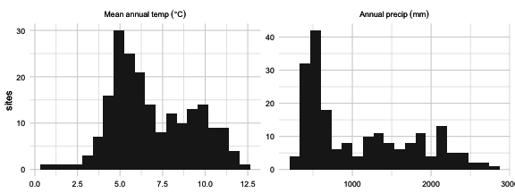
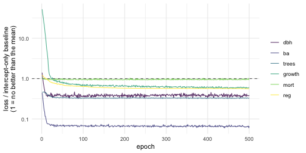
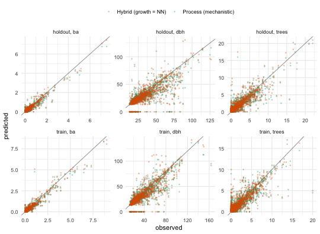
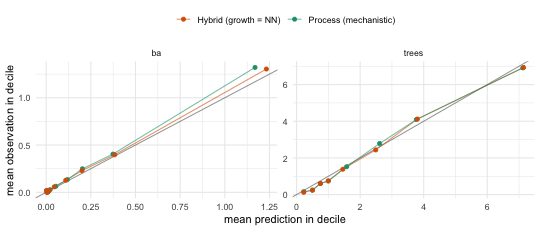
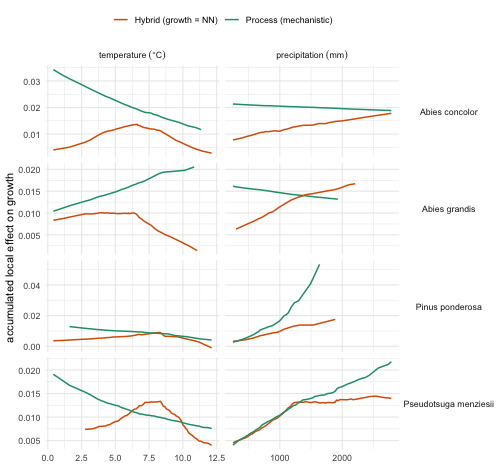

<style>
pre.summary-out, .summary-out pre { max-height: 22em; overflow: auto; }
</style>

Dynamic forest models are usually developed through a combination of encoding ecological knowledge into model structures and parameters. Usually the resulting parameters are then further refined by manual calibration procedures. Here we calibrate FINN directly from data: a subset of the US Forest Inventory & Analysis (FIA) program for Oregon, prepared exactly as in the **Preparing your data for FINN** vignette.

We fit FINN to 200 sites and evaluate on 200 **held-out** sites.

The calibration needs a torch backend and takes several minutes, so this
vignette is **precompiled**: the code was run once and its output committed with
it. The code you see is exactly the code that produced the output next to it.


``` r
library(FINN)
library(torch)
library(data.table)
library(ggplot2)

# Training length. Every epoch simulates the 20 years between the inventories
# for all 200 sites; the convergence section below shows the loss curves and how
# far the parameters still move.
EPOCHS <- 500L
```

## The data

The input tables are a seeded sample of 400 Oregon FIA plots with their
WorldClim climate, split into 200 sites to fit on and 200 holdout sites for
evaluation (`?fia_obs_dt`). A fitted FINN model should generalize to other
sites, so the holdout is a genuine out-of-sample test.


``` r
# The tables ship with FINN as datasets (?fia_obs_dt), already in FINN's input
# format, so there is nothing to read or prepare.

# --- training sites --------------------------------------------------------
obs_dt     <- fia_obs_dt        # observations, wide (one column per variable)
env_dt     <- fia_env_dt        # RAW, untransformed climate
init_trees <- fia_init_trees
species_dt <- fia_species_dt

# --- holdout sites: never seen during fitting ------------------------------
obs_test   <- fia_obs_test
env_test   <- fia_env_test
init_test  <- fia_init_test

# long form of the observations, so later we can match FINN's long predictions
# (sim$long$site) with a single merge()
resp  <- c("dbh", "ba", "trees", "growth", "mort", "reg")
to_long <- function(d) melt(d, id.vars = c("siteID", "year", "period_length", "species", "species_name"),
                            measure.vars = resp, variable.name = "variable", value.name = "obs",
                            variable.factor = FALSE)
obs_long  <- to_long(obs_dt)
test_long <- to_long(obs_test)

cat(sprintf("train: %d sites | holdout: %d sites | %d species | inventory years %s | env years %d-%d\n",
            uniqueN(obs_dt$siteID), uniqueN(obs_test$siteID), uniqueN(obs_dt$species),
            paste(sort(unique(obs_dt$year)), collapse = " & "), min(env_dt$year), max(env_dt$year)))
#> train: 200 sites | holdout: 200 sites | 11 species | inventory years 10 & 20 & 21 | env years 1-22
species_dt
#>     species            species_name
#>       <int>                  <char>
#>  1:       1   Pseudotsuga menziesii
#>  2:       2         Pinus ponderosa
#>  3:       3          Pinus contorta
#>  4:       4          Abies concolor
#>  5:       5           Abies grandis
#>  6:       6      Tsuga heterophylla
#>  7:       7       Tsuga mertensiana
#>  8:       8 Lithocarpus densiflorus
#>  9:       9             Alnus rubra
#> 10:      10          Abies amabilis
#> 11:      11                   other
```

FINN simulates the forest in **yearly steps**. The first inventory (2001-02) is
the starting state at year 0, and the two remeasurements are compared with the
simulated stand 10 and 20 years later; one site of each sample had its third
inventory a year or two late, at year 21 or 22. Each observation carries
`period_length`, the years since the previous inventory, and its growth and
mortality are **yearly** rates: `fit()` averages the simulated yearly rates over
those years, and sums the simulated recruits over them for `reg`. Because the
intervals differ between a few sites, `fit()` scores every site over its own
window, which it announces when it starts.


``` r
unique(obs_dt[, .(siteID, year, period_length)])[, .(sites = .N), by = .(year, period_length)]
#>     year period_length sites
#>    <int>         <int> <int>
#> 1:    10            10   200
#> 2:    20            10   199
#> 3:    21            11     1
```

The environment is supplied in **natural units**: with `env_autoscale = TRUE`
(the default) FINN z-standardizes the predictors internally and reuses the same
constants at prediction time, so raw values are all we ever pass. It has one row
per site and simulated year; the climate here is each plot's long-term normal,
the same in every year.


``` r
ggplot(melt(unique(env_dt[, c("siteID", "temp", "prec")]), id.vars = "siteID",
            measure.vars = c("temp", "prec")),
       aes(value)) +
  geom_histogram(bins = 20, fill = "grey40") +
  facet_wrap(~variable, scales = "free", labeller = as_labeller(
    c(temp = "Mean~annual~temp~(degree*C)", prec = "Annual~precip~(mm)"), label_parsed)) +
  labs(x = NULL, y = "sites") + theme_minimal()
```



Stand abundance, measured as total basal area per plot (summed over species),
against the temperature and precipitation gradients:


``` r
# total stand basal area per plot: sum over species, averaged over inventories
site_ba  <- obs_dt[, .(ba = sum(ba, na.rm = TRUE)), by = .(siteID, year)][
                   , .(ba = mean(ba)), by = siteID]
site_env <- env_dt[, .(temp = mean(temp), prec = mean(prec)), by = siteID]
grad <- melt(merge(site_ba, site_env, by = "siteID"),
             id.vars = c("siteID", "ba"), measure.vars = c("temp", "prec"),
             variable.name = "gradient")

ggplot(grad, aes(value, ba)) +
  geom_point(alpha = 0.4, size = 0.9, colour = "grey30") +
  geom_smooth(method = "loess", se = FALSE, colour = "firebrick", linewidth = 0.9) +
  facet_wrap(~gradient, scales = "free_x", labeller = as_labeller(
    c(temp = "Mean~annual~temp~(degree*C)", prec = "Annual~precip~(mm)"), label_parsed)) +
  labs(x = NULL, y = "Total basal area per plot") + theme_minimal()
```


## Initial cohorts

Each simulation starts from the observed first inventory. We build the starting
state for both samples, the holdout gets its own cohorts, from its own sites.


``` r
Nsp <- max(obs_dt$species)
init_cohorts      <- makeInitCohorts(init_trees, Nspecies = Nsp)
init_cohorts_test <- makeInitCohorts(init_test,  Nspecies = Nsp)
```


``` r
# shared colours for the two model variants, reused by the scatter and ALE panels
model_cols <- c("Process (mechanistic)" = "#1b9e77", "Hybrid (growth = NN)" = "#d95f02")
```

## Fit a Process-FINN

In the fully mechanistic configuration every process keeps its predefined form,
while its species and environmental parameters are learned (`optimize* = TRUE`)
and the formula chooses which environmental predictors enter the growth,
regeneration and mortality responses. The model is calibrated end-to-end by
gradient descent through the entire simulation.

The four processes are FINN's defaults, written out here only to give each a
formula: `regeneration_capped()` is the default regeneration, a recruitment
mean with a fitted carrying capacity `K` (see *The recruitment cap* below). All
six responses are fitted jointly in one `fit()` call with the default loss, and
this joint fit with the defaults is the calibration we recommend.

We pass **two** climate drivers rather than all six available. `~.` would use
every column, but the six are strongly collinear; `temp` and `tempmin` correlate
at r = 0.93, `prec` and `precwarmq` at 0.86, and two principal components carry
90% of the variance. Collinear predictors are not a problem for the *fit* (that is
what ALE is designed for), but they are a problem for the *interpretation* below:
two drivers that correlate at 0.93 have no separately identifiable response
curves, so calling each one a "niche" would be reading structure into an arbitrary
split. Two weakly-correlated drivers (r = 0.64) give curves that mean what the
text says they mean. Measured across three seeds on the earlier ten-year steps,
the cost was nothing on growth (0.56 vs 0.55 held out) and ~0.02 on basal area,
tree numbers and regeneration.


``` r
FINN.seed(42)
m <- finn(
  N_species            = uniqueN(obs_dt$species),
  recruits_dbh         = 12.9,   # DBH (cm) assigned to a new recruit; ~ FIA's 12.7 cm (5 in) minimum
  competition_process  = createProcess(~0, FINN::competition,  optimizeSpecies = TRUE),
  growth_process       = createProcess(~ temp + prec, FINN::growth,       optimizeSpecies = TRUE, optimizeEnv = TRUE),
  regeneration_process = createProcess(~ temp + prec, FINN::regeneration_capped, optimizeSpecies = TRUE, optimizeEnv = TRUE),
  mortality_process    = createProcess(~ temp + prec, FINN::mortality,    optimizeSpecies = TRUE, optimizeEnv = TRUE)
)
```

### Balancing the six losses

The objective is the sum of six terms, one per response, and their raw
magnitudes have nothing to do with each other: `dbh` is a squared error in
cm², `growth` a squared error on a ratio, `trees` a Poisson deviance. Before
anything is trained it is worth seeing what each term would contribute.
`fit(epochs = 0)` runs the set-up only, the data tensors, the intercept-only
baselines and the weights derived from them, and reports each response's share
of the objective; nothing is trained and the parameters stay as they were.


``` r
fit(m, env = env_dt, data = obs_dt, init_cohort = init_cohorts, epochs = 0L,
    patches = 4, patch_size = 0.06, plot_progress = FALSE)
#> ℹ Using per-site aggregation windows (one backward per batch): period_length varies between sites
#> ℹ weights: intercept-only baseline x your vector (dbh=0.00202, ba=3.9, trees=0.684, growth=1.91e+04, mortality=19, regeneration=0.588)
#> ℹ share of the objective at the intercept-only baseline (scaled): dbh=17%, ba=17%, trees=17%, growth=17%, mortality=17%, regeneration=17%
```

With the default `loss_weights = "auto"` every loss is divided by its own
intercept-only baseline, the loss of predicting the single best constant, so
each term starts at 1 and the six shares are equal. The baselines are kept in
`m$loss_baseline`, the weights in `m$loss_weights`.

A numeric `loss_weights` vector multiplies these scaled losses (since 0.2.0), so a
number reads directly as a share: `c(1, 1, 1, 2, 1, 1)` gives growth twice the
weight of every other response, and the report says so.


``` r
fit(m, env = env_dt, data = obs_dt, init_cohort = init_cohorts, epochs = 0L,
    patches = 4, patch_size = 0.06, plot_progress = FALSE,
    loss_weights = c(1, 1, 1, 2, 1, 1))
#> ℹ Using per-site aggregation windows (one backward per batch): period_length varies between sites
#> ℹ weights: intercept-only baseline x your vector (dbh=0.00202, ba=3.9, trees=0.684, growth=1.91e+04, mortality=19, regeneration=0.588)
#> ℹ share of the objective at the intercept-only baseline (scaled): dbh=14%, ba=14%, trees=14%, growth=29%, mortality=14%, regeneration=14%
```

`weight_scale = FALSE` applies the same vector to the unscaled losses, which is
what `weights` meant before 0.2.0 and what reproduces an analysis fitted with an
earlier version. The report is printed in that mode too, and it shows why the
scaling is the default:


``` r
fit(m, env = env_dt, data = obs_dt, init_cohort = init_cohorts, epochs = 0L,
    patches = 4, patch_size = 0.06, plot_progress = FALSE,
    loss_weights = c(1, 1, 1, 2, 1, 1), weight_scale = FALSE)
#> ℹ Using per-site aggregation windows (one backward per batch): period_length varies between sites
#> ℹ share of the objective at the intercept-only baseline (raw scale): dbh=99%, ba=0.052%, trees=0.29%, growth=4.2e-05%, mortality=0.011%, regeneration=0.34%
```

On the raw scale the diameter term is the objective and the nominal factor of
two on growth is a factor of two on a share that was already negligible. Read
the printed shares at the start of every fit; a response that holds a fraction
of a percent of the objective is a response the fit will not learn.

### The fit


``` r
fit(m,
  env         = env_dt,      # raw climate
  data        = obs_dt,
  init_cohort = init_cohorts,
  device      = "cpu",
  epochs      = EPOCHS,
  batchsize   = 40L,
  patches     = 4,
  patch_size  = 0.06,
  lr          = 0.01,
  env_autoscale   = TRUE,        # default
  checkpoints     = 50L,         # record every parameter every 50 epochs (m$param_history)
  plot_progress   = FALSE        # the convergence plot below is the readable one
)
```

## Replace growth with a neural network (Hybrid-FINN)

FINN's defining feature is that **any single demographic process can be swapped
from a mechanistic function to a neural network**, while the others stay
mechanistic, a *hybrid* model. The mechanistic processes keep the system
ecologically constrained; the network absorbs structure the fixed functional form
cannot express. Here we replace **growth** with a small neural network via
`createHybrid()`, leaving competition, regeneration and mortality mechanistic,
and refit on the same data with the **identical `fit()` call**.


``` r
FINN.seed(42)
m_hybrid <- finn(
  N_species            = uniqueN(obs_dt$species),
  recruits_dbh         = 12.9,
  competition_process  = createProcess(~0, FINN::competition,  optimizeSpecies = TRUE),
  growth_process       = createHybrid(~ temp + prec, hidden = c(20L, 20L), transformer = FALSE),  # NN replaces growth
  regeneration_process = createProcess(~ temp + prec, FINN::regeneration_capped, optimizeSpecies = TRUE, optimizeEnv = TRUE),
  mortality_process    = createProcess(~ temp + prec, FINN::mortality,    optimizeSpecies = TRUE, optimizeEnv = TRUE)
)
```


``` r
fit(m_hybrid,
  env = env_dt, data = obs_dt, init_cohort = init_cohorts, device = "cpu",
  epochs = EPOCHS, batchsize = 40L, patches = 4, patch_size = 0.06,
  lr = 0.01, env_autoscale = TRUE, plot_progress = FALSE
)
```

With both variants fitted, the rest of the vignette inspects and compares them:
training convergence, a `summary()` of the learned structure,
predicted-vs-observed fit, the learned niches, and the accumulated local effects
that reveal what the network learned.

## Training convergence

Both variants are trained the same way. Because the losses are scaled by their
intercept-only baselines, `m$history` can be read **per response** on one axis,
and the dashed line at 1 is a real reference: it is the intercept-only model, so a
curve below it means that response is predicted better than by its own mean.


``` r
hist_dt <- as.data.table(do.call(rbind, m$history))[, 1:6]
setnames(hist_dt, c("dbh", "ba", "trees", "growth", "mort", "reg"))
hist_dt[, epoch := .I]
ggplot(melt(hist_dt, id.vars = "epoch", variable.name = "response"),
       aes(epoch, value, colour = response)) +
  geom_hline(yintercept = 1, linetype = "dashed", colour = "grey40") +
  geom_line(alpha = 0.8) +
  scale_y_log10() +
  scale_colour_viridis_d() +
  labs(x = "epoch", y = "loss / intercept-only baseline\n(1 = no better than the mean)",
       colour = NULL) +
  theme_minimal()
```



The structural responses drop well below 1 within a few epochs. The per-tree rates
sit much closer to it; they are only weakly constrained by two inventories, which
is the honest picture and the reason for the caveat further down.

A flat loss is necessary for convergence, not sufficient: the objective can be
flat along a direction in which the parameters are still moving, which is what a
poorly identified parameter looks like. `checkpoints = 50` recorded every
parameter block every 50 epochs in `m$param_history` (with `folder = "<dir>"`
the whole model is also written there at each checkpoint, as
`epoch_<k>model.pt`, to resume from with `torch::torch_load()` and a further
`fit()`, or to compare). The largest step any parameter of a block took between
two consecutive checkpoints, on the unconstrained scale the optimiser works on:


``` r
ph <- m$param_history
steps <- rbindlist(lapply(seq_along(ph)[-1], function(i)
  data.table(epoch = i * 50L, block = names(ph[[i]]),
             max_step = sapply(names(ph[[i]]), function(nm)
               max(abs(ph[[i]][[nm]] - ph[[i - 1]][[nm]]))))))
dcast(steps[, max_step := round(max_step, 3)], block ~ epoch, value.var = "max_step")
#> Key: <block>
#>                             block   100   150   200   250   300   350   400
#>                            <char> <num> <num> <num> <num> <num> <num> <num>
#> 1:             nn_growth.0.weight 0.293 0.240 0.284 0.230 0.250 0.195 0.184
#> 2:          nn_mortality.0.weight 0.373 0.346 0.356 0.249 0.241 0.183 0.194
#> 3:       nn_regeneration.0.weight 1.128 0.732 0.659 0.598 0.439 0.335 0.294
#> 4:  par_competition_unconstrained 0.547 0.434 0.375 0.427 0.421 0.313 0.237
#> 5:       par_growth_unconstrained 1.099 0.331 0.554 0.452 0.540 0.418 0.330
#> 6:    par_mortality_unconstrained 0.225 0.245 0.192 0.171 0.143 0.116 0.101
#> 7: par_regeneration_unconstrained 1.007 1.188 0.936 1.340 0.797 0.494 0.395
#> 8:         par_theta_recruits_raw 0.000 0.000 0.000 0.000 0.000 0.000 0.000
#> 9:                       reg_logK 0.006 0.001 0.003 0.000 0.003 0.005 0.003
#>      450   500
#>    <num> <num>
#> 1: 0.186 0.177
#> 2: 0.197 0.181
#> 3: 0.274 0.258
#> 4: 0.158 0.250
#> 5: 0.296 0.277
#> 6: 0.125 0.141
#> 7: 0.374 0.556
#> 8: 0.000 0.000
#> 9: 0.002 0.000
```

At a constant learning rate no block comes to rest: every parameter group but the
recruitment cap still steps by one to a few tenths between checkpoints while the losses have been flat for
hundreds of epochs. Part of that is the jitter of mini-batch Adam, which a
learning-rate schedule (`control = finnControl(lr_scheduler = "step")` or `"cosine"`) damps at the
end of a fit; the rest is drift along directions the objective does not care
about, and the regeneration blocks, which step most over the first 200 epochs,
are the first suspects. Two seeds, or two checkpoints, compared on the holdout
tell whether the drift reaches the predictions.

## What the model learned: `summary()`

`summary()` gives a compact overview of the *learned structure*: for each process
and species it reports how important each environmental predictor is (ALE-variance
importance, rate-normalised) and its average conditional effect. It reuses the
cached conditional effects, so once `ALE()` (below) or a previous `summary()` has
run it needs no further simulation.


``` r
summary(m)
FINN model summary
==================

### GROWTH

Analytical ALE importance (rate-normalised) (species in columns):
 variable    sp1   sp2    sp3     sp4     sp5    sp6   sp7   sp8     sp9  sp10
     prec 0.1334 5.758 0.0639 0.00531 0.00531 0.0134 0.147 3.758 0.00698 23.26
     temp 0.0174 0.018 0.1147 0.08261 0.04289 0.4398 0.998 0.754 0.47231  1.29
   sp11
 0.2381
 0.0557

Average conditional effects (mean; species in columns):
 variable      sp1       sp2      sp3      sp4      sp5     sp6     sp7
     prec  0.00295  0.010574 -0.00289  0.00127 -0.00081 0.00217 0.00198
     temp -0.00116 -0.000769  0.00329 -0.00343  0.00197 0.01390 0.00567
      sp8       sp9     sp10     sp11
 -0.00509  0.000795 -0.01792  0.00381
 -0.00627 -0.006425  0.00319 -0.00177

### MORTALITY

Analytical ALE importance (rate-normalised) (species in columns):
 variable   sp1    sp2   sp3   sp4   sp5   sp6    sp7  sp8    sp9   sp10
     prec 0.735 0.0377 5.151 1.371 0.694 0.115 1.2228 3.36 0.0533 0.0535
     temp 0.705 1.0891 0.448 0.687 4.308 0.248 0.0488 1.77 0.0895 0.0170
     sp11
 0.000154
 0.051958

Average conditional effects (mean; species in columns):
 variable      sp1       sp2    sp3      sp4     sp5      sp6      sp7      sp8
     temp  0.00796  0.004942 0.0048 -0.00377  0.0209 -0.00158 -0.00322 -0.00718
     prec -0.00696 -0.000987 0.0113  0.00537 -0.0120  0.00115 -0.01436  0.00448
     sp9     sp10      sp11
 0.00685 -0.00787 -0.001805
 0.00479 -0.00343 -0.000103

### REGENERATION

Analytical ALE importance (rate-normalised) (species in columns):
 variable    sp1    sp2   sp3     sp4    sp5     sp6   sp7  sp8   sp9  sp10
     prec 0.0585 0.9499 0.173 0.90135 0.0881 1.06325 0.213 0.58 0.988 0.958
     temp 0.8215 0.0903 0.790 0.00818 1.0315 0.00106 1.008 1.43 0.658 0.427
  sp11
 1.369
 0.207

Average conditional effects (mean; species in columns):
 variable    sp1     sp2    sp3      sp4    sp5      sp6    sp7    sp8    sp9
     prec 0.0688 -0.6008 -0.351 -0.11654 -0.118  0.27031  0.212 0.0145 0.1235
     temp 0.2875  0.0918 -0.424 -0.00863 -0.214 -0.00773 -0.278 0.0317 0.0942
   sp10    sp11
  0.261  0.1434
 -0.183 -0.0559
```

The niche and ALE sections below unpack this overview into per-driver response
*curves*.

## Assess the fit: in-sample and on held-out sites

The fit was calibrated on the 200 training sites, so scoring it there only tells
us how well it *reproduces* them. The honest question is whether it transfers, so
we simulate each model twice, once on the training sites, once on the 200
held-out sites, and score both with **Spearman correlation** (rank agreement)
and **RMSE** (in each response's own units), matched on site × year × species.

The simulation runs in yearly steps, so a prediction is put together the way
`fit()` compares it with an inventory: the stand (`dbh`, `ba`, `trees`) at the
year of the census, the yearly growth and mortality rates of the
`period_length` years before it compounded into one rate per year -- the
geometric mean of `1 + g` minus one, and one minus the geometric mean survival,
the functional `makeObsData()` derives the observed rates with -- and the
expected recruits per hectare (`r_mean_ha`) summed over those years.


``` r
# the simulated counterpart of every observation, as fit() scores it
at_census <- function(site, obs_l) {
  win <- unique(obs_l[, .(siteID, census = year, period_length)])
  win <- win[, .(year = seq(census - period_length + 1L, census)), by = .(siteID, census)]
  s <- merge(site[, .(siteID, year, species, variable = as.character(variable), value)],
             win, by = c("siteID", "year"))
  rbindlist(list(
    s[variable %in% c("dbh", "ba", "trees") & year == census,
      .(siteID, year = census, species, variable, value)],
    s[variable == "growth",
      .(value = exp(mean(log1p(value))) - 1), by = .(siteID, year = census, species, variable)],
    s[variable == "mort",
      .(value = 1 - exp(mean(log1p(-pmin(value, 1 - 1e-4))))), by = .(siteID, year = census, species, variable)],
    s[variable == "r_mean_ha",
      .(variable = "reg", value = sum(value)), by = .(siteID, year = census, species)]
  ), use.names = TRUE)
}

# One prediction pass per model x sample. The holdout is driven only by its own
# environment and starting cohorts; nothing about it entered the fit.
pred_of <- function(model, label, env, init, obs_l, split) {
  model$eval()                                   # deterministic: dropout off
  sim <- predict(model, env = env, init_cohort = init,
                 patches = 4, patch_size = 0.06, device = "cpu")
  merge(obs_l, at_census(sim$long$site, obs_l), by = c("siteID", "year", "species", "variable"
  ))[, `:=`(model = label, split = split)][]
}
FINN.seed(1)
obs_pred <- rbind(
  pred_of(m,        "Process (mechanistic)", env_dt,   init_cohorts,      obs_long,  "train"),
  pred_of(m,        "Process (mechanistic)", env_test, init_cohorts_test, test_long, "holdout"),
  pred_of(m_hybrid, "Hybrid (growth = NN)",  env_dt,   init_cohorts,      obs_long,  "train"),
  pred_of(m_hybrid, "Hybrid (growth = NN)",  env_test, init_cohorts_test, test_long, "holdout"))

metrics <- obs_pred[is.finite(obs) & is.finite(value),
                    .(spearman = round(cor(obs, value, method = "spearman"), 2),
                      rmse     = round(sqrt(mean((obs - value)^2)), 2),
                      n        = .N), by = .(model, split, variable)]

comparison <- dcast(metrics, variable + model ~ split, value.var = c("spearman", "rmse"))
setcolorder(comparison, c("variable", "model", "spearman_train", "spearman_holdout",
                          "rmse_train", "rmse_holdout"))
comparison[order(variable, model)]
#> Key: <variable, model>
#>     variable                 model spearman_train spearman_holdout rmse_train
#>       <char>                <char>          <num>            <num>      <num>
#>  1:       ba  Hybrid (growth = NN)           0.80             0.80       0.12
#>  2:       ba Process (mechanistic)           0.80             0.80       0.13
#>  3:      dbh  Hybrid (growth = NN)           0.81             0.72      13.38
#>  4:      dbh Process (mechanistic)           0.81             0.76      13.50
#>  5:   growth  Hybrid (growth = NN)           0.60             0.53       0.01
#>  6:   growth Process (mechanistic)           0.58             0.57       0.01
#>  7:     mort  Hybrid (growth = NN)           0.21             0.06       0.11
#>  8:     mort Process (mechanistic)           0.20             0.03       0.10
#>  9:      reg  Hybrid (growth = NN)           0.38             0.40       6.19
#> 10:      reg Process (mechanistic)           0.41             0.41       6.16
#> 11:    trees  Hybrid (growth = NN)           0.78             0.78       0.76
#> 12:    trees Process (mechanistic)           0.78             0.78       0.76
#>     rmse_holdout
#>            <num>
#>  1:         0.09
#>  2:         0.10
#>  3:        14.71
#>  4:        13.91
#>  5:         0.01
#>  6:         0.01
#>  7:         0.09
#>  8:         0.09
#>  9:         6.10
#> 10:         6.04
#> 11:         0.79
#> 12:         0.78
```


The structural variables (basal area, tree numbers and diameter) are
reconstructed well, **and hold up on sites the model never saw**: that gap
between the train and holdout columns is the part that matters, because it is
the only evidence that the fitted processes generalise rather than memorise.
The noisier per-tree rates (growth, mortality, regeneration) are harder to
constrain from two inventories and should be read with that in mind (see the
caveat below). The hybrid tracks the mechanistic model on the structural
variables, with **no growth equation specified**, which is what makes hybrids
useful when a process's form is uncertain; the surrounding mechanistic processes
still anchor the model ecologically.


``` r
# facet_wrap, NOT facet_grid: the three responses live on completely different
# scales (dbh ~150 cm, ba ~8 m2, trees ~20). facet_grid(scales = "free") frees x
# per column but y per ROW, so ba and trees would be drawn on dbh's y-axis -
# squashing them onto y = 0 and flattening the 1:1 line until a good fit looks
# like a broken one. facet_wrap frees both axes per panel.
ggplot(obs_pred[variable %in% c("dbh", "ba", "trees") & is.finite(obs)],
       aes(obs, value, colour = model)) +
  geom_abline(slope = 1, intercept = 0, colour = "grey40", linewidth = 0.3) +
  geom_point(alpha = 0.25, size = 0.5) +
  facet_wrap(~ split + variable, scales = "free", ncol = 3,
             labeller = labeller(.multi_line = FALSE)) +
  scale_colour_manual(values = model_cols) +
  labs(x = "observed", y = "predicted", colour = NULL) +
  theme_minimal() + theme(legend.position = "top")
```



Each panel is on its **own** axes, and the grey line is 1:1, so the diagonal is
the target in every panel regardless of the units on it.

> **A caveat on the rate variables.** `growth`, `mort` and `reg` are per-tree
> rates and are only weakly constrained by two inventories, so their Spearman is
> a **noisy estimate**; refitting with a different random seed moves it by a few
> hundredths. Differences of that size between the models should not be
> over-read; the structural variables, estimated from far more information, are
> what carry the comparison. `mort` is the extreme case and gets a vignette of
> its own (**Mortality: a binomial response and a neural-network process**)
> because rank correlation is the wrong tool for a response that is mostly zeros.

### Score what the loss scores

The merge above is on site × year × species, which is the cell the loss is
computed on: `fit()` compares the patch-mean of each site, year and species with
the observation, and so does the table. Aggregating the predictions differently
before scoring (summing species to a stand total, averaging the two censuses,
pooling sites into regions) asks a different and usually easier question, and
the number it returns is not the skill of the fitted objective. If a stand total
is what matters, score it as well, but say so; and for a count-weighted response
weight the metric the way the loss does. The mortality vignette carries this
through for the binomial term, whose AUC is weighted by `n_at_risk` exactly as
the likelihood is.

### A model-free reference: persistence

A Spearman of 0.8 on basal area sounds good until it is compared with the
simplest forecast available: the previous census of the same site and species,
unchanged. On a ten-year interval that *persistence* forecast is strong for the
state variables, and a model has to beat it before it can claim to have learned
dynamics rather than inertia. The second census of the holdout sites predicted
by the first, next to the two models scored on the same cells:


``` r
# the first remeasurement (year 10) stands in as the prediction for the second
# (year 20, or 21/22 where it came late)
persist <- merge(test_long[year > 10],
                 test_long[year == 10, .(siteID, species, variable, value = obs)],
                 by = c("siteID", "species", "variable"))
ref <- rbind(persist[, .(siteID, species, variable, obs, value, model = "Persistence (year 10 as is)")],
             obs_pred[split == "holdout" & year > 10, .(siteID, species, variable, obs, value, model)])
ref[variable %in% c("dbh", "ba", "trees") & is.finite(obs) & is.finite(value),
    .(spearman = round(cor(obs, value, method = "spearman"), 2),
      rmse     = round(sqrt(mean((obs - value)^2)), 2)),
    by = .(variable, model)][order(variable, model)]
#>    variable                       model spearman  rmse
#>      <char>                      <char>    <num> <num>
#> 1:       ba        Hybrid (growth = NN)     0.77  0.11
#> 2:       ba Persistence (year 10 as is)     0.96  0.08
#> 3:       ba       Process (mechanistic)     0.77  0.12
#> 4:      dbh        Hybrid (growth = NN)     0.66 16.14
#> 5:      dbh Persistence (year 10 as is)     0.91  6.79
#> 6:      dbh       Process (mechanistic)     0.70 15.27
#> 7:    trees        Hybrid (growth = NN)     0.75  0.93
#> 8:    trees Persistence (year 10 as is)     0.96  0.60
#> 9:    trees       Process (mechanistic)     0.75  0.93
```

Persistence wins on all three state variables, and not narrowly. That is the
expected result for a ten-year interval in mature stands: most of the basal area
present at the second census was already there at the first, and the models
are at a disadvantage here, they start from the year-0 tree list and never see
the year-10 census, so their year-20 prediction carries twenty simulated years
of compounded error. The lesson is not that the models are poor but
that a holdout Spearman on `dbh`, `ba` or `trees` is mostly a statement about
the initial cohorts. The processes are tested by the rates, and by what the
model does over horizons where persistence has nothing to say, the
**Simulating succession** vignette. Persistence has no prediction for the first
remeasurement, which is why the table scores the second only.

### Calibration: predicted against observed by decile

A scatter shows the spread; it hides a systematic bias of the kind a fitted
model develops when it compresses towards the mean. Binning the predictions into
deciles and comparing the mean prediction of each bin with the mean observation
in it is the calibration view, and it is cheap. Cells in which the species is
absent from both the observation and the prediction are left out: they are most
of the table and would pile the lower deciles onto zero.


``` r
calib <- obs_pred[split == "holdout" & variable %in% c("ba", "trees") & is.finite(obs) &
                  (obs > 0 | value > 0)]
calib[, bin := cut(value, unique(quantile(value, 0:10 / 10)), include.lowest = TRUE),
      by = .(model, variable)]
calib_dt <- calib[, .(pred = mean(value), obs = mean(obs), n = .N), by = .(model, variable, bin)]
ggplot(calib_dt, aes(pred, obs, colour = model)) +
  geom_abline(slope = 1, intercept = 0, colour = "grey40", linewidth = 0.3) +
  geom_line(alpha = 0.6) + geom_point(size = 1.6) +
  facet_wrap(~variable, scales = "free") +
  scale_colour_manual(values = model_cols) +
  labs(x = "mean prediction in decile", y = "mean observation in decile", colour = NULL) +
  theme_minimal() + theme(legend.position = "top")
```



Points on the diagonal are calibrated; a slope below one means the model
under-predicts the dense stands and over-predicts the sparse ones, a slope above
one the reverse. A rank correlation is blind to either.

### A blocked holdout

The 200 holdout sites are a random draw from the same region as the training
sites, so every holdout site has training neighbours in climate space, and
nearly so in geographic space. That split measures interpolation. The question
usually asked of a calibrated model, how it does in conditions or places it was
not trained on, needs a holdout that is *blocked*: with coordinates, hold out
whole spatial blocks (grid cells, or clusters of plots); without them, hold out
a block of the environmental gradient. The bundled sample carries no
coordinates, so the block here is environmental, but the recipe is the same.
We hold out the warmest fifth of the training sites, fit the same model on the
other 160, and score it on the 40 blocked sites and, for comparison, on the 200
random holdout sites.


``` r
site_temp <- env_dt[, .(temp = mean(temp)), by = siteID]
warm      <- site_temp[temp > quantile(temp, 0.8), siteID]      # the blocked holdout
cool      <- setdiff(site_temp$siteID, warm)                    # the training block

FINN.seed(42)
m_block <- finn(
  N_species            = Nsp, recruits_dbh = 12.9,
  competition_process  = createProcess(~0, FINN::competition,  optimizeSpecies = TRUE),
  growth_process       = createProcess(~ temp + prec, FINN::growth,       optimizeSpecies = TRUE, optimizeEnv = TRUE),
  regeneration_process = createProcess(~ temp + prec, FINN::regeneration_capped, optimizeSpecies = TRUE, optimizeEnv = TRUE),
  mortality_process    = createProcess(~ temp + prec, FINN::mortality,    optimizeSpecies = TRUE, optimizeEnv = TRUE)
)
fit(m_block,
  env = env_dt[siteID %in% cool], data = obs_dt[siteID %in% cool],
  init_cohort = makeInitCohorts(init_trees[siteID %in% cool], Nspecies = Nsp),
  device = "cpu", epochs = EPOCHS, batchsize = 40L, patches = 4, patch_size = 0.06,
  lr = 0.01, plot_progress = FALSE
)
```


``` r
FINN.seed(1)
blocked <- rbind(
  pred_of(m_block, "random holdout (200 sites)", env_test, init_cohorts_test, test_long, "holdout"),
  pred_of(m_block, "blocked holdout (40 warmest sites)", env_dt[siteID %in% warm],
          makeInitCohorts(init_trees[siteID %in% warm], Nspecies = Nsp),
          obs_long[siteID %in% warm], "holdout"))
blocked[variable %in% c("dbh", "ba", "trees", "growth") & is.finite(obs) & is.finite(value),
        .(spearman = round(cor(obs, value, method = "spearman"), 2),
          rmse     = round(sqrt(mean((obs - value)^2)), 2), n = .N),
        by = .(variable, holdout = model)][order(variable, holdout)]
#>    variable                            holdout spearman  rmse     n
#>      <char>                             <char>    <num> <num> <int>
#> 1:       ba blocked holdout (40 warmest sites)     0.75  0.22   880
#> 2:       ba         random holdout (200 sites)     0.79  0.09  4400
#> 3:      dbh blocked holdout (40 warmest sites)     0.82 20.77   195
#> 4:      dbh         random holdout (200 sites)     0.72 15.52  1048
#> 5:   growth blocked holdout (40 warmest sites)     0.42  0.01   187
#> 6:   growth         random holdout (200 sites)     0.52  0.01  1000
#> 7:    trees blocked holdout (40 warmest sites)     0.73  1.18   880
#> 8:    trees         random holdout (200 sites)     0.77  0.81  4400
```

The blocked rows are the transfer skill, and they are the ones to report when
the model is meant to be applied beyond the sampled conditions. Here the rank
correlations of the state variables hold up on the warm block (growth's drops
from 0.52 to 0.42) while the errors do not: the basal-area RMSE more than doubles and the
stem error rises by more than a third (the growth RMSE, a yearly rate, does not
move at two decimals). The model orders the warm sites but misplaces their
level, which is what
an environmental response that is extrapolating looks like, and a random
holdout cannot show it. It is also the reason to keep the climate formula
small: a response curve fitted to two collinear drivers can fit the training
block and still extrapolate in opposite directions.

## Scoring mortality per tree

The mortality term above compares the mean death probability over the simulated
cohorts of a site, census and species with the pooled rate of the inventory. That
mean carries a compositional confound: mortality changes several-fold from the
smallest to the largest trees, so the cell mean moves whenever the simulated size
distribution moves, whether or not the hazard function is right. The bundled
sample carries every tree behind those counts, `fia_tree_dt` and
`fia_tree_test`: one row per tree alive at the start of an interval, with its
diameter then and its fate. With `loss_aggregation = c(mortality = "tree")` the
mortality term is scored on these trees instead, each at its measured diameter
with the light of the observed stand, against its 0/1 fate (see `?finn_loss`,
*Scoring individual trees*). Everything else stays as in the mechanistic fit.


``` r
FINN.seed(42)
m_tree <- finn(
  N_species            = uniqueN(obs_dt$species),
  recruits_dbh         = 12.9,
  competition_process  = createProcess(~0, FINN::competition,  optimizeSpecies = TRUE),
  growth_process       = createProcess(~ temp + prec, FINN::growth,       optimizeSpecies = TRUE, optimizeEnv = TRUE),
  regeneration_process = createProcess(~ temp + prec, FINN::regeneration_capped, optimizeSpecies = TRUE, optimizeEnv = TRUE),
  mortality_process    = createProcess(~ temp + prec, FINN::mortality,    optimizeSpecies = TRUE, optimizeEnv = TRUE)
)
fit(m_tree,
  env = env_dt, data = obs_dt, init_cohort = init_cohorts, device = "cpu",
  epochs = EPOCHS, batchsize = 40L, patches = 4, patch_size = 0.06, lr = 0.01,
  loss_aggregation = c(mortality = "tree"),   # the mortality term on the observed trees
  tree_data        = fia_tree_dt,
  plot_progress    = FALSE
)
```

`predictTrees()` runs the same per-tree code path on any tree list, so both
fits are scored on the holdout trees the same way: the probability that each
of the 10,109 holdout trees dies over its interval, against what happened to
it. The AUC needs no weighting here, every tree is one trial. `predictTrees()`
needs `env` for exactly the sites in `tree_data`; two holdout sites have no
tallied tree at risk, so their climate rows are left out.


``` r
auc_binom <- function(p, pos, neg) {
  g <- data.table(p = p, pos = pos, neg = neg)[, .(pos = sum(pos), neg = sum(neg)), by = p][order(p)]
  neg_below <- cumsum(g$neg) - g$neg
  den <- sum(g$pos) * sum(g$neg)
  if (den == 0) return(NA_real_)
  sum(g$pos * (neg_below + 0.5 * g$neg)) / den
}
m$eval(); m_tree$eval()
env_tree <- env_test[siteID %in% fia_tree_test$siteID]   # the sites that have trees at risk
tree_pred <- function(model, label)
  cbind(fia_tree_test, model = label,
        mort_pred = predictTrees(model, tree_data = fia_tree_test, env = env_tree, patch_size = 0.06)$mort_pred)
tp <- rbind(tree_pred(m, "site-level mortality"), tree_pred(m_tree, "per-tree mortality"))
tp[, .(trees = .N, deaths = sum(died), AUC = round(auc_binom(mort_pred, died, 1 - died), 3)), by = model]
#>                   model trees deaths   AUC
#>                  <char> <int>  <num> <num>
#> 1: site-level mortality 10109    734 0.573
#> 2:   per-tree mortality 10109    734 0.603
```

Both fits rank the holdout trees alike, AUC 0.57 and 0.60: on this sample the
per-tree term buys little ranking skill, which is the picture of the mortality
vignette, where two censuses carry little transferable mortality signal.

Where the two differ is in the size classes. Predicted and observed yearly
mortality of the holdout trees by diameter at the start of the interval, in
percent per year (a tree's interval probability `p` over `period_length` years
is the yearly rate `1 - (1 - p)^(1 / period_length)`):


``` r
annual <- function(p, years) 1 - (1 - p)^(1 / years)
tp[, dbh_class := cut(dbh, c(0, 20, 30, 45, 61, 80, 100, Inf),
                      labels = c("13-20", "20-30", "30-45", "45-61", "61-80", "80-100", ">100"))]
observed <- tp[model == "per-tree mortality",
               .(trees = .N, deaths = sum(died),
                 observed = round(100 * annual(mean(died), mean(period_length)), 2)), by = dbh_class]
predicted <- dcast(tp[, .(pred = round(100 * mean(annual(mort_pred, period_length)), 2)), by = .(dbh_class, model)],
                   dbh_class ~ model, value.var = "pred")
merge(observed, predicted, by = "dbh_class")[order(dbh_class)]
#> Key: <dbh_class>
#>    dbh_class trees deaths observed per-tree mortality site-level mortality
#>       <fctr> <int>  <num>    <num>              <num>                <num>
#> 1:     13-20  3593    338     0.98               0.83                 1.70
#> 2:     20-30  2866    201     0.72               0.84                 1.08
#> 3:     30-45  1618     93     0.59               0.81                 0.97
#> 4:     45-61   553     34     0.63               0.70                 0.72
#> 5:     61-80   812     45     0.57               0.56                 0.54
#> 6:    80-100   450     16     0.36               0.51                 0.45
#> 7:      >100   217      7     0.33               0.31                 0.22
```

The site-level fit reproduces the pooled rate of a cell and leaves the shape
over size to the simulated size distribution: it predicts nearly twice the
observed mortality of the trees below 20 cm (1.7 against 1.0 % a year) and
about two thirds of that of the trees above 100 cm (0.22 against 0.33 %), the
large-tree arm of the size response that site-level rates leave unidentified.
Scored per tree, the same hazard function stays within a factor of 1.5 of the
observation in every class and meets it above 100 cm (0.31 against 0.33 %).
What the route does not buy here is calibration overall: the per-tree fit
predicts more deaths than the holdout saw between 20 and 45 cm, and the
site-level fit in every class below 45 cm.

## The recruitment cap, and why stem counts hinge on a few bursts

Regeneration is the response with the least information in it: 87% of the
site × census × species cells record no recruit at all, and a recruit enters at
12.9 cm, so over a ten-year interval it adds little to basal area. The
unbounded mechanistic mean rises as `exp(env)`, so a steep climate coefficient
could turn a warm, wet site into a burst of hundreds of stems in one year. The
default `regeneration_capped()` bounds it with a Beverton-Holt cap,
`K m / (K + m)`: one carrying capacity `K` (stems per hectare and year) shared by
all species, started at the largest observed recruitment per hectare and year
and held near it by a weak prior, then fitted with everything else
(`?regeneration_capped`; `?recruitment` lists the options). The fitted cap of
the joint model:


``` r
# the fitted carrying capacity, recruits per hectare and year
exp(as.numeric(m$reg_logK))
#> [1] 14.57163
```

Here `K` stays at its start, 14.6 recruits per hectare and year, and it does
not bind: the largest expected recruitment of any site and species over a whole
census interval is about 36 per hectare (the table below), under 4 a year. On
this sample the cap is a guard rail that the climate response never reaches.

The stem count deserves a closer look, because its skill is the least stable of
the three state variables. Recruits are *sampled* at prediction time
(`createProcess(sample_regeneration = TRUE)`, the default), so a cell whose
expected recruitment is large can receive a burst in one simulation and nothing
in the next. The same model predicted five times with different seeds:


``` r
reps <- rbindlist(lapply(1:5, function(s) {
  FINN.seed(s)
  pred_of(m, "Joint", env_test, init_cohorts_test, test_long, "holdout")[, seed := s]
}))
trees_by_seed <- reps[variable == "trees" & is.finite(obs),
  .(spearman = round(cor(obs, value, method = "spearman"), 3),
    rmse     = round(sqrt(mean((obs - value)^2)), 3)), by = seed]
trees_by_seed
#>     seed spearman  rmse
#>    <int>    <num> <num>
#> 1:     1    0.771 0.785
#> 2:     2    0.780 0.775
#> 3:     3    0.777 0.783
#> 4:     4    0.768 0.779
#> 5:     5    0.783 0.783

# which cells carry the stem error? those whose predicted recruitment is in the
# top 1 % of the same simulation
burst <- merge(reps[variable == "trees", .(siteID, year, species, seed, obs, trees = value)],
               reps[variable == "reg",   .(siteID, year, species, seed, reg = value)],
               by = c("siteID", "year", "species", "seed"))
burst <- burst[is.finite(obs)]
burst[, top := reg >= quantile(reg, 0.99), by = seed]
total_sq_error <- burst[, sum((obs - trees)^2)]
burst[, .(cells = .N, share_of_sq_error = round(sum((obs - trees)^2) / total_sq_error, 2),
          max_reg = round(max(reg), 1)), by = .(top_1pct_recruitment = top)]
#>    top_1pct_recruitment cells share_of_sq_error max_reg
#>                  <lgcl> <int>             <num>   <num>
#> 1:                FALSE 21780              0.84    11.3
#> 2:                 TRUE   220              0.16    35.8
```

The 1 % of cells with the largest predicted recruitment carry about a sixth of
the squared stem error, and the seed-to-seed spread in the stem metrics
is the same mechanism at work: a site that receives a burst in one draw and not
in the next. That is why a single stems R² on a holdout should not decide
between two models whose regeneration differs; compare several seeds, or score
the *expected* stand (`sample_regeneration = FALSE` at prediction time), and
look at the largest predicted recruitment, the tail the cap acts on.


## Interpreting the growth process with ALE

`ALE()` returns the **accumulated local effect** of every driver on each process,
the effect measure of choice when predictors are correlated, because it
accumulates *local* changes within the observed data instead of extrapolating to
unrealistic combinations. Running it on **both** fitted models lets us read what
growth responds to *and* compare the mechanistic process with the neural-network
hybrid, across growth's **structural** inputs (tree size, light) and its
**environmental niche** (climate). It returns one table per process (`growth`,
`mortality`, `regeneration`); we use the growth table of each model.


``` r
FINN.seed(1)
ale_proc <- ALE(m,        env_dt, init_cohorts, plot = FALSE)   # mechanistic growth
ale_hyb  <- ALE(m_hybrid, env_dt, init_cohorts, plot = FALSE)   # growth = NN

# one tidy table with both variants. Environmental drivers come back on the
# model's scaled axis, so back-transform temp/prec to natural units (deg C, mm);
# the structural drivers (dbh, light) are already on their natural axes.
to_natural <- function(a, model) {
  sc <- as.data.table(model$env_scaling)[, .(var = variable, center, scale)]
  merge(data.table(a), sc, by = "var", all.x = TRUE)[!is.na(center), x := x * scale + center]
}
growth <- rbind(
  to_natural(ale_proc$growth, m)[,        model := "Process (mechanistic)"],
  to_natural(ale_hyb$growth,  m_hybrid)[, model := "Hybrid (growth = NN)"])
growth <- merge(growth, species_dt, by = "species")
```

One helper plots the growth ALE of both variants for any set of drivers, one
panel per species × driver, with **independent axes** so responses of very
different magnitude stay legible side by side:


``` r
plot_growth_ale <- function(vars, labs) {
  d <- growth[var %in% vars & species %in% c(1, 2, 4, 5)]   # the four focal species
  d[, var := factor(var, levels = names(labs))]
  ggplot(d, aes(x, ale, colour = model)) +
    geom_line(linewidth = 0.7) +
    facet_grid(species_name ~ var, scales = "free",
               labeller = labeller(var = as_labeller(labs, label_parsed),
                                    species_name = label_value)) +
    scale_colour_manual(values = model_cols) +
    labs(x = NULL, y = "accumulated local effect on growth", colour = NULL) +
    theme_minimal() + theme(legend.position = "top", strip.text.y = element_text(angle = 0))
}
```

### Environmental niches

Because the environmental responses are learned rather than prescribed, each
curve is an inferred **niche**, how a species' growth scales along a climate
gradient. Growth rises with precipitation in most curves, steeply for ponderosa
pine and Douglas fir. The temperature responses differ between the two models:
monotone in the mechanistic process, single-peaked with an optimum in the middle
of the sampled range in the network.

Read these as *illustrations of what ALE recovers*, not as settled ecology. The
per-species shapes are noisier than the structural responses below; growth is
weakly constrained by two inventories (see the caveat above), and the mechanistic
and hybrid curves do not always agree, even on the sign of a response. That
disagreement is itself informative: where two models trained on the same data
diverge, the data are not pinning that response down.


``` r
plot_growth_ale(c("temp", "prec"),
                c(temp = "temperature~(degree*C)", prec = "precipitation~(mm)"))
```



### Which drivers matter: `feature_importance()`

The niches show the *shape* of each response; `feature_importance()` gives its
*magnitude*. It permutes each environmental predictor and re-simulates, measuring
the resulting increase in prediction error, a re-simulation counterpart to the
analytical importance in `summary()`. Below we read off the importances for the
growth process of the four focal species:


``` r
FINN.seed(1)
fi <- feature_importance(m, env_dt, init_cohorts, nperm = 20L, seed = 1L,
                         patches = 4, patch_size = 0.06, device = "cpu")
fimp_growth <- merge(data.table(fi$growth)[species %in% c(1, 2, 4, 5)],
                     species_dt, by = "species")
```


``` r
ggplot(fimp_growth, aes(reorder(variable, importance), importance, fill = importance)) +
  geom_col() +
  coord_flip() +
  facet_wrap(~species_name, nrow = 1) +
  scale_fill_viridis_c(guide = "none") +
  labs(x = NULL, y = "permutation importance (delta error)") + theme_minimal()
```


Ponderosa pine leans on precipitation, three times as much as on temperature;
for the other three species the two drivers matter about equally. The
importances are learned per species, not shared.

### Response to size and light: did the network recover the mechanistic form?

The point of a hybrid is to ask which functional form the neural network learned
and how it *compares* to the mechanistic function it replaced. Here the two agree
on the response the data constrain best: growth **declines with tree size** for
every species, and the network recovered that shape without being given the
functional form. Light is less clear. In the mechanistic process growth
**increases with light availability** for every species; the network finds that
rise for ponderosa pine and Douglas fir at high light and an almost flat
response for the two firs. The size response says the mechanistic form was a
reasonable choice; where the light curves part, the data do not pin the
response down.


``` r
plot_growth_ale(c("dbh", "light"),
                c(dbh = "diameter~(cm)", light = "light~availability"))
```


Each curve spans only the range its *own* model actually simulates (ALE never
extrapolates), so where the process and hybrid cover different ranges, as for
*Abies grandis* light, the two models simply place that species in different
conditions; the mismatch is information, not an artefact.


``` r
sessionInfo()
#> R version 4.5.0 (2025-04-11)
#> Platform: aarch64-apple-darwin20
#> Running under: macOS 26.5.1
#> 
#> Matrix products: default
#> BLAS:   /Library/Frameworks/R.framework/Versions/4.5-arm64/Resources/lib/libRblas.0.dylib 
#> LAPACK: /Library/Frameworks/R.framework/Versions/4.5-arm64/Resources/lib/libRlapack.dylib;  LAPACK version 3.12.1
#> 
#> locale:
#> [1] en_US.UTF-8/en_US.UTF-8/en_US.UTF-8/C/en_US.UTF-8/en_US.UTF-8
#> 
#> time zone: Europe/Berlin
#> tzcode source: internal
#> 
#> attached base packages:
#> [1] stats     graphics  grDevices utils     datasets  methods   base     
#> 
#> other attached packages:
#> [1] ggplot2_3.5.2       data.table_1.18.6.1 torch_0.15.1       
#> [4] FINN_0.2.0         
#> 
#> loaded via a namespace (and not attached):
#>  [1] Matrix_1.7-3       bit_4.6.0          gtable_0.3.6       dplyr_1.1.4       
#>  [5] compiler_4.5.0     tidyselect_1.2.1   Rcpp_1.1.2         callr_3.7.6       
#>  [9] splines_4.5.0      scales_1.4.0       lattice_0.22-6     R6_2.6.1          
#> [13] labeling_0.4.3     generics_0.1.4     knitr_1.50         tibble_3.3.0      
#> [17] pillar_1.11.0      RColorBrewer_1.1-3 rlang_1.2.0        xfun_0.57         
#> [21] bit64_4.6.0-1      viridisLite_0.4.2  cli_3.6.6          withr_3.0.2       
#> [25] magrittr_2.0.3     mgcv_1.9-1         ps_1.9.1           grid_4.5.0        
#> [29] processx_3.8.6     lifecycle_1.0.5    nlme_3.1-168       coro_1.1.0        
#> [33] vctrs_0.6.5        evaluate_1.0.5     glue_1.8.0         farver_2.1.2      
#> [37] abind_1.4-8        tools_4.5.0        pkgconfig_2.0.3
```
