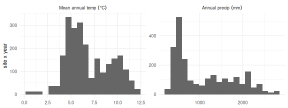
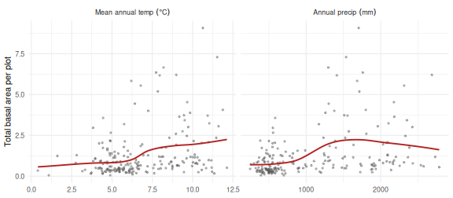
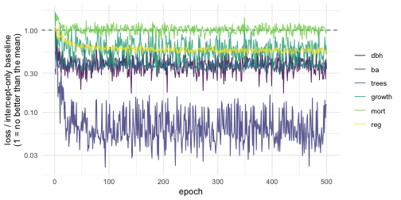
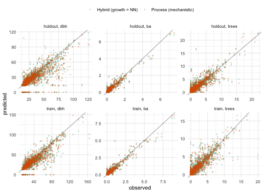
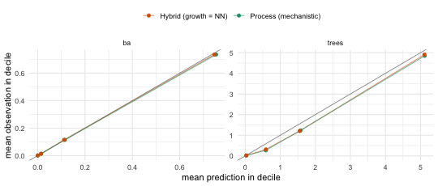
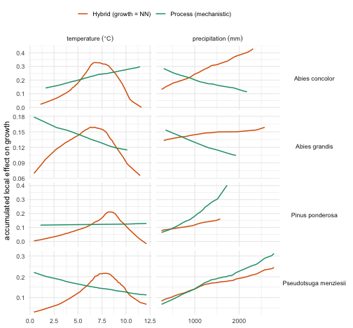
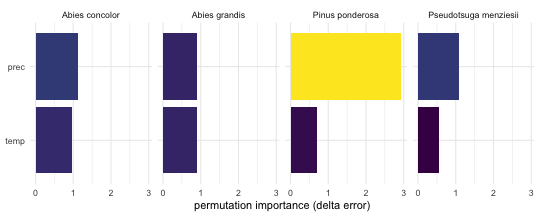
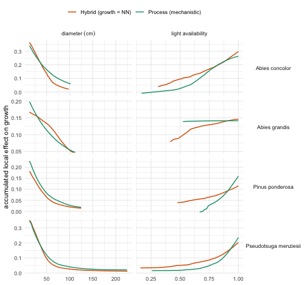

<style>
pre.summary-out, .summary-out pre { max-height: 22em; overflow: auto; }
</style>

Dynamic forest models are usually developed through a combination of encoding ecological knowledge into model structures and parameters. Usually the resulting parameters are then further refined by manual calibration procedures. Here we calibrate FINN directly from data: a subset of the US Forest Inventory & Analysis (FIA) program for Oregon, prepared exactly as in the **Preparing your data for FINN** vignette.

We fit FINN to 200 sites and evaluate on 200 **held-out** sites.

The calibration of the model for all species parameters relies on the a torch backend and therefor takes several minutes, the vignette is **precompiled**: `vignettes/build.R` knits `D-Fit_to_FIA.Rmd.orig`
once on a developer machine and commits the resulting static `.Rmd`. So the code
you see is exactly the code that produced the output, and the package
builds anywhere without torch.


``` r
library(FINN)
library(torch)
library(data.table)
library(ggplot2)

# Training length. 500 is comfortably past convergence: every response plateaus
# by ~epoch 400 (checked across 3 seeds). Raising it changes nothing except the
# knit time.
EPOCHS <- 500L
```

## The data

The input tables are built by **`dev/make_extdata.R`**, which draws 400 sites
from the full Oregon FIA set in `data-raw/` and splits them into two train and test data. 
The **climate** (`fia_env_dt`) was created in the FINN-fia
analysis repo (`scripts/03_attach_environment.R` → `07_prepare_finn_inputs.R`);
see `data-raw/README.md` for the full chain.

The data consists of 200 sites to fit on, and 200
holdout sites for evaluation. A fitted FINN model should generalize to other sites. So the holdout is a genuine out-of-sample test.


``` r
# The tables ship with FINN as datasets (?fia_obs_dt), already in FINN's input
# format, so there is nothing to read or prepare.

# --- training sites --------------------------------------------------------
obs_dt     <- fia_obs_dt        # observations, wide (one column per variable)
env_dt     <- fia_env_dt        # RAW, untransformed climate
init_trees <- fia_init_trees
species_dt <- fia_species_dt

# --- holdout sites: never seen during fitting ------------------------------
obs_test   <- fia_obs_test
env_test   <- fia_env_test
init_test  <- fia_init_test

# long form of the observations, so later we can match FINN's long predictions
# (sim$long$site) with a single merge()
resp  <- c("dbh", "ba", "trees", "growth", "mort", "reg")
to_long <- function(d) melt(d, id.vars = c("siteID", "year", "species", "species_name"),
                            measure.vars = resp, variable.name = "variable", value.name = "obs")
obs_long  <- to_long(obs_dt)
test_long <- to_long(obs_test)

cat(sprintf("train: %d sites | holdout: %d sites | %d species | years %s\n",
            uniqueN(obs_dt$siteID), uniqueN(obs_test$siteID), uniqueN(obs_dt$species),
            paste(sort(unique(obs_dt$year)), collapse = " & ")))
#> train: 200 sites | holdout: 200 sites | 11 species | years 1 & 2
species_dt
#>     species            species_name
#>       <int>                  <char>
#>  1:       1   Pseudotsuga menziesii
#>  2:       2         Pinus ponderosa
#>  3:       3          Pinus contorta
#>  4:       4          Abies concolor
#>  5:       5           Abies grandis
#>  6:       6      Tsuga heterophylla
#>  7:       7       Tsuga mertensiana
#>  8:       8 Lithocarpus densiflorus
#>  9:       9             Alnus rubra
#> 10:      10          Abies amabilis
#> 11:      11                   other
```

The environment is supplied in **natural units**: with `env_autoscale = TRUE`
(the default) FINN z-standardizes the predictors internally and reuses the same
constants at prediction time, so raw values are all we ever pass.


``` r
ggplot(melt(env_dt[, c("temp", "prec")], measure.vars = c("temp", "prec")),
       aes(value)) +
  geom_histogram(bins = 20, fill = "grey40") +
  facet_wrap(~variable, scales = "free", labeller = as_labeller(
    c(temp = "Mean~annual~temp~(degree*C)", prec = "Annual~precip~(mm)"), label_parsed)) +
  labs(x = NULL, y = "site x year") + theme_minimal()
```



Stand abundance, measured as total basal area per plot (summed over species),
against the temperature and precipitation gradients:


``` r
# total stand basal area per plot: sum over species, averaged over inventories
site_ba  <- obs_dt[, .(ba = sum(ba, na.rm = TRUE)), by = .(siteID, year)][
                   , .(ba = mean(ba)), by = siteID]
site_env <- env_dt[, .(temp = mean(temp), prec = mean(prec)), by = siteID]
grad <- melt(merge(site_ba, site_env, by = "siteID"),
             id.vars = c("siteID", "ba"), measure.vars = c("temp", "prec"),
             variable.name = "gradient")

ggplot(grad, aes(value, ba)) +
  geom_point(alpha = 0.4, size = 0.9, colour = "grey30") +
  geom_smooth(method = "loess", se = FALSE, colour = "firebrick", linewidth = 0.9) +
  facet_wrap(~gradient, scales = "free_x", labeller = as_labeller(
    c(temp = "Mean~annual~temp~(degree*C)", prec = "Annual~precip~(mm)"), label_parsed)) +
  labs(x = NULL, y = "Total basal area per plot") + theme_minimal()
```



## Initial cohorts

Each simulation starts from the observed first inventory. We build the starting
state for both samples, the holdout gets its own cohorts, from its own sites.


``` r
Nsp <- max(obs_dt$species)
init_cohorts      <- makeInitCohorts(init_trees, Nspecies = Nsp)
init_cohorts_test <- makeInitCohorts(init_test,  Nspecies = Nsp)
```


``` r
# shared colours for the two model variants, reused by the scatter and ALE panels
model_cols <- c("Process (mechanistic)" = "#1b9e77", "Hybrid (growth = NN)" = "#d95f02")
```

## Fit a Process-FINN

In the fully mechanistic configuration every process keeps its predefined form,
while its species and environmental parameters are learned (`optimize* = TRUE`)
and the formula chooses which environmental predictors enter the growth,
regeneration and mortality responses. The model is calibrated end-to-end by
gradient descent through the entire simulation.

We pass **two** climate drivers rather than all six available. `~.` would use
every column, but the six are strongly collinear; `temp` and `tempmin` correlate
at r = 0.93, `prec` and `precwarmq` at 0.86, and two principal components carry
90% of the variance. Collinear predictors are not a problem for the *fit* (that is
what ALE is designed for), but they are a problem for the *interpretation* below:
two drivers that correlate at 0.93 have no separately identifiable response
curves, so calling each one a "niche" would be reading structure into an arbitrary
split. Two weakly-correlated drivers (r = 0.64) give curves that mean what the
text says they mean. Measured across three seeds, the cost is nothing on growth
(0.56 vs 0.55 held out) and ~0.02 on basal area, tree numbers and regeneration.


``` r
FINN.seed(42)
m <- finn(
  N_species            = uniqueN(obs_dt$species),
  recruits_dbh         = 12.9,   # DBH (cm) assigned to a new recruit; ~ FIA's 12.7 cm (5 in) minimum
  competition_process  = createProcess(~0, FINN::competition,  optimizeSpecies = TRUE),
  growth_process       = createProcess(~ temp + prec, FINN::growth,       optimizeSpecies = TRUE, optimizeEnv = TRUE),
  regeneration_process = createProcess(~ temp + prec, FINN::regeneration, optimizeSpecies = TRUE, optimizeEnv = TRUE),
  mortality_process    = createProcess(~ temp + prec, FINN::mortality,    optimizeSpecies = TRUE, optimizeEnv = TRUE)
)
```

### Balancing the six losses

The objective is the sum of six terms, one per response, and their raw
magnitudes have nothing to do with each other: `dbh` is a squared error in
cm², `growth` a squared error on a ratio, `trees` a Poisson deviance. Before
anything is trained it is worth seeing what each term would contribute.
`fit(epochs = 0)` runs the set-up only, the data tensors, the intercept-only
baselines and the weights derived from them, and reports each response's share
of the objective; nothing is trained and the parameters stay as they were.


``` r
fit(m, env = env_dt, data = obs_dt, init_cohort = init_cohorts, epochs = 0L,
    patches = 4, patch_size = 0.06, plot_progress = FALSE)
#> ℹ weights: intercept-only baseline x your vector (dbh=0.00202, ba=3.9, trees=0.684, growth=122, mortality=4.1, regeneration=0.588)
#> ℹ share of the objective at the intercept-only baseline (scaled): dbh=17%, ba=17%, trees=17%, growth=17%, mortality=17%, regeneration=17%
```

With the default `weights = "auto"` every loss is divided by its own
intercept-only baseline, the loss of predicting the single best constant, so
each term starts at 1 and the six shares are equal. The baselines are kept in
`m$loss_baseline`, the weights in `m$loss_weights`.

A numeric `weights` vector multiplies these scaled losses (since 0.2.0), so a
number reads directly as a share: `c(1, 1, 1, 2, 1, 1)` gives growth twice the
weight of every other response, and the report says so.


``` r
fit(m, env = env_dt, data = obs_dt, init_cohort = init_cohorts, epochs = 0L,
    patches = 4, patch_size = 0.06, plot_progress = FALSE,
    weights = c(1, 1, 1, 2, 1, 1))
#> ℹ weights: intercept-only baseline x your vector (dbh=0.00202, ba=3.9, trees=0.684, growth=122, mortality=4.1, regeneration=0.588)
#> ℹ share of the objective at the intercept-only baseline (scaled): dbh=14%, ba=14%, trees=14%, growth=29%, mortality=14%, regeneration=14%
```

`weight_scale = "raw"` applies the same vector to the unscaled losses, which is
what `weights` meant before 0.2.0 and what reproduces an analysis fitted with an
earlier version. The report is printed in that mode too, and it shows why the
scaling is the default:


``` r
fit(m, env = env_dt, data = obs_dt, init_cohort = init_cohorts, epochs = 0L,
    patches = 4, patch_size = 0.06, plot_progress = FALSE,
    weights = c(1, 1, 1, 2, 1, 1), weight_scale = "raw")
#> ℹ share of the objective at the intercept-only baseline (raw scale): dbh=99%, ba=0.051%, trees=0.29%, growth=0.0066%, mortality=0.049%, regeneration=0.34%
```

On the raw scale the diameter term is the objective and the nominal factor of
two on growth is a factor of two on a share that was already negligible. Read
the printed shares at the start of every fit; a response that holds a fraction
of a percent of the objective is a response the fit will not learn.

### The fit


``` r
fit(m,
  env         = env_dt,      # raw climate
  data        = obs_dt,
  init_cohort = init_cohorts,
  device      = "cpu",
  epochs      = EPOCHS,
  batchsize   = 40L,
  patches     = 4,
  patch_size  = 0.06,
  lr          = 0.01,
  env_autoscale   = TRUE,        # default
  checkpoints     = 50L,         # record every parameter every 50 epochs (m$param_history)
  plot_progress   = FALSE        # the convergence plot below is the readable one
)
```

## Replace growth with a neural network (Hybrid-FINN)

FINN's defining feature is that **any single demographic process can be swapped
from a mechanistic function to a neural network**, while the others stay
mechanistic, a *hybrid* model. The mechanistic processes keep the system
ecologically constrained; the network absorbs structure the fixed functional form
cannot express. Here we replace **growth** with a small neural network via
`createHybrid()`, leaving competition, regeneration and mortality mechanistic,
and refit on the same data with the **identical `fit()` call**.


``` r
FINN.seed(42)
m_hybrid <- finn(
  N_species            = uniqueN(obs_dt$species),
  recruits_dbh         = 12.9,
  competition_process  = createProcess(~0, FINN::competition,  optimizeSpecies = TRUE),
  growth_process       = createHybrid(~ temp + prec, hidden = c(20L, 20L), transformer = FALSE),  # NN replaces growth
  regeneration_process = createProcess(~ temp + prec, FINN::regeneration, optimizeSpecies = TRUE, optimizeEnv = TRUE),
  mortality_process    = createProcess(~ temp + prec, FINN::mortality,    optimizeSpecies = TRUE, optimizeEnv = TRUE)
)
```


``` r
fit(m_hybrid,
  env = env_dt, data = obs_dt, init_cohort = init_cohorts, device = "cpu",
  epochs = EPOCHS, batchsize = 40L, patches = 4, patch_size = 0.06,
  lr = 0.01, env_autoscale = TRUE, plot_progress = FALSE
)
```

With both variants fitted, the rest of the vignette inspects and compares them:
training convergence, a `summary()` of the learned structure,
predicted-vs-observed fit, the learned niches, and the accumulated local effects
that reveal what the network learned.

## Training convergence

Both variants are trained the same way. Because the losses are scaled by their
intercept-only baselines, `m$history` can be read **per response** on one axis,
and the dashed line at 1 is a real reference: it is the intercept-only model, so a
curve below it means that response is predicted better than by its own mean.


``` r
hist_dt <- as.data.table(do.call(rbind, m$history))[, 1:6]
setnames(hist_dt, c("dbh", "ba", "trees", "growth", "mort", "reg"))
hist_dt[, epoch := .I]
ggplot(melt(hist_dt, id.vars = "epoch", variable.name = "response"),
       aes(epoch, value, colour = response)) +
  geom_hline(yintercept = 1, linetype = "dashed", colour = "grey40") +
  geom_line(alpha = 0.8) +
  scale_y_log10() +
  scale_colour_viridis_d() +
  labs(x = "epoch", y = "loss / intercept-only baseline\n(1 = no better than the mean)",
       colour = NULL) +
  theme_minimal()
```



The structural responses drop well below 1 within a few epochs. The per-tree rates
sit much closer to it; they are only weakly constrained by two inventories, which
is the honest picture and the reason for the caveat further down.

A flat loss is necessary for convergence, not sufficient: the objective can be
flat along a direction in which the parameters are still moving, which is what a
poorly identified parameter looks like. `checkpoints = 50` recorded every
parameter block every 50 epochs in `m$param_history` (with `folder = "<dir>"`
the whole model is also written there at each checkpoint, as
`epoch_<k>model.pt`, to resume from with `torch::torch_load()` and a further
`fit()`, or to compare). The largest step any parameter of a block took between
two consecutive checkpoints, on the unconstrained scale the optimiser works on:


``` r
ph <- m$param_history
steps <- rbindlist(lapply(seq_along(ph)[-1], function(i)
  data.table(epoch = i * 50L, block = names(ph[[i]]),
             max_step = sapply(names(ph[[i]]), function(nm)
               max(abs(ph[[i]][[nm]] - ph[[i - 1]][[nm]]))))))
dcast(steps[, max_step := round(max_step, 3)], block ~ epoch, value.var = "max_step")
#> Key: <block>
#>                             block   100   150   200   250   300   350   400
#>                            <char> <num> <num> <num> <num> <num> <num> <num>
#> 1:             nn_growth.0.weight 0.374 0.344 0.378 0.402 0.317 0.315 0.238
#> 2:          nn_mortality.0.weight 0.878 0.439 0.746 0.465 0.446 0.458 0.492
#> 3:       nn_regeneration.0.weight 0.727 0.464 0.339 0.308 0.270 0.245 0.260
#> 4:  par_competition_unconstrained 0.293 0.220 0.321 0.258 0.415 0.337 0.217
#> 5:       par_growth_unconstrained 0.811 0.493 0.524 0.384 0.432 0.396 0.265
#> 6:    par_mortality_unconstrained 0.244 0.281 0.152 0.172 0.185 0.159 0.196
#> 7: par_regeneration_unconstrained 0.964 0.743 0.409 0.392 0.310 0.269 0.256
#> 8:         par_theta_recruits_raw 1.015 0.793 0.707 0.671 0.661 0.668 0.548
#>      450   500
#>    <num> <num>
#> 1: 0.362 0.449
#> 2: 0.380 0.376
#> 3: 0.274 0.238
#> 4: 0.299 0.307
#> 5: 0.513 0.510
#> 6: 0.244 0.430
#> 7: 0.408 0.336
#> 8: 0.656 0.572
```

At a constant learning rate no block comes to rest: every parameter group still
steps by a few tenths between checkpoints while the losses have been flat for
hundreds of epochs. Part of that is the jitter of mini-batch Adam, which a
learning-rate schedule (`lr_scheduler = "step"` or `"cosine"`) damps at the
end of a fit; the rest is drift along directions the objective does not care
about, and the regeneration blocks, which step most over the first 200 epochs,
are the first suspects. Two seeds, or two checkpoints, compared on the holdout
tell whether the drift reaches the predictions.

## What the model learned: `summary()`

`summary()` gives a compact overview of the *learned structure*: for each process
and species it reports how important each environmental predictor is (ALE-variance
importance, rate-normalised) and its average conditional effect. It reuses the
cached conditional effects, so once `ALE()` (below) or a previous `summary()` has
run it needs no further simulation.


``` r
summary(m)
FINN model summary
==================

### GROWTH

Analytical ALE importance (rate-normalised) (species in columns):
 variable    sp1      sp2    sp3   sp4    sp5   sp6   sp7   sp8    sp9  sp10
     prec 0.2563 0.550220 0.0185 0.208 0.0819 0.416 0.361 0.988 0.0572 0.654
     temp 0.0258 0.000605 0.2926 0.090 0.0618 0.456 0.135 0.509 0.8154 0.584
   sp11
 0.4571
 0.0744

Average conditional effects (mean; species in columns):
 variable     sp1    sp2     sp3     sp4     sp5    sp6   sp7     sp8    sp9
     prec  0.0511 0.0877 -0.0127 -0.0561 -0.0209 0.0906 0.037 -0.0254  0.053
     temp -0.0163 0.0015  0.0430  0.0302 -0.0146 0.0974 0.032 -0.0354 -0.144
    sp10    sp11
 -0.0499  0.0419
  0.0460 -0.0164

### MORTALITY

Analytical ALE importance (rate-normalised) (species in columns):
 variable    sp1    sp2    sp3   sp4    sp5   sp6    sp7  sp8   sp9  sp10
     temp 0.0679 0.0129 0.1402 0.395 0.0296 2.806 0.0207 2.66 0.682 0.497
     prec 0.0027 0.0943 0.0764 0.822 1.6770 0.111 0.6273 1.19 0.070 2.373
    sp11
 0.12662
 0.00195

Average conditional effects (mean; species in columns):
 variable      sp1      sp2    sp3     sp4     sp5      sp6     sp7     sp8
     prec 0.000852  0.01901 0.0190  0.0215 0.06381 -0.00850 -0.1156 -0.0296
     temp 0.004266 -0.00384 0.0264 -0.0156 0.00869 -0.00867  0.0177 -0.0807
      sp9    sp10     sp11
  0.00546 -0.0681  0.00137
 -0.02139 -0.0296 -0.01051

### REGENERATION

Analytical ALE importance (rate-normalised) (species in columns):
 variable    sp1   sp2   sp3     sp4   sp5     sp6   sp7   sp8   sp9  sp10 sp11
     temp 1.0989 0.185 0.644 0.00416 0.814 0.00413 0.957 1.377 0.620 0.524 1.06
     prec 0.0213 1.129 0.238 0.91799 0.175 1.07066 0.435 0.115 0.941 1.024 1.20

Average conditional effects (mean; species in columns):
 variable    sp1    sp2   sp3     sp4    sp5    sp6    sp7   sp8   sp9   sp10
     prec -0.175 -3.391 -2.99 -0.7109 -0.647 0.9184  0.778 0.110 0.847  1.057
     temp  1.304  0.913 -2.83 -0.0391 -0.858 0.0525 -0.893 0.644 0.654 -0.809
   sp11
  0.925
 -0.856
```

The niche and ALE sections below unpack this overview into per-driver response
*curves*.

## Assess the fit: in-sample and on held-out sites

The fit was calibrated on the 200 training sites, so scoring it there only tells
us how well it *reproduces* them. The honest question is whether it transfers, so
we simulate each model twice, once on the training sites, once on the 200
held-out sites, and score both with **Spearman correlation** (rank agreement)
and **RMSE** (in each response's own units), matched on site × year × species.


``` r
# One prediction pass per model x sample. The holdout is driven only by its own
# environment and starting cohorts; nothing about it entered the fit.
pred_of <- function(model, label, env, init, obs_l, split) {
  model$eval()                                   # deterministic: dropout off
  sim <- predict(model, env = env, init_cohort = init,
                 patches = 4, patch_size = 0.06, device = "cpu")
  merge(obs_l, sim$long$site, by = c("siteID", "year", "species", "variable"
  ))[, `:=`(model = label, split = split)][]
}
FINN.seed(1)
obs_pred <- rbind(
  pred_of(m,        "Process (mechanistic)", env_dt,   init_cohorts,      obs_long,  "train"),
  pred_of(m,        "Process (mechanistic)", env_test, init_cohorts_test, test_long, "holdout"),
  pred_of(m_hybrid, "Hybrid (growth = NN)",  env_dt,   init_cohorts,      obs_long,  "train"),
  pred_of(m_hybrid, "Hybrid (growth = NN)",  env_test, init_cohorts_test, test_long, "holdout"))

metrics <- obs_pred[is.finite(obs) & is.finite(value),
                    .(spearman = round(cor(obs, value, method = "spearman"), 2),
                      rmse     = round(sqrt(mean((obs - value)^2)), 2),
                      n        = .N), by = .(model, split, variable)]

comparison <- dcast(metrics, variable + model ~ split, value.var = c("spearman", "rmse"))
setcolorder(comparison, c("variable", "model", "spearman_train", "spearman_holdout",
                          "rmse_train", "rmse_holdout"))
comparison[order(variable, model)]
#> Key: <variable, model>
#>     variable                 model spearman_train spearman_holdout rmse_train
#>       <fctr>                <char>          <num>            <num>      <num>
#>  1:      dbh  Hybrid (growth = NN)           0.81             0.72      12.98
#>  2:      dbh Process (mechanistic)           0.82             0.73      12.61
#>  3:       ba  Hybrid (growth = NN)           0.82             0.80       0.12
#>  4:       ba Process (mechanistic)           0.81             0.81       0.13
#>  5:    trees  Hybrid (growth = NN)           0.80             0.78       0.76
#>  6:    trees Process (mechanistic)           0.79             0.78       0.77
#>  7:   growth  Hybrid (growth = NN)           0.56             0.51       0.09
#>  8:   growth Process (mechanistic)           0.58             0.55       0.09
#>  9:     mort  Hybrid (growth = NN)           0.13             0.06       0.15
#> 10:     mort Process (mechanistic)           0.14             0.05       0.15
#> 11:      reg  Hybrid (growth = NN)           0.29             0.26       6.20
#> 12:      reg Process (mechanistic)           0.30             0.26       6.20
#>     rmse_holdout
#>            <num>
#>  1:        13.94
#>  2:        14.16
#>  3:         0.09
#>  4:         0.09
#>  5:         0.77
#>  6:         0.77
#>  7:         0.10
#>  8:         0.10
#>  9:         0.15
#> 10:         0.16
#> 11:         6.46
#> 12:         6.45
```


The structural variables (basal area, tree numbers and diameter) are
reconstructed well, **and hold up on sites the model never saw**: that gap
between the train and holdout columns is the part that matters, because it is
the only evidence that the fitted processes generalise rather than memorise.
The noisier per-tree rates (growth, mortality, regeneration) are harder to
constrain from two inventories and should be read with that in mind (see the
caveat below). The hybrid tracks the mechanistic model on the structural
variables, with **no growth equation specified**, which is what makes hybrids
useful when a process's form is uncertain; the surrounding mechanistic processes
still anchor the model ecologically.


``` r
# facet_wrap, NOT facet_grid: the three responses live on completely different
# scales (dbh ~150 cm, ba ~8 m2, trees ~20). facet_grid(scales = "free") frees x
# per column but y per ROW, so ba and trees would be drawn on dbh's y-axis -
# squashing them onto y = 0 and flattening the 1:1 line until a good fit looks
# like a broken one. facet_wrap frees both axes per panel.
ggplot(obs_pred[variable %in% c("dbh", "ba", "trees") & is.finite(obs)],
       aes(obs, value, colour = model)) +
  geom_abline(slope = 1, intercept = 0, colour = "grey40", linewidth = 0.3) +
  geom_point(alpha = 0.25, size = 0.5) +
  facet_wrap(~ split + variable, scales = "free", ncol = 3,
             labeller = labeller(.multi_line = FALSE)) +
  scale_colour_manual(values = model_cols) +
  labs(x = "observed", y = "predicted", colour = NULL) +
  theme_minimal() + theme(legend.position = "top")
```



Each panel is on its **own** axes, and the grey line is 1:1, so the diagonal is
the target in every panel regardless of the units on it.

> **A caveat on the rate variables.** `growth`, `mort` and `reg` are per-tree
> rates and are only weakly constrained by two inventories, so their Spearman is
> a **noisy estimate**; refitting with a different random seed moves it by a few
> hundredths. Differences of that size between the models should not be
> over-read; the structural variables, estimated from far more information, are
> what carry the comparison. `mort` is the extreme case and gets a vignette of
> its own (**Mortality: a binomial response and a neural-network process**)
> because rank correlation is the wrong tool for a response that is mostly zeros.

### Score what the loss scores

The merge above is on site × year × species, which is the cell the loss is
computed on: `fit()` compares the patch-mean of each site, year and species with
the observation, and so does the table. Aggregating the predictions differently
before scoring (summing species to a stand total, averaging the two censuses,
pooling sites into regions) asks a different and usually easier question, and
the number it returns is not the skill of the fitted objective. If a stand total
is what matters, score it as well, but say so; and for a count-weighted response
weight the metric the way the loss does. The mortality vignette carries this
through for the binomial term, whose AUC is weighted by `n_at_risk` exactly as
the likelihood is.

### A model-free reference: persistence

A Spearman of 0.8 on basal area sounds good until it is compared with the
simplest forecast available: the previous census of the same site and species,
unchanged. On a ten-year interval that *persistence* forecast is strong for the
state variables, and a model has to beat it before it can claim to have learned
dynamics rather than inertia. The second census of the holdout sites predicted
by the first, next to the two models scored on the same cells:


``` r
# the year-1 observation stands in as the prediction for year 2
persist <- merge(test_long[year == 2],
                 test_long[year == 1, .(siteID, species, variable, value = obs)],
                 by = c("siteID", "species", "variable"))
ref <- rbind(persist[, .(siteID, species, variable, obs, value, model = "Persistence (year 1 as is)")],
             obs_pred[split == "holdout" & year == 2, .(siteID, species, variable, obs, value, model)])
ref[variable %in% c("dbh", "ba", "trees") & is.finite(obs) & is.finite(value),
    .(spearman = round(cor(obs, value, method = "spearman"), 2),
      rmse     = round(sqrt(mean((obs - value)^2)), 2)),
    by = .(variable, model)][order(variable, model)]
#>    variable                      model spearman  rmse
#>      <fctr>                     <char>    <num> <num>
#> 1:      dbh       Hybrid (growth = NN)     0.66 15.29
#> 2:      dbh Persistence (year 1 as is)     0.91  6.79
#> 3:      dbh      Process (mechanistic)     0.66 15.76
#> 4:       ba       Hybrid (growth = NN)     0.79  0.11
#> 5:       ba Persistence (year 1 as is)     0.96  0.08
#> 6:       ba      Process (mechanistic)     0.79  0.12
#> 7:    trees       Hybrid (growth = NN)     0.77  0.91
#> 8:    trees Persistence (year 1 as is)     0.96  0.60
#> 9:    trees      Process (mechanistic)     0.76  0.92
```

Persistence wins on all three state variables, and not narrowly. That is the
expected result for a ten-year interval in mature stands: most of the basal area
present at the second census was already there at the first, and the models
are at a disadvantage here, they start from the year-0 tree list and never see
the year-1 census, so their year-2 prediction carries two intervals of
compounded simulation error. The lesson is not that the models are poor but
that a holdout Spearman on `dbh`, `ba` or `trees` is mostly a statement about
the initial cohorts. The processes are tested by the rates, and by what the
model does over horizons where persistence has nothing to say, the
**Simulating succession** vignette. Persistence has no prediction for the first
census, which is why the table scores year 2 only.

### Calibration: predicted against observed by decile

A scatter shows the spread; it hides a systematic bias of the kind a fitted
model develops when it compresses towards the mean. Binning the predictions into
deciles and comparing the mean prediction of each bin with the mean observation
in it is the calibration view, and it is cheap:


``` r
calib <- obs_pred[split == "holdout" & variable %in% c("ba", "trees") & is.finite(obs)]
calib[, bin := cut(value, unique(quantile(value, 0:10 / 10)), include.lowest = TRUE),
      by = .(model, variable)]
calib_dt <- calib[, .(pred = mean(value), obs = mean(obs), n = .N), by = .(model, variable, bin)]
ggplot(calib_dt, aes(pred, obs, colour = model)) +
  geom_abline(slope = 1, intercept = 0, colour = "grey40", linewidth = 0.3) +
  geom_line(alpha = 0.6) + geom_point(size = 1.6) +
  facet_wrap(~variable, scales = "free") +
  scale_colour_manual(values = model_cols) +
  labs(x = "mean prediction in decile", y = "mean observation in decile", colour = NULL) +
  theme_minimal() + theme(legend.position = "top")
```



Points on the diagonal are calibrated; a slope below one means the model
under-predicts the dense stands and over-predicts the sparse ones, a slope above
one the reverse. A rank correlation is blind to either.

### A blocked holdout

The 200 holdout sites are a random draw from the same region as the training
sites, so every holdout site has training neighbours in climate space, and
nearly so in geographic space. That split measures interpolation. The question
usually asked of a calibrated model, how it does in conditions or places it was
not trained on, needs a holdout that is *blocked*: with coordinates, hold out
whole spatial blocks (grid cells, or clusters of plots); without them, hold out
a block of the environmental gradient. The bundled sample carries no
coordinates, so the block here is environmental, but the recipe is the same.
We hold out the warmest fifth of the training sites, fit the same model on the
other 160, and score it on the 40 blocked sites and, for comparison, on the 200
random holdout sites.


``` r
site_temp <- env_dt[, .(temp = mean(temp)), by = siteID]
warm      <- site_temp[temp > quantile(temp, 0.8), siteID]      # the blocked holdout
cool      <- setdiff(site_temp$siteID, warm)                    # the training block

FINN.seed(42)
m_block <- finn(
  N_species            = Nsp, recruits_dbh = 12.9,
  competition_process  = createProcess(~0, FINN::competition,  optimizeSpecies = TRUE),
  growth_process       = createProcess(~ temp + prec, FINN::growth,       optimizeSpecies = TRUE, optimizeEnv = TRUE),
  regeneration_process = createProcess(~ temp + prec, FINN::regeneration, optimizeSpecies = TRUE, optimizeEnv = TRUE),
  mortality_process    = createProcess(~ temp + prec, FINN::mortality,    optimizeSpecies = TRUE, optimizeEnv = TRUE)
)
fit(m_block,
  env = env_dt[siteID %in% cool], data = obs_dt[siteID %in% cool],
  init_cohort = makeInitCohorts(init_trees[siteID %in% cool], Nspecies = Nsp),
  device = "cpu", epochs = EPOCHS, batchsize = 40L, patches = 4, patch_size = 0.06,
  lr = 0.01, plot_progress = FALSE
)
```


``` r
FINN.seed(1)
blocked <- rbind(
  pred_of(m_block, "random holdout (200 sites)", env_test, init_cohorts_test, test_long, "holdout"),
  pred_of(m_block, "blocked holdout (40 warmest sites)", env_dt[siteID %in% warm],
          makeInitCohorts(init_trees[siteID %in% warm], Nspecies = Nsp),
          obs_long[siteID %in% warm], "holdout"))
blocked[variable %in% c("dbh", "ba", "trees", "growth") & is.finite(obs) & is.finite(value),
        .(spearman = round(cor(obs, value, method = "spearman"), 2),
          rmse     = round(sqrt(mean((obs - value)^2)), 2), n = .N),
        by = .(variable, holdout = model)][order(variable, holdout)]
#>    variable                            holdout spearman  rmse     n
#>      <fctr>                             <char>    <num> <num> <int>
#> 1:      dbh blocked holdout (40 warmest sites)     0.80 16.67   195
#> 2:      dbh         random holdout (200 sites)     0.72 13.36  1048
#> 3:       ba blocked holdout (40 warmest sites)     0.77  0.21   880
#> 4:       ba         random holdout (200 sites)     0.80  0.10  4400
#> 5:    trees blocked holdout (40 warmest sites)     0.77  1.02   880
#> 6:    trees         random holdout (200 sites)     0.77  0.80  4400
#> 7:   growth blocked holdout (40 warmest sites)     0.45  0.17   187
#> 8:   growth         random holdout (200 sites)     0.56  0.11  1000
```

The blocked rows are the transfer skill, and they are the ones to report when
the model is meant to be applied beyond the sampled conditions. Here the rank
correlations hold up on the warm block while the errors do not: the basal-area
RMSE doubles and the stem and growth errors rise by a quarter to a half. The
model orders the warm sites correctly but misplaces their level, which is what
an environmental response that is extrapolating looks like, and a random
holdout cannot show it. It is also the reason to keep the climate formula
small: a response curve fitted to two collinear drivers can fit the training
block and still extrapolate in opposite directions.

## Two fitting strategies for regeneration

Regeneration is the response with the least information in it: 86% of the
site × census × species cells record no recruit at all, and a recruit enters at
12.9 cm, so over a ten-year interval it adds little to basal area. In a joint
fit the regeneration parameters are free to do something else instead: fill a
stem deficit that too much mortality created, or absorb a growth bias, because
the stem count and basal-area terms are indifferent to *which* process closes
the gap. Two strategies keep regeneration honest.

### Staged calibration: regeneration last

Fit the processes the data constrain well first, with recruitment switched off,
then fit regeneration alone against the recruitment observations with
everything else frozen. `createProcess(optimizeSpecies = , optimizeEnv = )`
does the freezing, and `initSpecies` / `initEnv` carry the stage-1 estimates
over.

One mistake is easy to make at stage 1, and `fit()` now refuses to make it
silently: switching the regeneration term off (`loss_family["regeneration"] =
"none"`) while leaving the regeneration process trainable. No other response
can train it, a recruit reaches `dbh` through a near-step sigmoid and `trees`
through a rounding that is zero below half a recruit per patch and species, so
the parameters would drift on no gradient at all (FINNverse/FINN#43):


``` r
m_wrong <- finn(
  N_species            = Nsp, recruits_dbh = 12.9,
  growth_process       = createProcess(~ temp + prec, FINN::growth,       optimizeSpecies = TRUE, optimizeEnv = TRUE),
  mortality_process    = createProcess(~ temp + prec, FINN::mortality,    optimizeSpecies = TRUE, optimizeEnv = TRUE),
  regeneration_process = createProcess(~ temp + prec, FINN::regeneration, optimizeSpecies = TRUE, optimizeEnv = TRUE)
)
fit(m_wrong, env = env_dt, data = obs_dt, init_cohort = init_cohorts, epochs = 0L,
    patches = 4, patch_size = 0.06, plot_progress = FALSE,
    loss_family = c(dbh = "mse", ba = "mse", trees = "poisson", growth = "mse",
                    mortality = "binomial", regeneration = "none"))
#> Warning: the regeneration process is being calibrated, but
#> `loss_family['regeneration']` is "none", so no observed recruitment enters the
#> loss. No other response can stand in for it: recruits reach `dbh` through a
#> near-step sigmoid and `trees` through a rounding that is 0 below 0.5 recruits
#> per patch and species. Score regeneration against an observation, or set
#> optimizeSpecies = FALSE and optimizeEnv = FALSE on the regeneration process.
#> See FINNverse/FINN#43.
```

The same warning comes when the family is set but the scored cells carry no
finite `reg`. Stage 1 proper freezes the regeneration process at a fixed,
near-zero recruitment. `initEnv` is the weight matrix of the linear
environmental response, one row per species and one column per term of the
formula (intercept, `temp`, `prec`); an intercept of `log(1e-3)` makes the
expected recruitment vanish, so the ten-year dynamics are carried by growth and
mortality of the trees already present.


``` r
FINN.seed(42)
m_s1 <- finn(
  N_species            = Nsp, recruits_dbh = 12.9,
  competition_process  = createProcess(~0, FINN::competition,  optimizeSpecies = TRUE),
  growth_process       = createProcess(~ temp + prec, FINN::growth,       optimizeSpecies = TRUE, optimizeEnv = TRUE),
  mortality_process    = createProcess(~ temp + prec, FINN::mortality,    optimizeSpecies = TRUE, optimizeEnv = TRUE),
  regeneration_process = createProcess(~ temp + prec, FINN::regeneration,
                                       initEnv = list(cbind(rep(log(1e-3), Nsp), 0, 0)),
                                       optimizeSpecies = FALSE, optimizeEnv = FALSE)   # frozen
)
fit(m_s1,
  env = env_dt, data = obs_dt, init_cohort = init_cohorts, device = "cpu",
  epochs = EPOCHS, batchsize = 40L, patches = 4, patch_size = 0.06, lr = 0.01,
  loss_family = c(dbh = "mse", ba = "mse", trees = "poisson", growth = "mse",
                  mortality = "binomial", regeneration = "none"),
  plot_progress = FALSE
)
```

Stage 2 rebuilds the model with the stage-1 estimates as fixed values and only
the regeneration process trainable. The species parameters are read back on
their natural scale (`m$par_growth`, ...) and go in through `initSpecies`; the
environmental weights (`m$nn_growth$parameters`, ...) through `initEnv`. Both
stages see the same `env`, so the standardisation constants `fit()` derives are
identical and the weights carry over unchanged. The loss is the full default
one again: the state terms cannot move the frozen processes, and they tell
regeneration how many stems its recruits have to account for.


``` r
species_pars <- function(model, process)
  as.matrix(model[[paste0("par_", process)]]$detach()$cpu())
env_weights  <- function(model, process)
  lapply(model[[paste0("nn_", process)]]$parameters, function(w) as_array(w$detach()$cpu()))

FINN.seed(42)
m_s2 <- finn(
  N_species            = Nsp, recruits_dbh = 12.9,
  competition_process  = createProcess(~0, FINN::competition,
                                       initSpecies = species_pars(m_s1, "competition"), optimizeSpecies = FALSE),
  growth_process       = createProcess(~ temp + prec, FINN::growth,
                                       initSpecies = species_pars(m_s1, "growth"), initEnv = env_weights(m_s1, "growth"),
                                       optimizeSpecies = FALSE, optimizeEnv = FALSE),
  mortality_process    = createProcess(~ temp + prec, FINN::mortality,
                                       initSpecies = species_pars(m_s1, "mortality"), initEnv = env_weights(m_s1, "mortality"),
                                       optimizeSpecies = FALSE, optimizeEnv = FALSE),
  regeneration_process = createProcess(~ temp + prec, FINN::regeneration, optimizeSpecies = TRUE, optimizeEnv = TRUE)
)
fit(m_s2,
  env = env_dt, data = obs_dt, init_cohort = init_cohorts, device = "cpu",
  epochs = EPOCHS, batchsize = 40L, patches = 4, patch_size = 0.06, lr = 0.01,
  plot_progress = FALSE
)
```

### A cap on recruitment

The mechanistic regeneration function is unbounded: its mean rises as
`exp(env)`, so a steep climate coefficient can turn a warm, wet site into a
recruitment burst of hundreds of stems in one step. `FINN::regeneration_saturation`
adds a Beverton-Holt cap, `K m / (K + m)`, with the carrying capacity `K`
(stems ha⁻¹ per step) declared as a custom parameter and fitted like any other.
A length-1 init gives one shared `K`, a length-`Nsp` init one per species. The
rest of the model is the joint fit above, so the two differ in the cap alone.


``` r
FINN.seed(42)
m_cap <- finn(
  N_species            = Nsp, recruits_dbh = 12.9,
  competition_process  = createProcess(~0, FINN::competition,  optimizeSpecies = TRUE),
  growth_process       = createProcess(~ temp + prec, FINN::growth,       optimizeSpecies = TRUE, optimizeEnv = TRUE),
  mortality_process    = createProcess(~ temp + prec, FINN::mortality,    optimizeSpecies = TRUE, optimizeEnv = TRUE),
  regeneration_process = createProcess(~ temp + prec, FINN::regeneration_saturation,
                                       custom_parameters = list(reg_logK = rep(log(100), Nsp)),  # per-species K
                                       optimizeSpecies = TRUE, optimizeEnv = TRUE)
)
fit(m_cap,
  env = env_dt, data = obs_dt, init_cohort = init_cohorts, device = "cpu",
  epochs = EPOCHS, batchsize = 40L, patches = 4, patch_size = 0.06, lr = 0.01,
  plot_progress = FALSE
)
```


``` r
# the fitted carrying capacities, recruits per hectare and step
data.table(species_dt, K = round(exp(as.numeric(m_cap$reg_logK)), 1))
#>     species            species_name      K
#>       <int>                  <char>  <num>
#>  1:       1   Pseudotsuga menziesii  851.8
#>  2:       2         Pinus ponderosa  572.2
#>  3:       3          Pinus contorta   35.0
#>  4:       4          Abies concolor    2.2
#>  5:       5           Abies grandis    3.1
#>  6:       6      Tsuga heterophylla    2.3
#>  7:       7       Tsuga mertensiana    2.2
#>  8:       8 Lithocarpus densiflorus  114.8
#>  9:       9             Alnus rubra   93.8
#> 10:      10          Abies amabilis    3.9
#> 11:      11                   other 1469.5
```

The fitted `K` spans three orders of magnitude, from a few recruits per hectare
and step for the firs and hemlocks to several hundred for Douglas fir, ponderosa
pine and the pooled rest. Where `K` is small the cap is binding, so the
recruitment of those species is now set by the cap rather than by the climate
response; a `K` that lands on a value the inventory cannot support is the first
thing to check against the observed recruitment of that species.

### How the three compare, and why stem counts hinge on a few bursts

All three are scored on the 200 holdout sites exactly as above. On this sample
they are not distinguishable there: the differences between the rows are of the
size a change of seed produces (see below), and that too is a result. Two
censuses ten years apart, with no recruit in 86% of the cells, contain little to
separate a recruitment model that is capped from one that is not, or one fitted
jointly from one fitted last. The regeneration models differ where the holdout
does not look, in the simulated stand, which is the next point.


``` r
FINN.seed(1)
strategies <- rbind(
  obs_pred[split == "holdout" & model == "Process (mechanistic)"][, model := "Joint"],
  pred_of(m_s2,  "Staged (regeneration last)", env_test, init_cohorts_test, test_long, "holdout"),
  pred_of(m_cap, "Joint + recruitment cap",    env_test, init_cohorts_test, test_long, "holdout"))
strategies[is.finite(obs) & is.finite(value),
           .(spearman = round(cor(obs, value, method = "spearman"), 2),
             rmse     = round(sqrt(mean((obs - value)^2)), 2)),
           by = .(variable, model)][order(variable, model)]
#>     variable                      model spearman  rmse
#>       <fctr>                     <char>    <num> <num>
#>  1:      dbh                      Joint     0.73 14.16
#>  2:      dbh    Joint + recruitment cap     0.71 14.32
#>  3:      dbh Staged (regeneration last)     0.72 13.80
#>  4:       ba                      Joint     0.81  0.09
#>  5:       ba    Joint + recruitment cap     0.80  0.09
#>  6:       ba Staged (regeneration last)     0.79  0.10
#>  7:    trees                      Joint     0.78  0.77
#>  8:    trees    Joint + recruitment cap     0.78  0.77
#>  9:    trees Staged (regeneration last)     0.77  0.80
#> 10:   growth                      Joint     0.55  0.10
#> 11:   growth    Joint + recruitment cap     0.55  0.10
#> 12:   growth Staged (regeneration last)     0.52  0.11
#> 13:     mort                      Joint     0.05  0.16
#> 14:     mort    Joint + recruitment cap    -0.05  0.16
#> 15:     mort Staged (regeneration last)    -0.02  0.16
#> 16:      reg                      Joint     0.26  6.45
#> 17:      reg    Joint + recruitment cap     0.24  6.47
#> 18:      reg Staged (regeneration last)     0.25  6.46
```

The stem count deserves a closer look, because its skill is the least stable of
the three state variables. Recruits are *sampled* from the fitted negative
binomial at prediction time (`createProcess(sample_regeneration = TRUE)`, the
default), so a cell whose expected recruitment is large can receive a burst in
one simulation and nothing in the next. The same model predicted five times
with different seeds:


``` r
reps <- rbindlist(lapply(1:5, function(s) {
  FINN.seed(s)
  pred_of(m, "Joint", env_test, init_cohorts_test, test_long, "holdout")[, seed := s]
}))
trees_by_seed <- reps[variable == "trees" & is.finite(obs),
  .(spearman = round(cor(obs, value, method = "spearman"), 3),
    rmse     = round(sqrt(mean((obs - value)^2)), 3)), by = seed]
trees_by_seed
#>     seed spearman  rmse
#>    <int>    <num> <num>
#> 1:     1    0.788 0.780
#> 2:     2    0.779 0.776
#> 3:     3    0.788 0.765
#> 4:     4    0.783 0.791
#> 5:     5    0.779 0.789

# which cells carry the stem error? those whose predicted recruitment is in the
# top 1 % of the same simulation
burst <- merge(reps[variable == "trees", .(siteID, year, species, seed, obs, trees = value)],
               reps[variable == "reg",   .(siteID, year, species, seed, reg = value)],
               by = c("siteID", "year", "species", "seed"))
burst <- burst[is.finite(obs)]
burst[, top := reg >= quantile(reg, 0.99), by = seed]
total_sq_error <- burst[, sum((obs - trees)^2)]
burst[, .(cells = .N, share_of_sq_error = round(sum((obs - trees)^2) / total_sq_error, 2),
          max_reg = round(max(reg), 1)), by = .(top_1pct_recruitment = top)]
#>    top_1pct_recruitment cells share_of_sq_error max_reg
#>                  <lgcl> <int>             <num>   <num>
#> 1:                FALSE 21695              0.89     1.0
#> 2:                 TRUE   305              0.11     4.7
```

One percent of the cells carries about a tenth of the squared stem error, and
the seed-to-seed spread in the stem metrics, a hundredth in Spearman and a few
hundredths in RMSE, is the same mechanism at work: a site that receives a burst
in one draw and not in the next. That is why a single stems R² on a holdout
should not decide between two models whose regeneration differs; compare
several seeds, or score the *expected* stand (`sample_regeneration = FALSE` at
prediction time), and look at the largest predicted recruitment. The cap acts
on exactly that tail:


``` r
strategies[variable == "reg", .(max_predicted_reg = round(max(value), 1),
                                p99 = round(quantile(value, 0.99), 1)), by = model]
#>                         model max_predicted_reg   p99
#>                        <char>             <num> <num>
#> 1:                      Joint               5.2     1
#> 2: Staged (regeneration last)               4.7     1
#> 3:    Joint + recruitment cap               3.2     1
```

## Interpreting the growth process with ALE

`ALE()` returns the **accumulated local effect** of every driver on each process,
the effect measure of choice when predictors are correlated, because it
accumulates *local* changes within the observed data instead of extrapolating to
unrealistic combinations. Running it on **both** fitted models lets us read what
growth responds to *and* compare the mechanistic process with the neural-network
hybrid, across growth's **structural** inputs (tree size, light) and its
**environmental niche** (climate). It returns one table per process (`growth`,
`mortality`, `regeneration`); we use the growth table of each model.


``` r
FINN.seed(1)
ale_proc <- ALE(m,        env_dt, init_cohorts, plot = FALSE)   # mechanistic growth
ale_hyb  <- ALE(m_hybrid, env_dt, init_cohorts, plot = FALSE)   # growth = NN

# one tidy table with both variants. Environmental drivers come back on the
# model's scaled axis, so back-transform temp/prec to natural units (deg C, mm);
# the structural drivers (dbh, light) are already on their natural axes.
to_natural <- function(a, model) {
  sc <- as.data.table(model$env_scaling)[, .(var = variable, center, scale)]
  merge(data.table(a), sc, by = "var", all.x = TRUE)[!is.na(center), x := x * scale + center]
}
growth <- rbind(
  to_natural(ale_proc$growth, m)[,        model := "Process (mechanistic)"],
  to_natural(ale_hyb$growth,  m_hybrid)[, model := "Hybrid (growth = NN)"])
growth <- merge(growth, species_dt, by = "species")
```

One helper plots the growth ALE of both variants for any set of drivers, one
panel per species × driver, with **independent axes** so responses of very
different magnitude stay legible side by side:


``` r
plot_growth_ale <- function(vars, labs) {
  d <- growth[var %in% vars & species %in% c(1, 2, 4, 5)]   # the four focal species
  d[, var := factor(var, levels = names(labs))]
  ggplot(d, aes(x, ale, colour = model)) +
    geom_line(linewidth = 0.7) +
    facet_grid(species_name ~ var, scales = "free",
               labeller = labeller(var = as_labeller(labs, label_parsed),
                                    species_name = label_value)) +
    scale_colour_manual(values = model_cols) +
    labs(x = NULL, y = "accumulated local effect on growth", colour = NULL) +
    theme_minimal() + theme(legend.position = "top", strip.text.y = element_text(angle = 0))
}
```

### Environmental niches

Because the environmental responses are learned rather than prescribed, each
curve is an inferred **niche**, how a species' growth scales along a climate
gradient. Growth generally rises with precipitation, and the temperature
responses are single-peaked, with an optimum in the middle of the sampled range.

Read these as *illustrations of what ALE recovers*, not as settled ecology. The
per-species shapes are noisier than the structural responses below; growth is
weakly constrained by two inventories (see the caveat above), and the mechanistic
and hybrid curves do not always agree, even on the sign of a response. That
disagreement is itself informative: where two models trained on the same data
diverge, the data are not pinning that response down.


``` r
plot_growth_ale(c("temp", "prec"),
                c(temp = "temperature~(degree*C)", prec = "precipitation~(mm)"))
```



### Which drivers matter: `feature_importance()`

The niches show the *shape* of each response; `feature_importance()` gives its
*magnitude*. It permutes each environmental predictor and re-simulates, measuring
the resulting increase in prediction error, a re-simulation counterpart to the
analytical importance in `summary()`. Below we read off the importances for the
growth process of the four focal species:


``` r
FINN.seed(1)
fi <- feature_importance(m, env_dt, init_cohorts, nperm = 20L, seed = 1L,
                         patches = 4, patch_size = 0.06, device = "cpu")
fimp_growth <- merge(data.table(fi$growth)[species %in% c(1, 2, 4, 5)],
                     species_dt, by = "species")
```


``` r
ggplot(fimp_growth, aes(reorder(variable, importance), importance, fill = importance)) +
  geom_col() +
  coord_flip() +
  facet_wrap(~species_name, nrow = 1) +
  scale_fill_viridis_c(guide = "none") +
  labs(x = NULL, y = "permutation importance (delta error)") + theme_minimal()
```



Each species leans on a different climate driver; the importances are learned per
species, not shared.

### Response to size and light: did the network recover the mechanistic form?

The point of a hybrid is to ask which functional form the neural network learned
and how it *compares* to the mechanistic function it replaced. Here the two agree
on the structural responses that are well constrained by the data: growth
**declines with tree size** and **increases with light availability** for every
species, and the network recovered both shapes without being given the functional
form. That agreement is the useful result; it says the mechanistic size-and-light
response was a reasonable choice, and that a flexible network, free to do anything,
reproduces it. The remaining gaps between the curves are small next to the noise
in the rate itself.


``` r
plot_growth_ale(c("dbh", "light"),
                c(dbh = "diameter~(cm)", light = "light~availability"))
```



Each curve spans only the range its *own* model actually simulates (ALE never
extrapolates), so where the process and hybrid cover different ranges, as for
*Abies grandis* light, the two models simply place that species in different
conditions; the mismatch is information, not an artefact.


``` r
sessionInfo()
#> R version 4.5.0 (2025-04-11)
#> Platform: aarch64-apple-darwin20
#> Running under: macOS 26.5.1
#> 
#> Matrix products: default
#> BLAS:   /Library/Frameworks/R.framework/Versions/4.5-arm64/Resources/lib/libRblas.0.dylib 
#> LAPACK: /Library/Frameworks/R.framework/Versions/4.5-arm64/Resources/lib/libRlapack.dylib;  LAPACK version 3.12.1
#> 
#> locale:
#> [1] en_US.UTF-8/en_US.UTF-8/en_US.UTF-8/C/en_US.UTF-8/en_US.UTF-8
#> 
#> time zone: Europe/Berlin
#> tzcode source: internal
#> 
#> attached base packages:
#> [1] stats     graphics  grDevices utils     datasets  methods   base     
#> 
#> other attached packages:
#> [1] ggplot2_3.5.2       data.table_1.18.6.1 torch_0.15.1       
#> [4] FINN_0.2.0         
#> 
#> loaded via a namespace (and not attached):
#>  [1] Matrix_1.7-3       bit_4.6.0          gtable_0.3.6       dplyr_1.1.4       
#>  [5] compiler_4.5.0     tidyselect_1.2.1   Rcpp_1.1.2         callr_3.7.6       
#>  [9] splines_4.5.0      scales_1.4.0       lattice_0.22-6     R6_2.6.1          
#> [13] labeling_0.4.3     generics_0.1.4     knitr_1.50         tibble_3.3.0      
#> [17] pillar_1.11.0      RColorBrewer_1.1-3 rlang_1.2.0        xfun_0.57         
#> [21] bit64_4.6.0-1      viridisLite_0.4.2  cli_3.6.6          withr_3.0.2       
#> [25] magrittr_2.0.3     mgcv_1.9-1         ps_1.9.1           grid_4.5.0        
#> [29] processx_3.8.6     lifecycle_1.0.5    nlme_3.1-168       coro_1.1.0        
#> [33] vctrs_0.6.5        evaluate_1.0.5     glue_1.8.0         farver_2.1.2      
#> [37] abind_1.4-8        tools_4.5.0        pkgconfig_2.0.3
```
