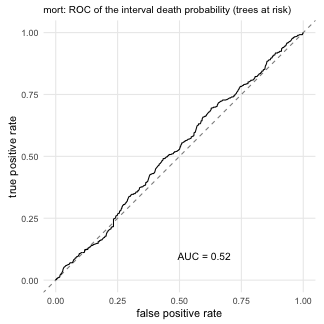
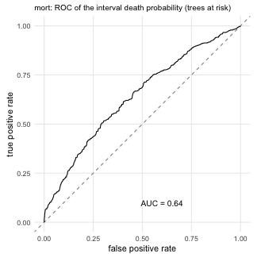
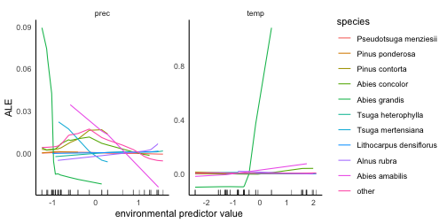
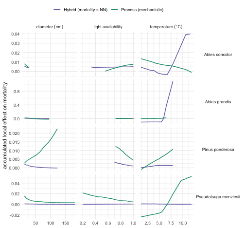

<style>
pre.summary-out, .summary-out pre { max-height: 22em; overflow: auto; }
</style>

Mortality is the hardest of FINN's six responses to calibrate, and the one where
the choice of likelihood matters most. This vignette takes it on its own terms:
what the observation actually *is*, which likelihood belongs to it, how to swap
the process for a neural network, and (the part that is easy to get wrong) how
to score the result.

It follows the same 200-fit / 200-holdout FIA sample as **Fitting FINN to forest
inventory data**, and like that page it is **precompiled** by `vignettes/build.R`:
the models below are really trained.


``` r
library(FINN)
library(torch)
library(data.table)
library(ggplot2)

EPOCHS <- 500L
```

## Mortality is a proportion, not a rate

`makeObsData()` returns mortality as a **pair of counts** rather than a bare rate:

- **`n_at_risk`**: trees alive at the *start* of an inventory interval,
- **`n_died`**: how many of those were dead at the *end*,

with the yearly rate `mort = 1 - (1 - n_died / n_at_risk)^(1 / period_length)`
derived from them: FINN simulates yearly steps, and an inventory interval of
`period_length` years is that many simulated years, whose yearly mortalities
`fit()` compounds into the same per-year rate before it meets the observation.
The counts are exactly the
`cbind(died, survived)` response of a binomial GLM, and it is deliberate. A bare
proportion throws away the sample size: it cannot tell a site where 1 of 1 trees
died from one where 60 of 60 did, even though the second carries sixty times the
information.

The pair is a **closed cohort**; both columns are pinned to the tree's state at
the start of the interval. That matters more than it sounds. FIA re-identifies a
tree's species between visits, so a rate built by dividing "deaths this year" by
"survivors last year" can book a death against the species a tree *ended* as while
the denominator counted the species it *started* as, and report more deaths than
there were trees. Pinning both columns to the interval start makes
`n_died <= n_at_risk` true by construction. (Trees that *recruit* during the
interval are in neither column; see `?makeObsData` for the open-cohort
alternative.)


``` r
# The tables ship with FINN as datasets (?fia_obs_dt), already in FINN's input
# format, so there is nothing to read or prepare.

# --- training sites --------------------------------------------------------
obs_dt     <- fia_obs_dt        # observations, wide (one column per variable)
env_dt     <- fia_env_dt        # RAW, untransformed climate
init_trees <- fia_init_trees
species_dt <- fia_species_dt

# --- holdout sites: never seen during fitting ------------------------------
obs_test   <- fia_obs_test
env_test   <- fia_env_test
init_test  <- fia_init_test

obs_dt[, .(siteID, year, period_length, species_name, n_at_risk, n_died, mort)][n_at_risk > 0][1:6]
#>    siteID  year period_length          species_name n_at_risk n_died      mort
#>     <int> <int>         <int>                <char>     <int>  <int>     <num>
#> 1:      1    10            10 Pseudotsuga menziesii         2      0 0.0000000
#> 2:      1    10            10         Abies grandis         6      0 0.0000000
#> 3:      1    10            10                 other         3      1 0.0397355
#> 4:      1    20            10 Pseudotsuga menziesii         2      0 0.0000000
#> 5:      1    20            10         Abies grandis        10      0 0.0000000
#> 6:      1    20            10                 other         2      0 0.0000000
```

How much mortality signal is actually in this sample? Less than the number of rows
suggests:


``` r
cat(sprintf("observations with a cohort at risk : %d\n", obs_dt[n_at_risk > 0, .N]))
#> observations with a cohort at risk : 1003
cat(sprintf("of which mort is exactly zero      : %d (%.0f%%)\n",
            obs_dt[n_at_risk > 0 & n_died == 0, .N],
            100 * obs_dt[n_at_risk > 0, mean(n_died == 0)]))
#> of which mort is exactly zero      : 688 (69%)
cat(sprintf("trees at risk (train)              : %d\n", obs_dt[, sum(n_at_risk)]))
#> trees at risk (train)              : 9907
cat(sprintf("deaths (train)                     : %d\n", obs_dt[, sum(n_died)]))
#> deaths (train)                     : 656
cat(sprintf("pooled mortality                   : %.3f over the ten-year interval, %.4f per year\n",
            obs_dt[, sum(n_died) / sum(n_at_risk)],
            obs_dt[, 1 - (1 - sum(n_died) / sum(n_at_risk))^(1 / 10)]))
#> pooled mortality                   : 0.066 over the ten-year interval, 0.0068 per year
```

A few hundred deaths, and roughly two-thirds of the observations at exactly zero.
No likelihood can manufacture information that is not there, but the wrong one
can waste what is.

## Why `binomial` and not `mse`

FINN scores mortality with `loss_family = c(..., mortality = "binomial", ...)`
by default. Squared error assumes an unbounded response with constant variance;
mortality is neither. A proportion lives on \[0, 1\] and its variance *shrinks*
as the rate approaches either end, so on a response that is ~69% zeros, MSE puts
almost no gradient where the data actually are.

The binomial term is weighted by `n_at_risk`, which is what turns a Bernoulli
term into a binomial one. It is the same thing R does with
`glm(prop ~ ., family = binomial, weights = n)`.

## Two models: mechanistic mortality, and mortality as a network


``` r
Nsp          <- uniqueN(obs_dt$species)
init_cohorts      <- makeInitCohorts(init_trees, Nspecies = Nsp)
init_cohorts_test <- makeInitCohorts(init_test,  Nspecies = Nsp)
```


``` r
# shared colours for the two model variants, reused below
model_cols <- c("Process (mechanistic)" = "#1b9e77", "Hybrid (mortality = NN)" = "#7570b3")
```

The mechanistic baseline, with all four processes in their functional form:


``` r
FINN.seed(42)
m <- finn(
  N_species            = Nsp,
  recruits_dbh         = 12.9,   # DBH (cm) assigned to a new recruit; ~ FIA's 12.7 cm (5 in) minimum
  competition_process  = createProcess(~0, FINN::competition,  optimizeSpecies = TRUE),
  growth_process       = createProcess(~ temp + prec, FINN::growth,       optimizeSpecies = TRUE, optimizeEnv = TRUE),
  regeneration_process = createProcess(~ temp + prec, FINN::regeneration_capped, optimizeSpecies = TRUE, optimizeEnv = TRUE),
  mortality_process    = createProcess(~ temp + prec, FINN::mortality,    optimizeSpecies = TRUE, optimizeEnv = TRUE)
)
```


``` r
fit(m,
  env = env_dt, data = obs_dt, init_cohort = init_cohorts, device = "cpu",
  epochs = EPOCHS, batchsize = 40L, patches = 4, patch_size = 0.06,
  lr = 0.01, env_autoscale = TRUE, plot_progress = FALSE
)
```

Now the same model with **mortality replaced by a neural network**, every other
process, and the entire `fit()` call, unchanged. `createHybrid()` is the only
difference:


``` r
FINN.seed(42)
m_mort <- finn(
  N_species            = Nsp,
  recruits_dbh         = 12.9,
  competition_process  = createProcess(~0, FINN::competition,  optimizeSpecies = TRUE),
  growth_process       = createProcess(~ temp + prec, FINN::growth,       optimizeSpecies = TRUE, optimizeEnv = TRUE),
  regeneration_process = createProcess(~ temp + prec, FINN::regeneration_capped, optimizeSpecies = TRUE, optimizeEnv = TRUE),
  mortality_process    = createHybrid(~ temp + prec, hidden = c(20L, 20L), transformer = FALSE)
)
```


``` r
fit(m_mort,
  env = env_dt, data = obs_dt, init_cohort = init_cohorts, device = "cpu",
  epochs = EPOCHS, batchsize = 40L, patches = 4, patch_size = 0.06,
  lr = 0.01, env_autoscale = TRUE, plot_progress = FALSE
)
```

## Scoring mortality: why not Spearman

The model simulates yearly steps, so its mortality is compared with an
observation as `fit()` compares it: the simulated yearly mortalities of the
`period_length` years before the census compounded into one rate per year,
`1 - exp(mean(log1p(-m)))`, the functional behind the observed
`1 - (1 - n_died / n_at_risk)^(1 / period_length)`.

`evaluate()` does this pairing. It simulates the model on the sites it was
fitted to and, with `holdout`, on sites it has not seen, aggregates every
response the way `fit()` scores it, and keeps the paired table (`$matched`) and
the skill measures (`$skill`) of each set. The result is also stored on the
model, where `summary()` reads it.


``` r
holdout <- list(data = obs_test, env = env_test, init_cohort = init_cohorts_test)
m$eval(); m_mort$eval()
FINN.seed(1)
ev      <- evaluate(m,      holdout = holdout)
ev_mort <- evaluate(m_mort, holdout = holdout)

# the paired mortality cells of both models on both sets
mort_of <- function(ev, label)
  rbind(ev$train$matched[variable == "mort"][, `:=`(model = label, split = "train")],
        ev$holdout$matched[variable == "mort"][, `:=`(model = label, split = "holdout")])
mort_pred <- rbind(mort_of(ev,      "Process (mechanistic)"),
                   mort_of(ev_mort, "Hybrid (mortality = NN)"))
mort_pred[1:3, .(siteID, year, species_name, period_length, n_at_risk, n_died, obs, pred, p_interval)]
#>    siteID  year          species_name period_length n_at_risk n_died       obs
#>     <int> <int>                <char>         <num>     <int>  <int>     <num>
#> 1:      1    10 Pseudotsuga menziesii            10         2      0 0.0000000
#> 2:      1    10         Abies grandis            10         6      0 0.0000000
#> 3:      1    10                 other            10         3      1 0.0397355
#>            pred p_interval
#>           <num>      <num>
#> 1: 0.0003227343 0.00322266
#> 2: 0.0022701982 0.02247146
#> 3: 0.0050098909 0.04898441
```

Each row is one site, census and species: the observed yearly rate `obs`, the
simulated yearly rate `pred` compounded over the interval, and `p_interval`,
the probability that a tree dies over the whole interval,
`1 - (1 - pred)^period_length`.

Rank correlation is the natural first reach, and it is a trap here. Two-thirds of
the observed proportions are exactly zero, so Spearman spends most of its power
ranking ties against each other; a value near zero cannot distinguish "the model
learned nothing" from "the metric cannot see what it learned".


``` r
mort_pred[, .(spearman = round(cor(obs, pred, method = "spearman"), 2), n = .N),
          by = .(model, split)][order(split, model)]
#>                      model   split spearman     n
#>                     <char>  <char>    <num> <int>
#> 1: Hybrid (mortality = NN) holdout     0.07   994
#> 2:   Process (mechanistic) holdout     0.03   994
#> 3: Hybrid (mortality = NN)   train     0.21  1003
#> 4:   Process (mechanistic)   train     0.20  1003
```

**AUC** asks the question the binomial actually poses: does the model give a
higher death probability to a tree that died than to one that survived? Each
observation stands for `n_at_risk` Bernoulli trials of which `n_died` are deaths,
all sharing that observation's predicted probability of death over the
interval, so rather than expand the trials we weight them, with tied
predictions taking half credit (the standard Mann-Whitney treatment). Written
out:


``` r
auc_binom <- function(p, pos, neg) {
  g <- data.table(p = p, pos = pos, neg = neg)[
    , .(pos = sum(pos), neg = sum(neg)), by = p][order(p)]
  neg_below <- cumsum(g$neg) - g$neg              # negatives strictly below each p
  den <- sum(g$pos) * sum(g$neg)
  if (den == 0) return(NA_real_)
  sum(g$pos * (neg_below + 0.5 * g$neg)) / den    # 0.5 credit for ties
}

auc_tab <- mort_pred[n_at_risk > 0,
  .(AUC     = round(auc_binom(p_interval, n_died, n_at_risk - n_died), 3),
    deaths  = sum(n_died),
    at_risk = sum(n_at_risk)), by = .(model, split)]
auc_tab[order(split, -AUC)]
#>                      model   split   AUC deaths at_risk
#>                     <char>  <char> <num>  <int>   <int>
#> 1: Hybrid (mortality = NN) holdout 0.537    727   10013
#> 2:   Process (mechanistic) holdout 0.524    727   10013
#> 3: Hybrid (mortality = NN)   train 0.643    656    9907
#> 4:   Process (mechanistic)   train 0.639    656    9907
```


0.5 is coin-flipping, 1.0 is perfect ranking. `evaluate()` computes the same
AUC in its skill table, next to the ratio of the predicted to the observed
deaths (the expected deaths `n_at_risk * p_interval` summed over the cells):


``` r
skill_of <- function(ev, label)
  rbind(ev$train$skill[variable == "mort", .(model = label, split = "train", AUC = round(auc, 3),
                                             deaths_ratio = round(deaths_ratio, 2))],
        ev$holdout$skill[variable == "mort", .(model = label, split = "holdout", AUC = round(auc, 3),
                                               deaths_ratio = round(deaths_ratio, 2))])
rbind(skill_of(ev, "Process (mechanistic)"), skill_of(ev_mort, "Hybrid (mortality = NN)"))
#>                      model   split   AUC deaths_ratio
#>                     <char>  <char> <num>        <num>
#> 1:   Process (mechanistic)   train 0.639         1.30
#> 2:   Process (mechanistic) holdout 0.524         1.25
#> 3: Hybrid (mortality = NN)   train 0.643         0.43
#> 4: Hybrid (mortality = NN) holdout 0.537         0.45
```

`plot()` of the evaluation draws the ROC curve behind it, here of the
mechanistic model on the holdout (`response` keeps the mortality panel only;
without it the page also shows the other responses):


``` r
plot(ev, response = "mort")
```



and on its training sites:


``` r
plot(ev, response = "mort", set = "train")
```



`summary()` prints the skill tables of both sets with the AUC, followed by the
convergence of the fit and the environmental effects. The environmental
effects take long on all 200 training sites, so `env` and `init_cohort` give
them a subset of 30 sites:


``` r
xai_sites <- sort(unique(env_dt$siteID))[1:30]
env_xai   <- env_dt[siteID %in% xai_sites]
init_xai  <- makeInitCohorts(init_trees[siteID %in% xai_sites], Nspecies = Nsp)
summary(m, env = env_xai, init_cohort = init_xai)
FINN model summary
==================

## Skill (observed vs simulated, aggregated as fit() scores)

Training data:
 response      R2 correlation     RMSE     bias pred/obs    n   AUC
      dbh  0.6308       0.833 13.50357 -5.46851    0.863 1048    NA
       ba  0.9353       0.971  0.12872 -0.01282    0.892 4400    NA
    trees  0.8000       0.895  0.75783  0.04324    1.068 4400    NA
   growth  0.2118       0.559  0.00775 -0.00138    0.875 1003    NA
     mort  0.0741       0.383  0.10492 -0.00778    1.004 1003 0.639
      reg -0.0273       0.240  6.15605  0.21111    1.138 4400    NA
 deaths pred/obs
              NA
              NA
              NA
              NA
             1.3
              NA

Holdout:
 response      R2 correlation     RMSE     bias pred/obs    n   AUC
      dbh  0.4645      0.7412 13.90761 -4.79831    0.868 1048    NA
       ba  0.9233      0.9680  0.09635 -0.01028    0.882 4400    NA
    trees  0.8066      0.8986  0.78260  0.02472    1.039 4400    NA
   growth  0.2984      0.6035  0.00773 -0.00046    0.960 1000    NA
     mort -0.0256     -0.0208  0.09162 -0.00525    1.006  994 0.524
      reg  0.0906      0.3144  6.03722  0.09746    1.063 4400    NA
 deaths pred/obs
              NA
              NA
              NA
              NA
            1.25
              NA

## Convergence

Loss: the largest change is dbh, -1.90 % over the last 50 epochs (mean of the last 50 epochs against the 50 before).
         term loss_now  change
          dbh   0.3787 -1.90 %
           ba   0.0658 -0.07 %
        trees   0.3293 -0.09 %
       growth   0.5962 -1.01 %
    mortality   0.9526  0.15 %
 regeneration   0.5670 -0.33 %

Parameters: how much they moved over the last 50 epochs (from the parameters of every epoch).
  The change is the size of the step the values took, as a percentage of the size of the values:
  100 x |values now - values then| / |values then|, over all species of a parameter (or all weights
  of a network layer). 1 % means the values moved by about a hundredth of their size.
  The species parameter that moved most: mortality: growth, 8.84 %; the largest change overall: mortality: growth, 8.84 %.
      process                   part                      moved most change
       growth     species parameters              growth: size decay 4.25 %
       growth environmental response              nn_growth.0.weight 5.45 %
    mortality     species parameters               mortality: growth 8.84 %
    mortality environmental response           nn_mortality.0.weight 2.69 %
 regeneration     species parameters regeneration: light requirement 7.56 %
 regeneration environmental response        nn_regeneration.0.weight 2.44 %
 regeneration     recruit dispersion          par_theta_recruits_raw 0.00 %
 regeneration        recruitment cap                        reg_logK 0.01 %
  competition     species parameters           competition: strength 4.08 %

## Environment

### GROWTH

Analytical ALE importance (rate-normalised) (species in columns):
 variable Pseudotsuga menziesii Pinus ponderosa Pinus contorta Abies concolor
     prec                0.3162          0.2559          0.020         0.0162
     temp                0.0671          0.0132          0.101         0.3665
 Abies grandis Tsuga heterophylla Tsuga mertensiana Lithocarpus densiflorus
       0.00264            0.00588            0.0247                   0.193
       0.01798            0.89255            0.2413                   0.431
 Alnus rubra Abies amabilis  other
     0.00747          6.049 0.2916
     0.59406          0.564 0.0793

Average conditional effects (mean; species in columns):
 variable Pseudotsuga menziesii Pinus ponderosa Pinus contorta Abies concolor
     temp             -0.000777       -0.000807        0.00309       -0.00647
     prec              0.001979        0.011100       -0.00271        0.00240
 Abies grandis Tsuga heterophylla Tsuga mertensiana Lithocarpus densiflorus
      0.001585             0.0301           0.00446                -0.00580
     -0.000653             0.0047           0.00156                -0.00471
 Alnus rubra Abies amabilis    other
    -0.00835        0.00374 -0.00131
     0.00103       -0.02102  0.00282

### MORTALITY

Analytical ALE importance (rate-normalised) (species in columns):
 variable Pseudotsuga menziesii Pinus ponderosa Pinus contorta Abies concolor
     temp                 8.533         1.98970          0.211           1.26
     prec                 0.407         0.00817          0.990           3.31
 Abies grandis Tsuga heterophylla Tsuga mertensiana Lithocarpus densiflorus
         0.867             0.6833            0.0683                   5.086
         0.101             0.0117            1.0807                   0.544
 Alnus rubra Abies amabilis    other
      0.1066         0.5951 0.154370
      0.0326         0.0342 0.000396

Average conditional effects (mean; species in columns):
 variable Pseudotsuga menziesii Pinus ponderosa Pinus contorta Abies concolor
     prec              -0.00763       -0.000712        0.00876        0.00461
     temp               0.00873        0.003568        0.00371       -0.00324
 Abies grandis Tsuga heterophylla Tsuga mertensiana Lithocarpus densiflorus
      -0.00765           0.000747           -0.0245                 0.00411
       0.01338          -0.001029           -0.0055                -0.00659
 Alnus rubra Abies amabilis     other
     0.00322       -0.00691 -8.76e-05
     0.00461       -0.01584 -1.53e-03

### REGENERATION

Analytical ALE importance (rate-normalised) (species in columns):
 variable Pseudotsuga menziesii Pinus ponderosa Pinus contorta Abies concolor
     prec                0.0283           0.553          0.443         0.9998
     temp                0.7742           0.691          1.212         0.0235
 Abies grandis Tsuga heterophylla Tsuga mertensiana Lithocarpus densiflorus
         0.275             1.0666              1.50                    0.55
         1.261             0.0073              1.75                    1.54
 Alnus rubra Abies amabilis other
       0.340           9.76 2.621
       0.912           1.49 0.567

Average conditional effects (mean; species in columns):
 variable Pseudotsuga menziesii Pinus ponderosa Pinus contorta Abies concolor
     prec                0.0774          -0.738         -0.481       -0.12727
     temp                0.3236           0.113         -0.580       -0.00943
 Abies grandis Tsuga heterophylla Tsuga mertensiana Lithocarpus densiflorus
        -0.174            0.15469             0.329                  0.0379
        -0.317           -0.00442            -0.432                  0.0827
 Alnus rubra Abies amabilis  other
      0.1095         0.0718  0.128
      0.0836        -0.0503 -0.050
```

Read the two splits **together**, because the gap between them is the result. On
the training sites the models rank deaths above survivors better than chance
(AUC 0.64 and 0.64), so there *is* a learnable mortality signal, and the
models find it. On the held-out sites that skill falls to
0.52 and 0.54, close to 0.5. The model is not failing to fit mortality; it
is fitting it and **not generalising**.

That is what a few hundred deaths buys. With ~69% of observations at exactly zero
and mortality concentrated in whichever species happened to die on whichever plot,
there is enough signal to memorise and not enough to transfer. The network variant
and the mechanistic process rank alike on the holdout, both close to
coin-flipping and far below their training skill, so neither transfers.

So mortality here is honestly reported as **not identified out-of-sample**. The
binomial likelihood is the right loss for a proportion and the closed cohort is
the right response, but neither manufactures information the two inventories do
not contain. Treat differences between the two models as noise; the signal worth
reading is train-vs-holdout, not model-vs-model.


## Scoring each tree instead of each cell

Everything above scores mortality per *cell*: the model's mean death
probability over the cohorts of a site, census and species against the pooled
proportion. That mean has a compositional confound. Mortality falls several-fold
from the smallest to the largest trees, so the cell mean moves when the
simulated size distribution moves, whether or not the hazard function is right,
and a mortality parameter can end up correcting a growth or recruitment error.
With a tree list in hand, `fit()` can instead score the fate of every observed
tree: `loss_aggregation = c(mortality = "tree")` runs the mortality kernel on
each tree at its measured diameter, with light from the observed stand, and
compares the death probability over the interval with the tree's 0/1 fate. It
measures the mortality function alone, teacher-forced onto the observed stands,
and combines with the simulated `dbh`, `ba`, `trees` and regeneration terms
(see `?fit`, section *Scoring individual trees*, for the other per-tree route
and when each applies).

Prefer it when the trees are available and mortality is the response of
interest: it uses every tree as a trial rather than a few hundred cells, it is
unaffected by how well the stand is simulated, and `predictTrees()` evaluates
the same code path, so a validation cannot drift from the objective it checks.
Its cost is that the scored mortality is no longer a property of the simulated
trajectory.

The bundled sample carries the tree fates as `fia_tree_dt` and `fia_tree_test`,
and the **Fitting FINN to forest inventory data** vignette fits the 200 sites
with this route and reports the holdout AUC and the mortality by size class.
Here the mechanism is shown on a tree list built from raw data, the eight Oregon
FIA plots of the **Preparing your data for FINN** vignette, four patches each,
three inventories. `makeObsData()` already derives each tree's
start-of-interval state, so `tree_data` is a selection of its columns. The
`year` of a row is the census that *closes* the interval, `dbh` the diameter at
its start, `died` the fate over it; trees that recruited during the interval
were not at risk and stay out.


``` r
tree_raw <- fread(system.file("extdata", "example_tree_dt.csv", package = "FINN"))
prep <- makeObsData(tree_raw[complete == TRUE], plotsize = 0.06, aggregate_by_site = FALSE,
                    fix_period_length = 10, NspeciesQuantile = 0.98)
inputs <- resolveSiteIDs(tree_dt = prep$tree_dt, obs_dt = prep$obs_dt,
                         env_dt = fread(system.file("extdata", "example_env_dt.csv", package = "FINN")))
tree_data <- inputs$tree_dt[year > 0 & living_before == TRUE,
  .(siteID, year, patchID, species, dbh = dbh_before, growth,
    died = as.numeric(status == "dead"), period_length)]
tree_data[, .(trees = .N, died = sum(died)), by = .(year, period_length)]
#>     year period_length trees  died
#>    <int>         <int> <int> <num>
#> 1:    10            10   130     9
#> 2:    20            10   127    12
```

Two details of the set-up. `growth` is the tree's yearly growth rate that
`makeObsData()` computed, and `period_length` the ten years of its interval: the
tree route runs the mortality kernel over every simulated year of the interval
and compares the compounded death probability `1 - prod(1 - m)` with the tree's
fate. The per-tree term is accumulated over each site's observation window,
which `fit()` reads from the `period_length` column of `data`, which
`resolveSiteIDs()` returns. And the model is the mechanistic one from above,
with the mortality term alone switched to the tree route:


``` r
obs_8 <- inputs$obs_dt
Nsp_8 <- nrow(inputs$species_dt)

FINN.seed(42)
m_tree <- finn(
  N_species            = Nsp_8, recruits_dbh = 12.9,
  competition_process  = createProcess(~0, FINN::competition,  optimizeSpecies = TRUE),
  growth_process       = createProcess(~ temp + prec, FINN::growth,       optimizeSpecies = TRUE, optimizeEnv = TRUE),
  regeneration_process = createProcess(~ temp + prec, FINN::regeneration_capped, optimizeSpecies = TRUE, optimizeEnv = TRUE),
  mortality_process    = createProcess(~ temp + prec, FINN::mortality,    optimizeSpecies = TRUE, optimizeEnv = TRUE)
)
fit(m_tree,
  env = inputs$env_dt, data = obs_8, init_cohort = inputs$initCohorts, device = "cpu",
  epochs = EPOCHS, patches = 4, patch_size = 0.06, lr = 0.01, plot_progress = FALSE,
  loss_aggregation = c(mortality = "tree"),   # growth and the state terms stay per cell
  tree_data        = tree_data
)
```

`predictTrees()` returns one row per row of `tree_data`, in the same order, so
the predictions are bound on rather than joined. Each tree is one Bernoulli
trial, so the AUC needs no weighting here; it is the same `auc_binom()` with
one trial per row:


``` r
m_tree$eval()
tree_pred <- cbind(tree_data,
                   predictTrees(m_tree, tree_data = tree_data, env = inputs$env_dt)[, .(mort_pred)])
tree_pred[, .(trees = .N, deaths = sum(died),
              AUC = round(auc_binom(mort_pred, died, 1 - died), 3)), by = year]
#>     year trees deaths   AUC
#>    <int> <int>  <num> <num>
#> 1:    10   130      9 0.941
#> 2:    20   127     12 0.936
```

Eight plots and two dozen deaths are a demonstration of the mechanism, not a
mortality model, and the trees scored are the trees fitted; the 200-site fit
with its holdout is in the **Fitting FINN to forest inventory data** vignette. What the route buys
shows in a drought or disturbance study, where the question is how the hazard of
a tree of a given size and species responds to the environment, and the cell
mean would let the simulated size distribution answer instead.

## What the network learned: ALE

`ALE()` returns one table per process, so the same tool reads a mechanistic
mortality function and a neural network standing in its place. The effect is on
the yearly mortality **probability**.

We read the effects over the same 30 training sites as `summary()` above
(without `env` and `init_cohort`, `ALE()` uses all training sites the model
keeps from `fit()`). `plot()` draws the environmental drivers, one line per
species, here for the network:


``` r
ale_proc <- ALE(m,      env = env_xai, init_cohort = init_xai, plot = FALSE)
ale_hyb  <- ALE(m_mort, env = env_xai, init_cohort = init_xai, plot = FALSE)
plot(ale_hyb, process = "mortality")
```



To compare the two models on the same axes, we put both tables together, on the
natural scale of the climate drivers:


``` r

to_natural <- function(a, model) {
  sc <- as.data.table(model$env_scaling)[, .(var = variable, center, scale)]
  merge(data.table(a), sc, by = "var", all.x = TRUE)[!is.na(center), x := x * scale + center]
}
mortality <- rbind(
  to_natural(ale_proc$mortality, m)[,      model := "Process (mechanistic)"],
  to_natural(ale_hyb$mortality,  m_mort)[, model := "Hybrid (mortality = NN)"])
mortality <- merge(mortality, species_dt, by = "species")
```


``` r
d <- mortality[var %in% c("dbh", "light", "temp") & species %in% c(1, 2, 4, 5)]
d[, var := factor(var, levels = c("dbh", "light", "temp"))]
ggplot(d, aes(x, ale, colour = model)) +
  geom_line(linewidth = 0.7) +
  facet_grid(species_name ~ var, scales = "free",
             labeller = labeller(
               var = as_labeller(c(dbh = "diameter~(cm)", light = "light~availability",
                                   temp = "temperature~(degree*C)"), label_parsed),
               species_name = label_value)) +
  scale_colour_manual(values = model_cols) +
  labs(x = NULL, y = "accumulated local effect on mortality", colour = NULL) +
  theme_minimal() + theme(legend.position = "top", strip.text.y = element_text(angle = 0))
```



Each curve spans only the range its own model actually simulates (ALE never
extrapolates) so where the two cover different ranges they are simply placing a
species in different conditions.

Read these as a demonstration of the *mechanism*: a process can be replaced by a
network and still be interrogated with the same tool. They are not a settled
mortality response. With a few hundred deaths the network is free to flatten
wherever the data do not constrain it, and a flat ALE here is as likely to mean
"no signal" as "no effect".


``` r
sessionInfo()
#> R version 4.5.0 (2025-04-11)
#> Platform: aarch64-apple-darwin20
#> Running under: macOS 26.5.1
#> 
#> Matrix products: default
#> BLAS:   /Library/Frameworks/R.framework/Versions/4.5-arm64/Resources/lib/libRblas.0.dylib 
#> LAPACK: /Library/Frameworks/R.framework/Versions/4.5-arm64/Resources/lib/libRlapack.dylib;  LAPACK version 3.12.1
#> 
#> locale:
#> [1] en_US.UTF-8/en_US.UTF-8/en_US.UTF-8/C/en_US.UTF-8/en_US.UTF-8
#> 
#> time zone: Europe/Berlin
#> tzcode source: internal
#> 
#> attached base packages:
#> [1] stats     graphics  grDevices utils     datasets  methods   base     
#> 
#> other attached packages:
#> [1] ggplot2_3.5.2       data.table_1.18.6.1 torch_0.15.1       
#> [4] FINN_0.2.0         
#> 
#> loaded via a namespace (and not attached):
#>  [1] vctrs_0.6.5        cli_3.6.6          knitr_1.50         rlang_1.2.0       
#>  [5] xfun_0.57          processx_3.8.6     generics_0.1.4     coro_1.1.0        
#>  [9] labeling_0.4.3     glue_1.8.0         bit_4.6.0          ps_1.9.1          
#> [13] scales_1.4.0       grid_4.5.0         abind_1.4-8        evaluate_1.0.5    
#> [17] tibble_3.3.0       lifecycle_1.0.5    compiler_4.5.0     dplyr_1.1.4       
#> [21] RColorBrewer_1.1-3 Rcpp_1.1.2         pkgconfig_2.0.3    farver_2.1.2      
#> [25] R6_2.6.1           tidyselect_1.2.1   pillar_1.11.0      callr_3.7.6       
#> [29] magrittr_2.0.3     withr_3.0.2        tools_4.5.0        bit64_4.6.0-1     
#> [33] gtable_0.3.6
```
